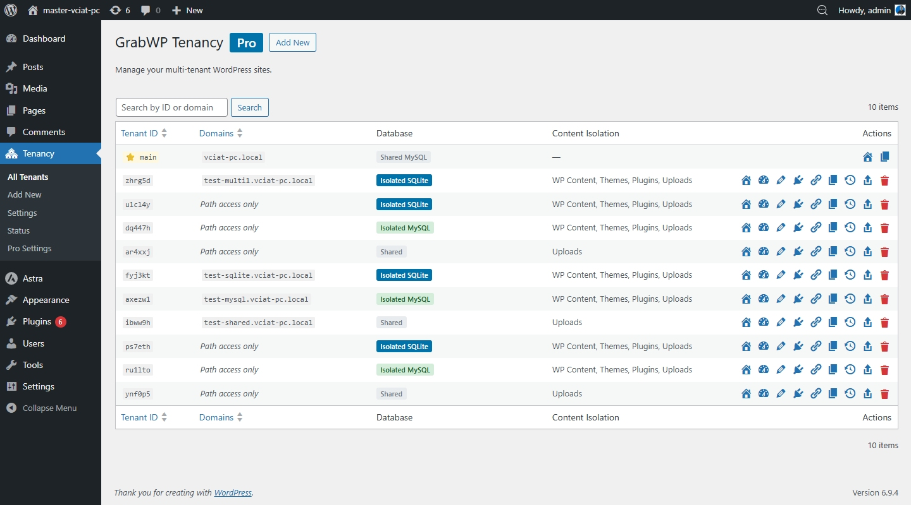
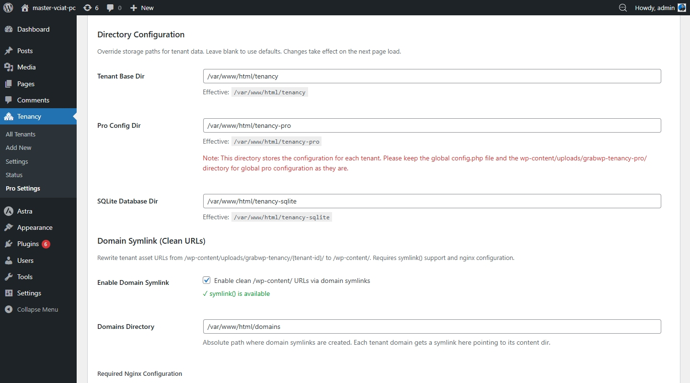

# Installing Pro

## Before You Start

> **Required:** Install and activate the free **GrabWP Tenancy** base plugin first. Pro is an add-on that extends the base plugin — it will not work without it.

→ [Install the free plugin first](/grabwp-tenancy/installation-guide)

## Get Your Pro Plugin ZIP

After purchase, **Polar** (our payment processor) sends a confirmation email to your address. That email contains a **Customer Portal** link — open it to download your Pro plugin ZIP file.

If you can't find the email, check your spam folder or search for "Polar" or "GrabWP".

## Install the Pro Plugin

1. Download the ZIP from your Polar Customer Portal
2. Go to **Plugins → Add New → Upload Plugin**
3. Upload the ZIP → **Install Now** → **Activate Plugin**

Pro activates alongside the base plugin with no additional configuration needed.

## Verify the Installation

Go to **GrabWP Tenancy → Status** and check that the Pro plugin is shown as active.

## What Changes After Activation

Once Pro is active, each tenant site in the list gets additional row action links:

- **Extensions** — manage which plugins and themes are available to the site
- **Backup** — create a backup of the site
- **Restore** — restore the site from a backup ZIP

The tenant **Edit** form also gains additional fields for per-site isolation settings (database type, content isolation).

A new **GrabWP Tenancy → Pro Settings** submenu page is added for configuring default isolation settings for new sites.

## Deactivating Pro

Deactivating Pro removes the Pro UI and stops Pro-specific features. Tenant sites revert to base plugin behavior.

**Tenant data is not deleted** on deactivation.
