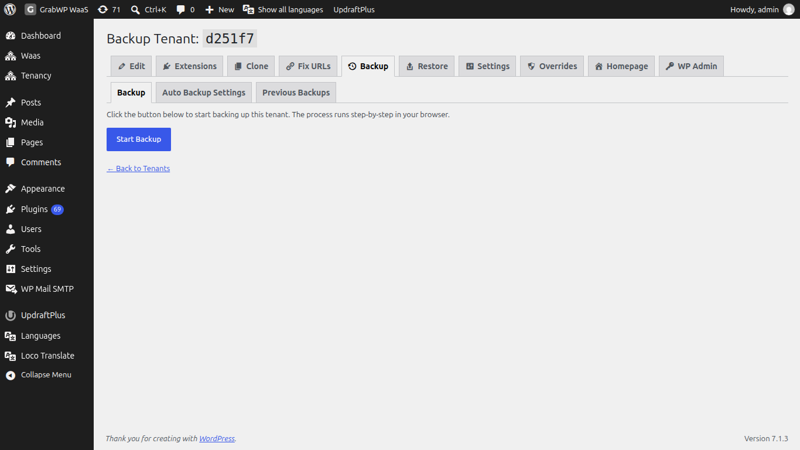
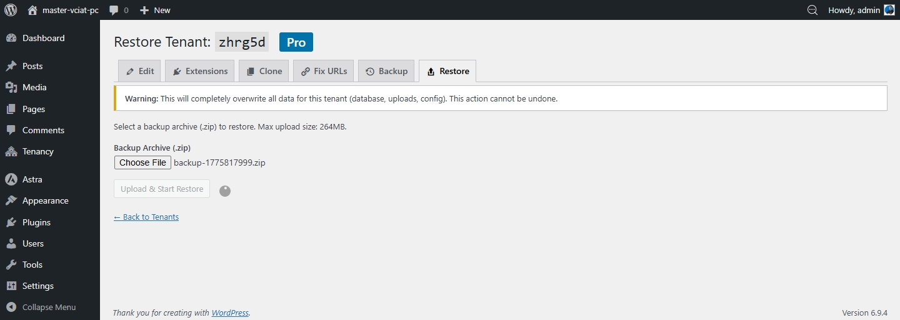
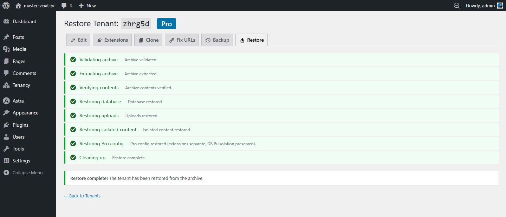

# Backup & Restore

Pro lets you back up and restore any individual tenant site - including its database, uploads, Pro config, and isolated content.

## Creating a Backup

1. Go to **GrabWP Tenancy → Tenants**
2. Find the site and click the **Backup** row action link
3. Click **Start Backup**

The backup runs step-by-step in your browser:

1. Validating tenant
2. Exporting database
3. Exporting uploads
4. Exporting isolated content
5. Exporting Pro config
6. Packaging archive
7. Cleaning up

When complete, a ZIP archive is created. **Download and save this file** - it is stored on your server and you'll need it to restore.

## Restoring from a Backup

1. Go to **GrabWP Tenancy → Tenants**
2. Find the site and click the **Restore** row action link
3. Upload the backup ZIP file
4. Click **Upload & Start Restore**

> ⚠ **Warning:** Restoring completely overwrites the site's current database, uploads, and config. This cannot be undone. Back up the current state first if you need to keep it.

The restore runs 8 steps and shows progress in your browser.

## Managing Backup Files

Backup archives are stored on your server. To manage disk space, download old backups via FTP/SFTP and delete them from the server. Keep copies in a safe offsite location.
