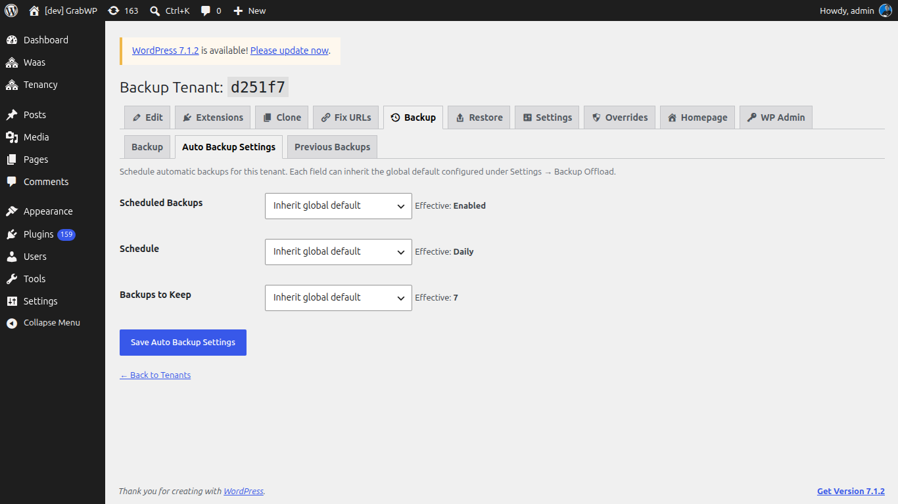

# Backup & Restore

Back up one tenant at a time: database, isolated content, Pro config, and uploads. Global offload and schedule defaults live on **Tenancy → Pro Settings**, **Backup** tab. See [Pro Settings](/grabwp-tenancy-pro/pro-settings).

## Create a backup

**Navigate to Tenancy → All Tenants**, then **Backup Tenant** on the row (`page=grabwp-tenancy-pro-backup`).

The title is **Backup Tenant:** plus the tenant ID. Tabs: **Backup**, **Auto Backup Settings**, **Previous Backups**.

1. Stay on **Backup**.
2. Click **Start Backup**.

The run stays in the browser:

1. Validating tenant
2. Exporting database
3. Exporting isolated content
4. Exporting Pro config
5. Exporting uploads
6. Packaging archive
7. Cleaning up

On success: **Backup complete!** and **Your backup archive is ready.** Click **Download Backup**.

Keep the browser tab open until the steps finish.

## Schedule backups for this tenant

Open **Auto Backup Settings**.

Each field can inherit the global default from **Pro Settings → Backup** (**Auto Backup**). The screen shows **Effective:** under each control.

| Field | Notes |
|-------|--------|
| Scheduled Backups | **Inherit global default**, **Enabled**, or **Disabled**. |
| Schedule | **Inherit global default**, or **Manual only (no schedule)**, **Daily**, **Weekly**, **Every two weeks**, **Monthly**. |
| Backups to Keep | How many archives to retain (1 to 30). Older ones are pruned after a successful run. |

Click **Save Auto Backup Settings**.

Scheduled runs use WP-Cron. If **DISABLE_WP_CRON** is on, set up a system cron. **Pro Settings → Backup** includes **Schedule Assurance** for the next run.

## Previous backups

Open **Previous Backups**.

Columns: **Date**, **Filename**, **Size**, **Local**, **Remote**.

| When | Actions |
|------|---------|
| File is on the server | **Download**, **Delete Local** |
| Offload is configured and the file is still local | **Offload** |
| File is remote only | **Download to Local** |
| File is remote | **Delete Remote** |

**Delete Local** asks **Delete local backup `{file}`? This cannot be undone.** **Delete Remote** asks the same for the remote copy.

## Restore

**Navigate to Tenancy → All Tenants**, then **Restore Tenant** (`page=grabwp-tenancy-pro-restore`).

> **Warning:** **This will completely overwrite all data for this tenant (database, uploads, config). This action cannot be undone.**

Tabs:

| Tab | What to do |
|-----|------------|
| From Existing Backup | Pick a row and click **Restore**. Confirm **Restore from `{file}`? This will OVERWRITE all tenant data and cannot be undone.** |
| Upload Archive | Choose **Backup Archive (.zip)** and click **Upload & Start Restore**. The screen shows the max upload size. |

Restore steps:

1. Validating archive
2. Extracting archive
3. Verifying contents
4. Restoring database
5. Restoring isolated content
6. Restoring Pro config
7. Restoring uploads
8. Cleaning up

Success: **Restore complete!**

A restore can land on a different database type than the backup (shared MySQL, isolated MySQL, or SQLite).

If URLs in the restored database do not match the tenant domain, use [Fix URLs](/grabwp-tenancy-pro/pro-fix-urls).

**Verify:** Open **Homepage** or the tenant domain and confirm the restored content. **Previous Backups** lists the archive you created.
