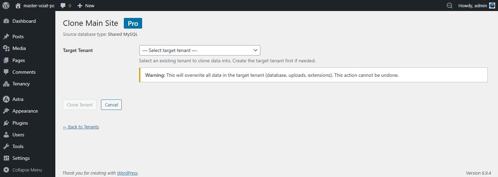
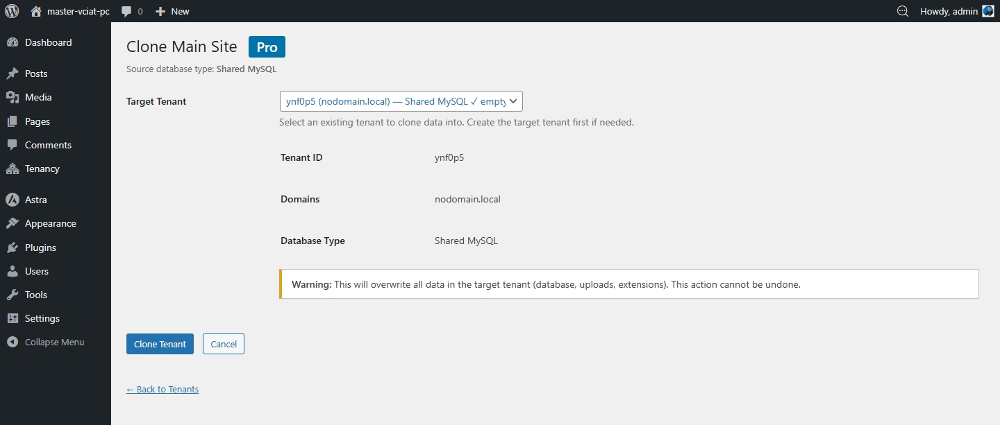

# Tenant Cloning

Pro lets you duplicate any existing tenant site into a new one. Cloning copies the database, uploads, isolated content, and Pro config — then rewrites URLs to match the new site. Useful for staging environments, pre-configured site templates, or rapid provisioning.

## Before You Start

- Both the source and destination must be tenant sites managed by GrabWP Tenancy Pro
- Create the destination tenant first (empty), then clone into it
- The destination site's existing data will be overwritten by the clone

## How to Clone

1. Go to **GrabWP Tenancy → Tenants**
2. Find the **source** site (the one to copy from) and click the **Clone** row action link
3. Select the **destination** site from the dropdown
4. Click **Start Clone**

The clone runs 7 steps and shows live progress in your browser:

| Step | What Happens |
|------|-------------|
| 1. Validate | Checks source and destination are valid and accessible |
| 2. Export | Exports source database with prefix replacement |
| 3. Import | Imports the exported database into the destination |
| 4. Copy uploads | Copies the source uploads folder to the destination |
| 5. Symlink extensions | Links per-site plugins/themes from source to destination |
| 6. Fix URLs | Rewrites all stored URLs to match the destination domain |
| 7. Cleanup | Removes temporary export files |

## After Cloning

- Visit the destination site and verify content, theme, and plugins loaded correctly
- If the destination uses a different domain, check that all media URLs resolve correctly
- The destination site has its own independent database — changes to one won't affect the other

## Notes

- Clone does not transfer active user sessions or transients
- If plugins/themes isolation is enabled on the source but not the destination, extension symlinking is skipped
- For large sites, the browser tab must stay open while the clone runs
