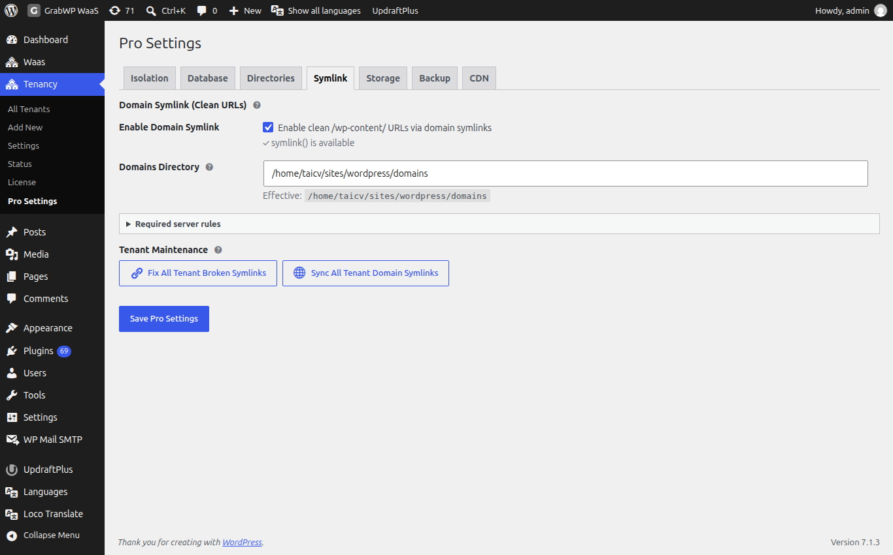
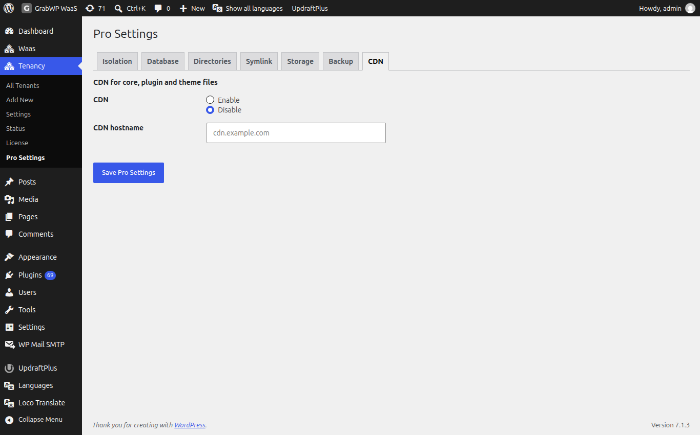

# Pro Settings

**Navigate to Tenancy → Pro Settings** (`page=grabwp-tenancy-pro-settings`).

The page title is **Pro Settings**. Tabs: **Isolation**, **Database**, **Directories**, **Symlink**, **Storage**, **Backup**, **CDN**. The active tab is remembered. Click **Save Pro Settings** on any tab to store the form.

These values are defaults for new tenants, plus site-wide storage, symlink, and backup offload. An existing tenant keeps its own config until you edit that tenant.

Routing is no longer on this page. **Path Prefix** and **Path Alias Routing** are under **Tenancy → Settings → Routing**. See [Installation](/grabwp-tenancy/installation-guide).

## Isolation


**Content Isolation Defaults**. See the field table in [Database & Content Isolation](/grabwp-tenancy-pro/pro-database-isolation).

## Database


**Database Defaults** and, when **Isolated MySQL Database** is selected, **Default MySQL Connection** (**MySQL Host**, **MySQL Database**, **MySQL Username**). The password is set on each tenant, not here.

## Directories


**Directory Configuration**. Leave a field blank to keep the default. The **Effective:** line shows the path in use. If the path was set in `wp-config.php`, the field is disabled and marked **set in wp-config.php**.

| Field | Default location |
|-------|------------------|
| Tenant Base Dir | `wp-content/grabwp-tenancy` |
| Pro Config Dir | `wp-content/grabwp-tenancy-pro` (tenant `config.php` files, and the global config at the root of this directory) |
| SQLite Database Dir | `wp-content/grabwp-tenancy-sqlite` |

Changes apply on the next page load. A **Directory validation errors:** notice lists paths WordPress rejected.

## Symlink



**Domain Symlink (Clean URLs)** rewrites tenant asset URLs so they are served from `/wp-content/` through a per-domain symlink. This is separate from how visitors open the site. Visitors still use the tenant domain.

| Field | Notes |
|-------|--------|
| Enable Domain Symlink | **Enable clean /wp-content/ URLs via domain symlinks**. Disabled when `symlink()` is missing. The row shows **symlink() is available** or **symlink() is not available. Feature cannot be enabled.** |
| Domains Directory | Absolute path for the symlinks. Blank uses the default. **Effective:** shows the path. The directory is created automatically. |

Expand **Required server rules** and copy the Nginx block, or the LiteSpeed and Apache block for `wp-content/uploads/.htaccess`, then restart the web server. The paths in that block match **Domains Directory** on this screen.

**Tenant Maintenance:**

| Button | Notes |
|--------|--------|
| Fix All Tenant Broken Symlinks | Repairs broken plugin and theme symlinks on every tenant. Disabled when `symlink()` is missing. |
| Sync All Tenant Domain Symlinks | Creates missing domain symlinks and removes stale ones. Disabled until domain symlinks are enabled, a domains directory is set, and `symlink()` is available. |

## Storage


**Object Storage (S3-Compatible)** is for tenant uploads. Providers called out in the help text: Cloudflare R2, AWS S3, MinIO, Backblaze B2.

| Field | Notes |
|-------|--------|
| Default Storage Driver | **Local Filesystem (default)** or **S3-Compatible Object Storage**. |

Choosing S3 opens **S3 storage credentials**:

| Field | Notes |
|-------|--------|
| S3 Endpoint URL | Full endpoint URL. |
| Bucket Name | Bucket for uploads. |
| Region | `auto` for Cloudflare R2. Examples: `us-east-1`, `eu-west-1`. |
| Path-Style Endpoint | **Enable path-style endpoint (required for MinIO)**. |
| Access Key ID | Access key. |
| Secret Access Key | Leave blank to keep the saved secret. |
| CDN URL (optional) | Public URL prefix. If empty, pre-signed URLs are used. |
| Connection Test | **Test Connection**. Success: **Connection successful!** |

After S3 is saved and configured, **Bulk Migration** can show **Migrate All Tenants to S3** and **Migrate All Tenants to Local**. Confirm **This will migrate uploads for ALL tenants. Continue?** For large sites, the same screen lists WP-CLI under **WP-CLI reference**:

```
wp grabwp-pro storage migrate --all --to=s3
```

Per-tenant driver and **Migrate uploads now** are on the tenant Edit screen. See [Database & Content Isolation](/grabwp-tenancy-pro/pro-database-isolation).

## Backup


### Backup Offload

| Field | Notes |
|-------|--------|
| Offload Driver | **Disabled**, **Use Platform S3 Storage** (needs S3 on the Storage tab first), or **Custom S3 Endpoint**. |
| Coming soon drivers | **Google Drive (Coming Soon)** and **FTP / SFTP (Coming Soon)** are disabled. |
| Auto Offload | **Automatically offload backups to remote storage after creation**. |
| Delete Local Copy | **Delete local backup file after successful offload**. |

**Offload storage credentials** (after you pick a driver):

- **Use Platform S3 Storage**: **Backup Prefix** and **Test Connection**.
- **Custom S3 Endpoint**: **S3 Endpoint URL**, **Bucket Name**, **Region**, **Backup Prefix**, **Access Key ID**, **Secret Access Key**, **Path-Style Endpoint**, **Test Connection**. Leave the secret blank to keep the saved key.

### Auto Backup

Global schedule for tenants that inherit it. Each tenant can override this on **Auto Backup Settings**. See [Backup & Restore](/grabwp-tenancy-pro/pro-backup-restore).

| Field | Notes |
|-------|--------|
| Auto Backup | **Enabled** or **Disabled**. |
| Default Schedule | **Manual only (no schedule)**, **Daily**, **Weekly**, **Every two weeks**, **Monthly**. Under **Schedule and retention**. |
| Backups to Keep | 1 to 30. Older local and remote archives are pruned after a successful run. |

**Schedule Assurance** shows **WP-Cron Status** (**Active (WordPress pseudo-cron)** or **Disabled (system cron required)**) and **Next Scheduled Backup**. If WP-Cron is disabled, the notice says scheduled backups will not run until a system cron is configured.

**WP-CLI Commands** on the same tab:

```
wp grabwp backup run <tenant_id>
wp grabwp backup schedule <tenant_id> --enabled=enabled --schedule=daily --retain=7
wp grabwp backup show <tenant_id>
wp grabwp backup reschedule-all
```

## CDN



**CDN for core, plugin and theme files**. When enabled, tenant front-end pages load static files (CSS, JS, images, fonts) from WordPress core, plugins, and themes through `https://` plus the CDN hostname. Point the CDN pull zone at the main site host. Admin screens are not changed.

| Field | Notes |
|-------|--------|
| CDN | **Enable** or **Disable**. Default **Disable**. |
| CDN hostname | Hostname only, for example `cdn.example.com`. If you enable CDN with an invalid hostname, it is saved as disabled. |

Leave it disabled unless you have a pull zone ready.

**Verify:** **Save Pro Settings** returns you to this screen without an error notice. Create a tenant and confirm **Database** and **Isolation** on **All Tenants** match the defaults you saved.
