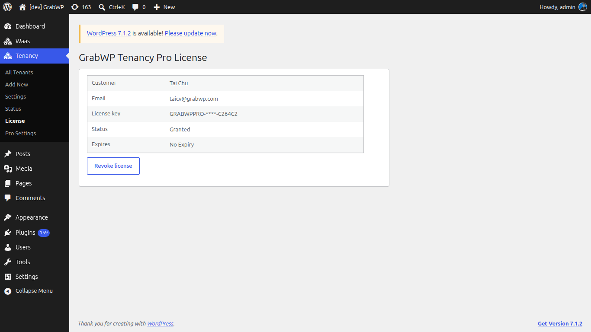

# License

**Navigate to Tenancy → License** (`page=grabwp-tenancy-license`).

The page title is **GrabWP Tenancy Pro License**.

## Activate

The unlicensed card says **Activate your license to unlock Pro features.**

1. Open the [Customer Portal](https://polar.sh/grabwp/portal) with the purchase email and copy the key. Keys begin with `GRABWPPRO-`.
2. Paste it into **License key**.
3. Click **Activate License**.

The consent line states that activation sends this site's domain and the license key to GrabWP / Polar.

No key yet: the screen links to [grabwp.com](https://grabwp.com/).

## Licensed site

| Field | Notes |
|-------|--------|
| Customer | Name on the license |
| Email | Email on the license |
| License key | Masked. The full key is not shown on this page. |
| Status | License status, for example **Granted** |
| Expires | Expiry, or **No Expiry** |

## Revoke

Click **Revoke license** to clear the Polar activation and remove the stored license from this site. The screen returns to the activate form.

**Verify:** **Status** shows a granted (or otherwise active) value, and **Tenancy → Status → Pro Plugin** still shows **Active** while the Pro plugin is enabled.
