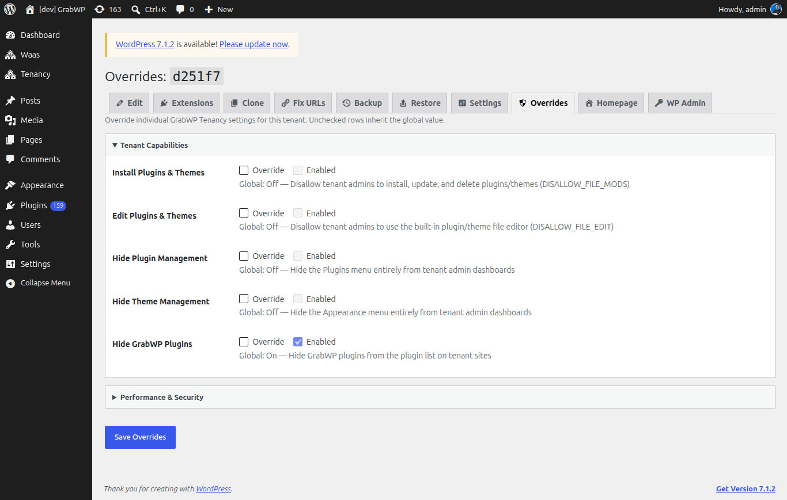

# Tenant Settings & Overrides

Global defaults for every tenant are under **Tenancy → Settings**. See [Installation](/grabwp-tenancy/installation-guide). Pro adds two tenant tabs: **Settings** (that site's WordPress options) and **Overrides** (GrabWP settings for that site only).

Open either tab from the tenant: **Tenancy → All Tenants**, **Settings** icon (`page=grabwp-tenancy-edit`), then the tab. **Homepage** and **WP Admin** on the same bar open the tenant site.

## Settings

`page=grabwp-tenancy-pro-tenant-settings`

The title is **Settings:** plus the tenant ID.

If the tenant database cannot be read: **Cannot read tenant database. Settings are unavailable.**

### Read-Only

| Option | Notes |
|--------|--------|
| Siteurl | Current `siteurl` in the tenant database. Not edited here. |
| Home | Current `home` value. Not edited here. |

To change the URL stored in the database, use [Fix URLs](/grabwp-tenancy-pro/pro-fix-urls).

### Editable Options

| Option | Notes |
|--------|--------|
| Site Title | `blogname` |
| Tagline | `blogdescription` |
| Admin Email | `admin_email` |

1. Click **Edit** on the row.
2. Change **Value**.
3. Click **Save**. **Cancel** restores the previous value.

**Verify:** Reload the tab. **Site Title**, **Tagline**, and **Admin Email** show the values you saved. **Siteurl** and **Home** are unchanged.

## Overrides

`page=grabwp-tenancy-pro-overrides`

The **Overrides** tab is registered when per-tenant overrides are supported on this install.

The title is **Overrides:** plus the tenant ID. Intro: **Override individual GrabWP Tenancy settings for this tenant. Unchecked rows inherit the global value.**

Groups match **Tenancy → Settings**:

- **Tenant Capabilities**
- **Performance & Security**

| Control | Notes |
|---------|--------|
| Override | Check to stop inheriting the global value for that row. |
| Value | On/Off, a number, or the setting's own control, depending on the row. |
| Global: | Hint with the current global value (**On**, **Off**, or the number or text). |

Click **Save Overrides**. Success: **Overrides saved.** If the tenant config file is not writable: **Failed to save overrides. Check that the tenant config file is writable.**

Clear every **Override** checkbox and save to inherit all global settings again.

**Verify:** Change one capability on this tenant only. **Tenancy → Settings** still shows the global value. The override row shows **Global:** with that global value and your tenant value beside it.
