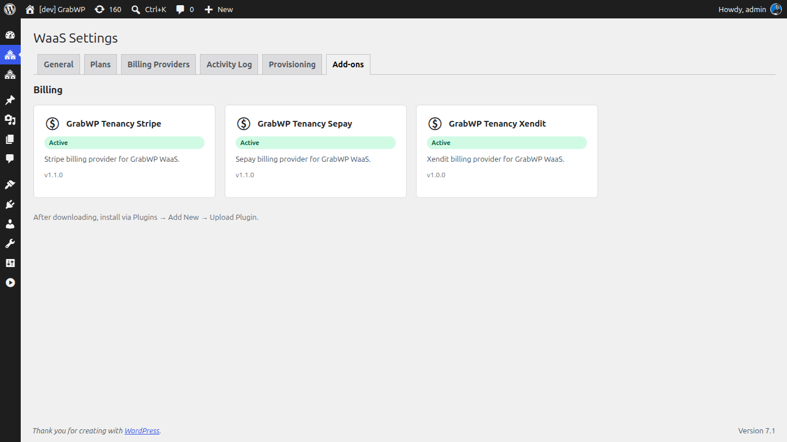

# Install Plugins

GrabWP WaaS requires three plugins installed in a specific order. Each plugin depends on the one before it.

## Installation Order

```
1. GrabWP Tenancy (base)  ← must be active first
2. GrabWP Tenancy Pro     ← requires base
3. GrabWP Tenancy WaaS    ← requires base + pro
```

## Step 1: Install GrabWP Tenancy (Base)

1. Go to **Plugins → Add New → Upload Plugin**
2. Upload `grabwp-tenancy.zip`
3. Click **Install Now**, then **Activate**
4. You should see a new **Tenancy** menu in the admin sidebar

## Step 2: Install GrabWP Tenancy Pro

1. Go to **Plugins → Add New → Upload Plugin**
2. Upload `grabwp-tenancy-pro.zip`
3. Click **Install Now**, then **Activate**
4. The **Tenancy** menu now shows additional items: **Pro Settings**, **Tenant Extensions**

> **Note:** If activation fails with a dependency error, make sure GrabWP Tenancy (base) is activated first.

## Step 3: Install GrabWP Tenancy WaaS

1. Go to **Plugins → Add New → Upload Plugin**
2. Upload `grabwp-tenancy-waas.zip`
3. Click **Install Now**, then **Activate**
4. A new **WaaS** menu appears in the admin sidebar with:
   - Dashboard
   - Subscriptions
   - Domains
   - Templates
   - Settings

## Verify Installation

After activating all three plugins, go to **Tenancy → Status**. This page runs system checks and reports any issues:

- File system permissions
- Required PHP extensions
- Database compatibility
- Plugin version compatibility

Fix any reported issues before proceeding.

## Plugin List

Your active plugins should include:

| Plugin | Status |
|--------|--------|
| GrabWP Tenancy | Active |
| GrabWP Tenancy Pro | Active |
| GrabWP Tenancy WaaS | Active |

## Discovering Official Add-ons

The recommended way to get official GrabWP add-ons (Stripe, Sepay, Xendit billing providers, and more) is the **Add-ons** tab in WaaS Settings, rather than hunting for ZIP files. Go to **WaaS → Settings → Add-ons** (`/wp-admin/admin.php?page=grabwp-tenancy-waas-settings&tab=addons`). The catalog is grouped by category, bilingual, and cached for six hours (with a last-known-good fallback if the catalog server is unreachable). Compatible add-ons download as a one-click ZIP from the admin; the license key and site URL are appended server-side and never exposed in page HTML. The Billing Providers screen also has a **Browse Add-ons** link that jumps here.



| Badge | Meaning |
|-------|---------|
| **Available** | Compatible and ready to download |
| **Installed** | Downloaded but not activated |
| **Active** | Installed and running |
| **Update Available** | A newer compatible version is available |
| **Requires WaaS Update** | Your WaaS version is too old for this add-on |

## Optional: Install SePay Plugin

If you plan to accept Vietnamese bank transfer payments (VietQR), also install:

1. Upload `grabwp-tenancy-sepay.zip`
2. Activate

This adds SePay as a billing provider option in WaaS settings.

---

**Next:** [Configure Pro Settings](/grabwp-tenancy-waas/waas-configure-pro-settings)
