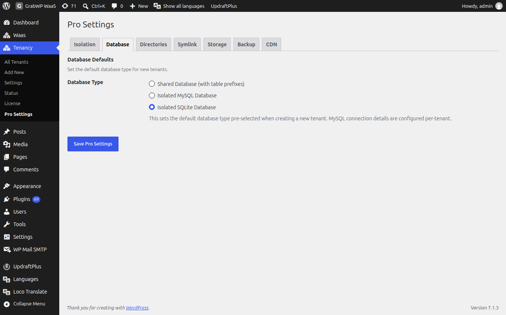
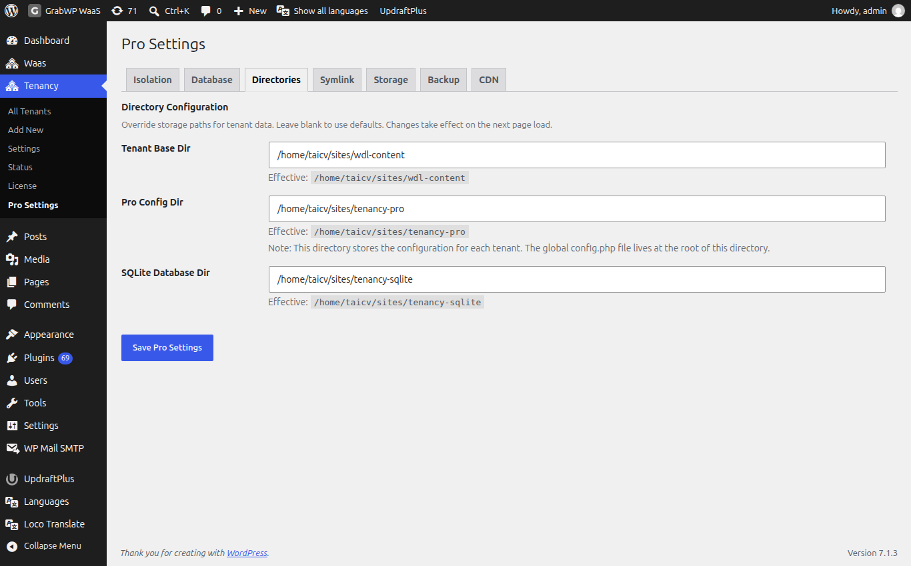

# Configure Pro Settings

Pro Settings are the defaults applied when a new tenant is created. Individual tenants can override them later.

Navigate to **Tenancy → Pro Settings** (`/wp-admin/admin.php?page=grabwp-tenancy-pro-settings`).

The page has these tabs: **Isolation**, **Database**, **Directories**, **Symlink**, **Storage**, **Backup**, **CDN**.

For this tutorial, set **Isolation** and **Database**, confirm **Directories**, and leave the other tabs at their defaults. Click **Save Pro Settings** after your changes.

## Isolation

Open the **Isolation** tab.

**Content Isolation Defaults** control what a new tenant gets its own copy of.

| Setting | Tutorial choice | What it does |
|---------|-----------------|--------------|
| **Content + Themes Isolation** | On | Each new tenant gets its own `wp-content` and themes directories |
| **Plugins Isolation** | Off for most setups | Each new tenant gets its own plugins directory |
| **Uploads Isolation** | On | Each new tenant gets its own uploads directory |

> **Tip:** Leave **Plugins Isolation** off unless tenants need different plugin sets. Shared plugins use less disk. Per-tenant plugin and theme install is done later from the tenant's extensions screen.

## Database

Open the **Database** tab.

**Database Type** is the type pre-selected when you create a tenant.

| Option | When to use it |
|--------|----------------|
| **Shared Database (with table prefixes)** | Getting started. Tenants share one MySQL database, isolated by table prefix. |
| **Isolated MySQL Database** | Each tenant uses its own MySQL database. |
| **Isolated SQLite Database** | Each tenant uses a SQLite file. |

**For this tutorial:** choose **Shared Database (with table prefixes)**.

If you choose **Isolated MySQL Database**, **Default MySQL Connection** appears:

| Field | Notes |
|-------|-------|
| **MySQL Host** | Hostname, for example `localhost` or `localhost:3306` |
| **MySQL Database** | Default database name |
| **MySQL Username** | Default database user |

These values are pre-filled on the create-tenant form. Each tenant can override them.

## Directories

Open the **Directories** tab.

**Directory Configuration** overrides where tenant data is stored. Leave the fields blank to keep the defaults.

| Field | Role |
|-------|------|
| **Tenant Base Dir** | Root for tenant uploads and data |
| **Pro Config Dir** | Per-tenant configuration. The global `config.php` lives at the root of this directory. |
| **SQLite Database Dir** | SQLite files when **Isolated SQLite Database** is in use |

Each row shows **Effective:** with the resolved path. If a path is locked, the field shows **set in wp-config.php** and cannot be edited here.

## Tabs You Can Leave for Later

| Tab | What it is |
|-----|------------|
| **Symlink** | **Domain Symlink (Clean URLs)**. Needs `symlink()` and the **Required server rules** snippet on that tab. Skip until you want clean content URLs. |
| **Storage** | **Default Storage Driver**: **Local Filesystem (default)** or **S3-Compatible Object Storage**. Leave local for now. See [S3 Object Storage](/grabwp-tenancy-waas/waas-optional-s3-storage). |
| **Backup** | Backup offload defaults. Leave until you configure backups. |
| **CDN** | **CDN for core, plugin and theme files**. Leave **Disable** selected. See [Pro Settings](/grabwp-tenancy-pro/pro-settings). |

Routing is not a Pro Settings tab. It is under **Tenancy → Settings → Routing**. This guide uses subdomains on **Platform Domain**, so leave **Routing mode** at its default. See [Installation](/grabwp-tenancy/installation-guide).

## Save

Click **Save Pro Settings**.

## Verify

1. **Isolation** shows the checkboxes you chose
2. **Database** shows **Shared Database (with table prefixes)**
3. **Directories** shows an **Effective:** path for each row, with no validation error

---

**Next:** [Configure WaaS General Settings](/grabwp-tenancy-waas/waas-configure-general)
