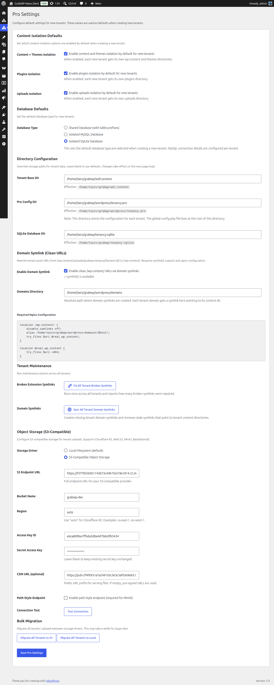

# Configure Pro Settings

Pro Settings control how tenant sites are isolated and where their data is stored. These are **defaults** — individual tenants can override them later.

Navigate to **Tenancy → Pro Settings** (`/wp-admin/admin.php?page=grabwp-tenancy-pro-settings`).

## Content Isolation Defaults

These settings determine what gets isolated for each new tenant.

| Setting | Recommended | What it does |
|---------|-------------|-------------|
| **Content + Themes Isolation** | On | Each tenant gets its own `wp-content` and themes directories |
| **Plugins Isolation** | Off (for most setups) | Each tenant gets its own plugins directory. Increases disk usage. |
| **Uploads Isolation** | On | Each tenant gets its own uploads directory (media files) |

> **Tip:** Keep Plugins Isolation off unless tenants need different plugin sets. With it off, all tenants share the same plugins (controlled via Tenant Extensions), saving disk space.

## Database Defaults

Choose how tenant databases are structured.

| Option | Best for | Description |
|--------|----------|-------------|
| **Shared** | Getting started, small scale | All tenants share one MySQL database with table-prefix isolation. Simplest setup. |
| **MySQL Isolated** | Production, compliance | Each tenant gets a dedicated MySQL database. Better isolation but requires more database resources. |
| **SQLite Isolated** | Lightweight tenants | Each tenant gets a SQLite file. No extra MySQL setup needed. Requires the [SQLite Database Integration](https://wordpress.org/plugins/sqlite-database-integration/) plugin. |

**For this tutorial:** Start with **Shared**. You can migrate tenants to isolated databases later.

### MySQL Isolated Settings (if selected)

If you choose MySQL Isolated, configure default credentials:

| Field | Description |
|-------|-------------|
| **MySQL Host** | Database server (e.g., `localhost` or `localhost:3306`) |
| **MySQL Database** | Default database name for new tenants |
| **MySQL Username** | Database user with CREATE TABLE permissions |

> **Note:** These are defaults. You can set per-tenant credentials when creating individual tenants.

## Directory Configuration

Where GrabWP stores tenant data on disk.

| Field | Default | Description |
|-------|---------|-------------|
| **Tenant Base Dir** | `wp-content/grabwp-tenancy` | Root directory for tenant uploads and data |
| **Pro Config Dir** | `wp-content/grabwp-tenancy-pro` | Configuration files for each tenant |
| **SQLite Database Dir** | `wp-content/grabwp-tenancy-sqlite` | SQLite database files (if using SQLite isolation) |

**Usually the defaults are fine.** Only change these if you need tenant data on a different partition or mount point.

> You can also lock these paths via `wp-config.php` constants. If a constant is set, the field shows "set in wp-config.php" and cannot be changed from the UI.

## Domain Symlink

Enable clean URLs for tenant content directories. Instead of serving tenant assets from a path like `/wp-content/grabwp-tenancy/tenant-123/uploads/`, symlinks let them appear under the tenant's own domain path.

| Field | Description |
|-------|-------------|
| **Enable Domain Symlink** | Turn on symlink-based clean URLs. Requires `symlink()` PHP function. |
| **Domains Directory** | Absolute path where domain symlinks are created |

> **Requires Nginx configuration.** The settings page shows a copy-paste ready Nginx config block. Add it to your server configuration and reload Nginx.

**For this tutorial:** You can skip this initially and enable it later when setting up custom domains.

## Object Storage (S3)

Offload tenant media to S3-compatible storage. This section is covered in detail in [S3 Object Storage](/grabwp-tenancy-waas/waas-optional-s3-storage).

| Field | Description |
|-------|-------------|
| **Storage Driver** | `Local` (default) or `S3` |

**For this tutorial:** Leave as **Local**. Configure S3 later if needed.

## Save Settings

Click **Save Settings** at the bottom of the page. A success message confirms the save.

---

**Next:** [Configure WaaS General Settings](/grabwp-tenancy-waas/waas-configure-general)
