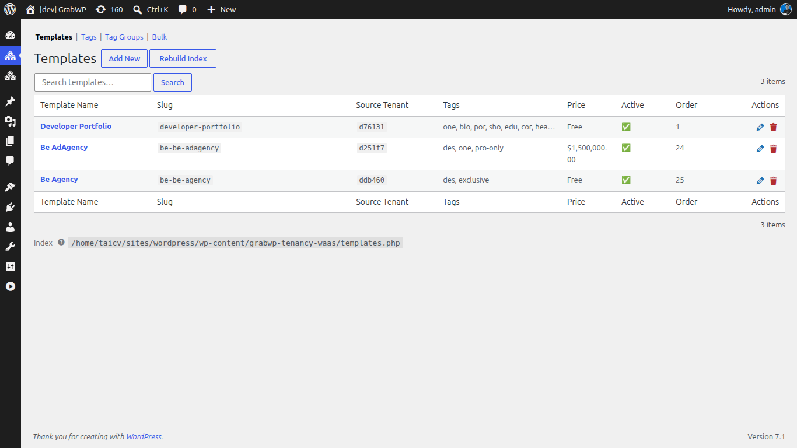

# Set Up Templates

Templates are pre-built site designs that customers choose during signup. Each template is a snapshot of an existing tenant site - theme, content, settings, and all.

Navigate to **WaaS → Templates** (`/wp-admin/admin.php?page=grabwp-tenancy-waas-templates`).



## How Templates Work

```
1. You create a tenant site and design it
2. You register that tenant as a template
3. Customers browse templates during signup
4. When a customer signs up, their new site is cloned from the template
```

Templates are stored as references to existing tenant sites, not as separate copies. The template's tenant must remain active.

## Step 1: Create a Tenant for Your Template

Before creating a template, you need a tenant site to use as the source.

1. Go to **Tenancy → Add New**
2. Create a new tenant (e.g., slug: `template-starter`, domain: `template-starter.yoursaas.com`)
3. Access the tenant's WordPress admin and design the site:
   - Install and configure a theme
   - Add demo content (pages, posts, media)
   - Set up menus, widgets, and site identity
   - Configure any plugins you want included

> **Tip:** Spend time making this site look polished - every customer who picks this template starts with an exact copy.

## Step 2: Create a Template

1. Go to **WaaS → Templates**
2. Click **Add New Template**


Fill in:

| Field | Value | Notes |
|-------|-------|-------|
| **Source Tenant** | Select the tenant you designed | Only shown when creating, not editable after |
| **Template Name** | `Starter Blog` | Display name in the template gallery |
| **Slug** | `starter-blog` | URL-safe identifier. Lowercase letters, numbers, hyphens only. |
| **Tags** | Select or type tags | For filtering in the gallery. See tags setup below. |
| **Allowed Plans** | Leave unchecked for all plans | Check specific plans to restrict this template to paid users only |
| **Price** | `0` | Optional - charge extra for premium templates |
| **Active** | Checked | Template appears in the gallery |

3. Upload a **Thumbnail** - a screenshot or mockup of the template. Recommended size: 1280×960px.
4. Optionally add a **Preview URL** - a live link customers can click to see the template in action.
5. Click **Save Template**

## Setting Up Tags

Tags let customers filter the template gallery by category, industry, or feature.

### Create Tag Groups

1. Go to **WaaS → Settings → Tags**
2. Click **Add Tag Group**
3. Create groups such as:
   - `industry` - Restaurant, Portfolio, Blog, E-commerce
   - `builder` - Elementor, Gutenberg, Beaver Builder
   - `feature` - WooCommerce, Multilingual, Membership

### Create Tags

Within each group, create individual tags:

1. Click **Add Tag** inside a group
2. Set the **Name** (display) and **Slug** (URL-safe identifier)
3. Save

### Assign Tags to Templates

When editing a template, select tags from the dropdown. Templates can have tags from multiple groups.

## Controlling Gallery Filters

The template browser shortcode controls which tag groups appear as filter pills vs. dropdowns. See [Shortcode Reference](/grabwp-tenancy-waas/waas-shortcode-templates) for all options.

## Template Cloning Process

When a customer selects a template and completes signup, WaaS clones the template tenant:

1. **Validate** - check source tenant is healthy
2. **Export** - export source tenant database
3. **Import** - import into new tenant database
4. **Copy uploads** - copy media files
5. **Symlink extensions** - link plugins and themes
6. **Fix URLs** - update all URLs to the new tenant domain
7. **Cleanup** - finalize and activate

This process typically takes 10–30 seconds depending on template size.

---

**Next:** [Set Up Frontend Pages](/grabwp-tenancy-waas/waas-setup-frontend-pages)
