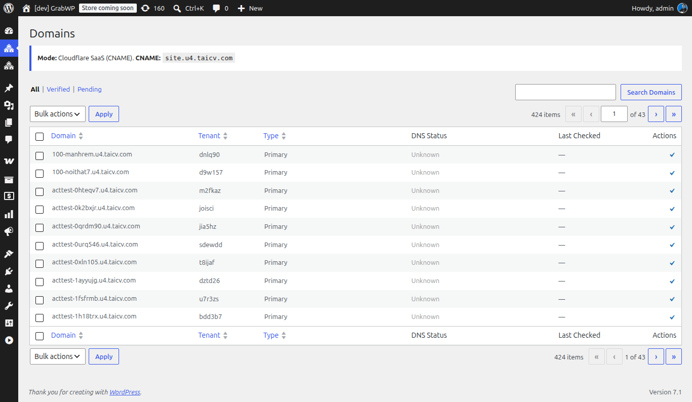

# Managing Custom Domains

Custom domains let your customers use their own domain (e.g., `mybusiness.com`) instead of a subdomain (`mybusiness.yoursaas.com`). GrabWP WaaS supports two methods.

Navigate to **WaaS → Domains** (`/wp-admin/admin.php?page=grabwp-tenancy-waas-domains`).



## Domain Modes

Configure the mode in **WaaS → Settings → General → Custom Domains**.

| Mode | How it works | Best for |
|------|-------------|----------|
| **Cloudflare SaaS** | Customer adds a CNAME record to your fallback origin. Cloudflare handles SSL and routing. | Production platforms, automatic SSL, scalable |
| **Direct IP** | Customer adds an A record to your server IP. You configure the domain on your server. | Simple setups, non-Cloudflare hosting |

## Cloudflare SaaS Custom Hostnames

This is the recommended approach for production. Cloudflare handles SSL certificates automatically for every custom domain.

### One-Time Setup (Your Side)

1. **Add your domain to Cloudflare** (if not already)
2. **Enable Cloudflare for SaaS** on your zone:
   - Contact Cloudflare support or use the dashboard → SSL/TLS → Custom Hostnames
   - This feature may require a paid Cloudflare plan
3. **Set a fallback origin:**
   - In Cloudflare dashboard → SSL/TLS → Custom Hostnames → Add Fallback Origin
   - Set it to your platform subdomain (e.g., `cdn.saas.yoursaas.com`)
   - Create a DNS A record for this subdomain pointing to your server
4. **Configure in WaaS:**
   - Go to WaaS → Settings → General → Custom Domains
   - Set Domain Mode to **Cloudflare SaaS**
   - Enter your CNAME Target (e.g., `cdn.saas.yoursaas.com`)

> **Cloudflare docs:** [Cloudflare for SaaS](https://developers.cloudflare.com/cloudflare-for-platforms/cloudflare-for-saas/) - covers setup, SSL, and API automation.

### Per-Customer Flow

When a customer wants to use their own domain:

1. **Customer side:** Add a CNAME record in their DNS:
   ```
   mybusiness.com  →  CNAME  →  cdn.saas.yoursaas.com
   ```

2. **Your side (admin):** Add the domain in WaaS → Domains or the customer can add it via the tenant dashboard:
   - Click **Add Domain**
   - Enter the custom domain
   - Click **Verify** - checks DNS propagation

3. **Cloudflare** automatically provisions an SSL certificate for the custom domain

4. The tenant site is now accessible at `mybusiness.com`

### Customer Instructions Template

Share this with your customers when they request a custom domain:

> **To connect your domain:**
> 1. Log in to your domain registrar (GoDaddy, Namecheap, etc.)
> 2. Go to DNS settings
> 3. Add a CNAME record:
>    - **Name/Host:** `@` or `www` (or your subdomain)
>    - **Value/Target:** `cdn.saas.yoursaas.com`
>    - **TTL:** Automatic or 300
> 4. Wait 5-10 minutes for DNS propagation
> 5. Go to your Dashboard → Domains → Add Domain
> 6. Enter your domain and click Verify

## Direct IP Mode

Simpler but requires manual server configuration for each domain.

### Setup

1. In WaaS → Settings → General → Custom Domains:
   - Set Domain Mode to **Direct IP**
   - Enter your **Server Public IP**

2. For each custom domain, you need to:
   - Add a server block (Nginx) or virtual host (Apache) for the domain
   - Point it to your WordPress installation
   - Set up SSL (e.g., via Let's Encrypt / Certbot)

### Per-Customer Flow

1. **Customer:** Add an A record in their DNS:
   ```
   mybusiness.com  →  A  →  203.0.113.50
   ```

2. **You:** Add the domain to your web server config:

   **Nginx example:**
   ```nginx
   server {
       listen 80;
       server_name mybusiness.com;
       # ... same config as your main site
   }
   ```

   Then run Certbot for SSL:
   ```bash
   sudo certbot --nginx -d mybusiness.com
   ```

3. **Admin panel:** Add and verify the domain in WaaS → Domains

> **Note:** Direct IP requires manual server work per domain. Cloudflare SaaS is recommended if you expect many custom domains.

## Domain Management from Tenant Dashboard

Customers can also manage domains from their tenant dashboard (your `/dashboard/` page):

- **Add Domain** - enter a custom domain
- **Verify** - check DNS propagation
- **Set Primary** - make a domain the primary URL for their site
- **Remove** - disconnect a custom domain

## Domain Verification

After adding a domain, verification checks:
- DNS record exists and points correctly (CNAME or A record)
- Domain resolves to your server
- SSL is working (for Cloudflare SaaS, this is automatic)

Verification can take a few minutes depending on DNS propagation.

---

**Next:** [Managing Subscriptions](/grabwp-tenancy-waas/waas-managing-subscriptions)
