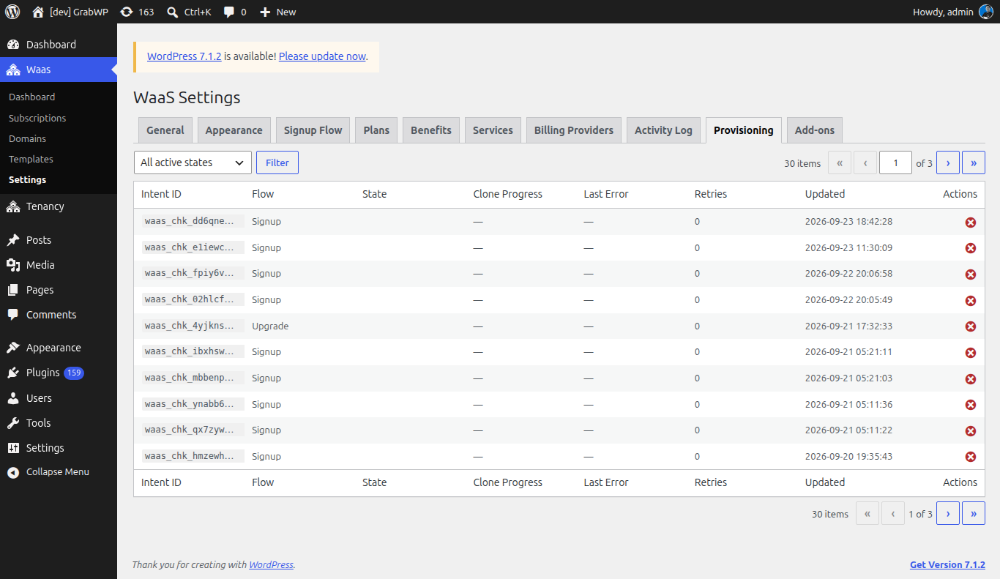
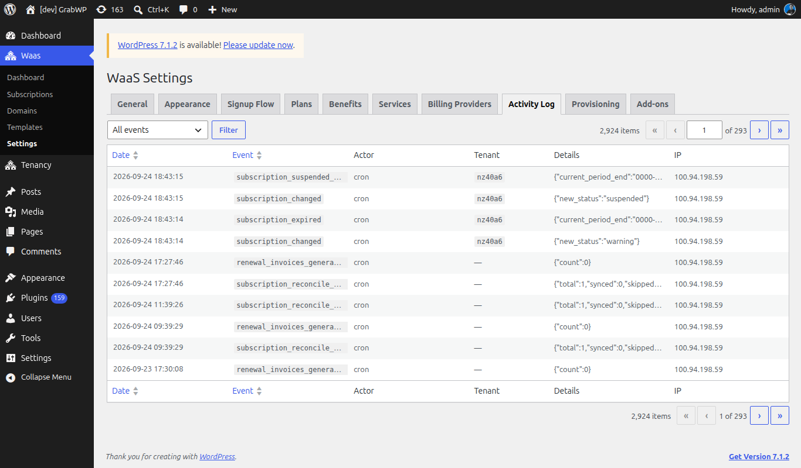

# Troubleshooting

Use the **Activity Log** and **Provisioning** tabs before changing server config. Both live under **Waas → Settings**.

## Provisioning

**Navigate to Waas → Settings**, tab **Provisioning** (`/wp-admin/admin.php?page=grabwp-tenancy-waas-settings&tab=provisioning`).



The filter default is **All active states**. Other values: `checkout_pending`, `payment_confirmed`, `finalizing`, `tenant_created`, `clone_running`, `failed_retriable`. Click **Filter**.

| Column | Notes |
|--------|-------|
| **Intent ID** | Provisioning id |
| **Flow** | For example Signup or Upgrade |
| **State** | One of the states above, or `failed_terminal` / `completed` when shown |
| **Clone Progress** | Step and total while a clone is running |
| **Last Error** | Truncated error text |
| **Retries** | Retry count |
| **Updated** | Last update time |
| **Actions** | **Retry** (states `failed_retriable` and `clone_running` only) and **Dismiss** |

**Dismiss** asks: **Mark this intent as dismissed (failed_terminal)?**

If payment finished and the site never appears:

1. Find the intent and read **Last Error** and **State**.
2. Click **Retry** when the icon is there.
3. Open **Activity Log** for the same time.
4. Confirm the web server can write the directory shown as **Waas Directory** on the **General** tab.

> **Tip:** A tenant dashboard can show **Your site is being set up.** while media and extensions are still copying. That banner clears when the clone finishes.

## Activity Log

**Navigate to Waas → Settings**, tab **Activity Log** (`page=grabwp-tenancy-waas-settings&tab=activity`). More detail: [Dashboard and Activity](/grabwp-tenancy-waas/waas-dashboard-activity).



Choose an event in the dropdown (default **All events**) and click **Filter**. Columns: **Date**, **Event**, **Actor**, **Tenant**, **Details**, **IP**.

Subscription expiry shows events such as `subscription_expired` and `subscription_suspended_after_grace`. Actor `cron` means the daily job, not a person.

## Payment and billing

**Navigate to Waas → Settings**, tab **Billing Providers** (`page=grabwp-tenancy-waas-settings&tab=billing`). See [WooCommerce Billing](/grabwp-tenancy-waas/waas-optional-woocommerce) for the WooCommerce card.

Providers that declare webhooks show **Webhook URL** and a **Copy** button. The help tip shows **Last webhook received:** and a time, or **No webhook events received yet.**

The path is:

```text
https://your-site.example/wp-json/grabwp-waas/v1/webhooks/billing/<provider>
```

`<provider>` is the slug on the card (`polar`, `sepay`, `stripe`, `xendit`, and so on). Paste that exact URL into the provider dashboard, including `https`.

If the customer paid and the subscription stays **Pending**:

1. Hover **Webhook URL** and check whether a webhook has been received.
2. Compare the secret on the card with the provider dashboard.
3. Confirm the site is reachable from the internet (not blocked by maintenance mode or HTTP basic auth).
4. If the webhook arrived, check **Provisioning** for `payment_confirmed` or `failed_retriable`.

WooCommerce does not use that webhook URL. If checkout opens an empty cart:

- Run **Create/Repair WooCommerce Anchor Product** under **Repair tools** on **General**.
- Confirm the anchor product is still purchasable. The error **The WaaS anchor product is not available for purchase.** means it is not.
- Clear a cart or cache plugin that restores an old WooCommerce cart.

## Templates

**Navigate to Waas → Templates** (`page=grabwp-tenancy-waas-templates`).

If a template is missing from the gallery:

1. Edit the template and check **Active** / **Show in signup form**.
2. Confirm **Source Tenant** still exists under **Tenancy → All Tenants**.
3. Check **Allowed Plans**. Leave them unchecked to allow every plan.
4. Set **Thumbnail** if the card looks empty. A missing image uses a placeholder, not a hidden card.
5. Bypass any full-page cache on the templates page.

Preview links use `?grabwp_waas_preview=<slug>` on the site home URL. If the preview is blank, load that URL directly, confirm the source tenant responds, and make sure a cache does not strip the query argument.

## Custom domains

**Navigate to Waas → Domains**. Full steps: [Managing Custom Domains](/grabwp-tenancy-waas/waas-managing-domains).

| What you see | What to do |
|--------------|------------|
| Warning: domain settings not configured | Set **Domain Mode** on **General**. |
| **Unknown** | Never checked. Click the **Actions** checkmark. |
| **Pending**, did not respond | DNS or the web server is not accepting the hostname yet. Wait, then **Verify** again. |
| **Pending**, not serving this site | The hostname reaches a different site. Fix the server name or Cloudflare hostname, then **Verify**. |
| **(stale)** | Last check is older than 24 hours. Run **Verify** again. |
| **Verified** filter is empty | No domain has passed a check yet. |

Direct IP hostnames also need a certificate on this server. Cloudflare SaaS needs **CNAME Target** and, for automatic certificate checks, **DCV Delegation**.

## Tenant site

1. Confirm the hostname resolves to this server.
2. Confirm the tenant exists under **Tenancy → All Tenants**.
3. Read the PHP error log.
4. For **WAAS Auth (Email signup)**, owners sign in with the dashboard login (email code), not only `wp-login.php`. **WordPress Auth (Login required)** uses a normal WordPress account.

The tenant keeps its platform hostname until a verified custom domain is set as primary.

## Email and signup

OTP and other mail use WordPress `wp_mail()`. If codes never arrive:

1. Check spam.
2. Send a test from your SMTP plugin.
3. Confirm the sender domain has SPF and DKIM, and that the host allows the SMTP port.

The signup page sends no-cache headers because it embeds a REST nonce. A cache that still stores that page can later fail with a cookie or nonce error. Exclude the signup URL from full-page cache.

## S3

On **Tenancy → Pro Settings → Storage**, **Test Connection** should say **Connection successful!** If it says **Connection failed.** or **Request failed.**:

1. Recheck **S3 Endpoint URL**, **Bucket Name**, **Region**, and **Access Key ID**.
2. Re-enter **Secret Access Key** (a blank field keeps the old secret).
3. For MinIO, enable **Path-Style Endpoint**.
4. Confirm this server can open the endpoint.

See [S3 Object Storage](/grabwp-tenancy-waas/waas-optional-s3-storage).

## WordPress debug log

In `wp-config.php`:

```php
define('WP_DEBUG', true);
define('WP_DEBUG_LOG', true);
define('WP_DEBUG_DISPLAY', false);
```

Messages go to `wp-content/debug.log`. Turn display off on a public site so errors are not printed in the browser.

---

**Back to:** [WaaS Documentation Index](/grabwp-tenancy-waas/waas-overview)
