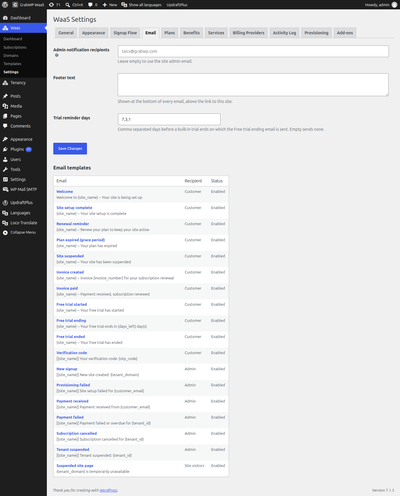

# Email Settings and Templates

The **Email** tab controls who gets admin notifications, the footer on every email, when trial reminders go out, and the text of each template.

Navigate to **Waas → Settings → Email** (`/wp-admin/admin.php?page=grabwp-tenancy-waas-settings&tab=email`).

## Email settings

| Field | Notes |
|---|---|
| **Admin notification recipients** | Comma-separated email addresses. Invalid addresses are dropped. Leave empty to use the site admin email. |
| **Footer text** | Shown at the bottom of every email, above the link to this site. |
| **Trial reminder days** | Comma-separated days before a built-in trial ends on which **Free trial ending** is sent. Default `7,3,1`. Empty sends none. |

Click **Save Changes**.

## Email templates

The **Email templates** table has three columns: **Email**, **Recipient**, and **Status**. **Email** shows the template name and its current subject. **Status** is **Enabled** or **Disabled**, plus **Customized** when you changed the default. All templates are enabled by default.

### Customer

| Email | Default subject |
|---|---|
| **Welcome** | `Welcome to {site_name} -- Your site is being set up` |
| **Site setup complete** | `{site_name} -- Your site setup is complete` |
| **Renewal reminder** | `{site_name} -- Renew your plan to keep your site active` |
| **Plan expired (grace period)** | `{site_name} -- Your plan has expired` |
| **Site suspended** | `{site_name} -- Your site has been suspended` |
| **Invoice created** | `{site_name} -- Invoice {invoice_number} for your subscription renewal` |
| **Invoice paid** | `{site_name} -- Payment received, subscription renewed` |
| **Free trial started** | `{site_name} -- Your free trial has started` |
| **Free trial ending** | `{site_name} -- Your free trial ends in {days_left} day(s)` |
| **Free trial ended** | `{site_name} -- Your free trial has ended` |
| **Verification code** | `[{site_name}] Your verification code: {otp_code}` |

**Verification code** is required for signup and login. It cannot be turned off, and its body must contain `{otp_code}`.

### Admin

Sent to **Admin notification recipients**.

| Email | Default subject |
|---|---|
| **New signup** | `[{site_name}] New site created: {tenant_domain}` |
| **Provisioning failed** | `[{site_name}] Site setup failed for {customer_email}` |
| **Payment received** | `[{site_name}] Payment received from {customer_email}` |
| **Payment failed** | `[{site_name}] Payment failed or overdue for {tenant_id}` |
| **Subscription cancelled** | `[{site_name}] Subscription cancelled for {tenant_id}` |
| **Tenant suspended** | `[{site_name}] Tenant suspended: {tenant_id}` |

### Site visitors

| Email | Default subject |
|---|---|
| **Suspended site page** | `{tenant_domain} is temporarily unavailable` |

This is the page visitors see on a suspended site, not an email. It is always on and has no **Send test email** button.

## Edit a template

1. Click the template name in the **Email** column.
2. Set **Enabled** (**Send this email**), **Subject**, and **HTML body**. The header, colors, and footer are added automatically. A plain-text version is generated from the HTML.
3. Click a button under **Tokens** to insert that token at the cursor in the subject or body.
4. Click **Save template**.

**Preview** opens the rendered email in a new tab. **Send test email** sends it to your own user email. Both use sample token values and the subject and body currently in the form. **Reset to default** appears once the template is customized.

Click **All email templates** to go back to the list.

**Verify:** after **Save template**, the notice **Settings saved.** appears on the edit screen. Back on the list, the row shows **Customized** in **Status**. **Send test email** shows **Test email sent to** your address.

---

**Related:** [Configure the Signup Flow](/grabwp-tenancy-waas/waas-signup-flow)
