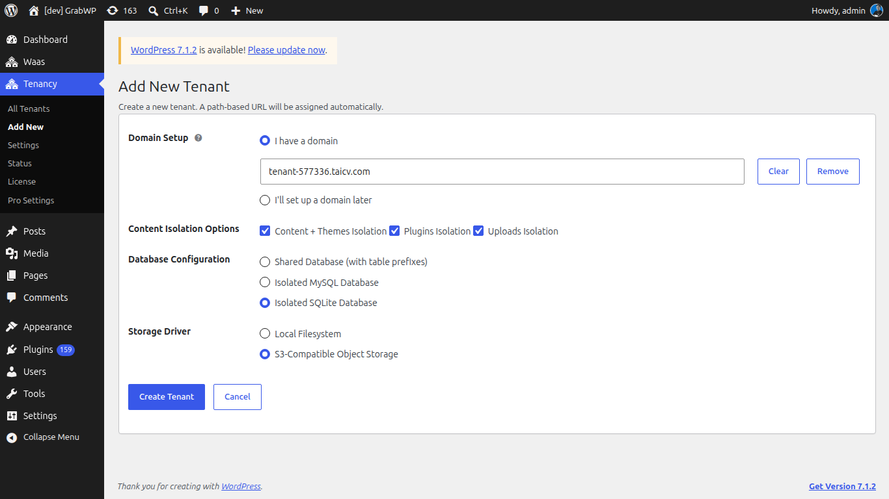

# Getting Started

Create a tenant site on its own domain, then open that site from the tenant list.

## Requirements

- WordPress 5.0 or later (tested up to 7.1)
- PHP 7.4 or later
- WordPress admin access (`manage_options`)

## Step 1: Install the plugin

1. Go to **Plugins → Add New**
2. Search for **GrabWP Tenancy**
3. Click **Install Now**, then **Activate**

Activation installs the components the plugin needs. You do not edit `wp-config.php` by hand for a normal install.

> **Tip:** After activation, open **Tenancy → Status** (`page=grabwp-tenancy-status`) and confirm the checks on **Plugin General**. If a row shows a warning or error, click **Auto Fix**.

## Step 2: Create your first tenant

**Navigate to Tenancy → Add New** (`page=grabwp-tenancy-create`).

1. Leave **I have a domain** selected (it is the default).
2. Enter the domain without `http://` or `www` (for example `client1.com`).
3. Click **Create Tenant**.

The plugin assigns a unique 6-character tenant ID and creates that site's database tables and upload folder.

> **Note:** **I'll set up a domain later** creates the tenant before a domain is connected. The Domains column then shows **Path access only**. A temporary preview URL is listed on the Edit screen until you add a domain. Connect a real domain before you send the site to visitors. See [Domain & DNS Setup](/grabwp-tenancy/hosting-dns-setup).

If GrabWP Tenancy Pro is active, the same form also shows **Content Isolation Options**, **Database Configuration**, and (when S3 is configured) **Storage Driver**. Those fields are covered in [Database & Content Isolation](/grabwp-tenancy-pro/pro-database-isolation).

## Step 3: Point the domain at this server

Add the domain in your hosting panel so its document root is this WordPress directory, then point DNS at the server.

→ [Domain & DNS Setup](/grabwp-tenancy/hosting-dns-setup)

## Step 4: Open the tenant admin

**Navigate to Tenancy → All Tenants** (`page=grabwp-tenancy`).

Find the new row and click **Admin** (dashboard icon). That opens the tenant's WordPress admin. The link includes a short-lived access token (30 minutes by default). If it expires, click **Admin** again.

**Verify:** Visit the tenant domain in a browser. You should see that tenant's site, not the main site. The domain appears in the **Domains** column on **All Tenants**.
