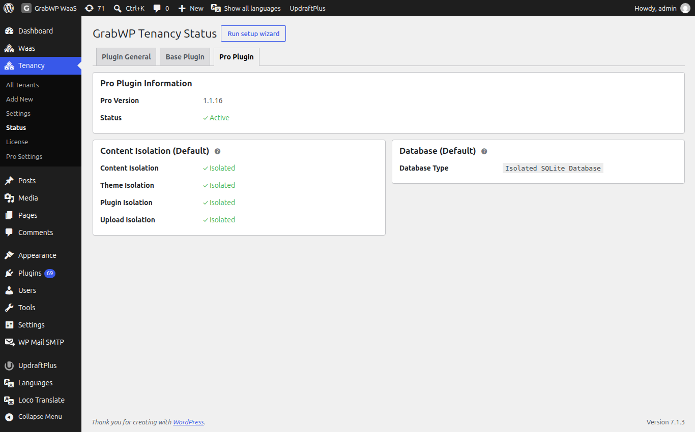

# Installation

## Requirements

- WordPress 5.0 or later (tested up to 7.1)
- PHP 7.4 or later
- WordPress admin access (`manage_options`)

## Install from wp-admin

1. Go to **Plugins → Add New**
2. Search for **GrabWP Tenancy**
3. Click **Install Now**, then **Activate**

Activation installs the must-use plugin, the `wp-config.php` loader, and the rewrite rules. You do not edit those files by hand for a normal install.

## Install from a ZIP

1. Download the plugin ZIP from [wordpress.org/plugins/grabwp-tenancy](https://wordpress.org/plugins/grabwp-tenancy/)
2. Go to **Plugins → Add New → Upload Plugin**
3. Upload the ZIP, click **Install Now**, then **Activate Plugin**

## Verify on Status

**Navigate to Tenancy → Status** (`page=grabwp-tenancy-status`).

The page title is **GrabWP Tenancy Status**. It has three tabs: **Plugin General**, **Base Plugin**, and **Pro Plugin**.

### Plugin General

`page=grabwp-tenancy-status&tab=general`

**Environment Checks** lists the pieces activation installs. Each row can be expanded for **Fix steps and install code**, **Copy Code**, and **Auto Fix** when the file is writable.

| Check | Healthy state |
|-------|----------------|
| wp-config.php Loader | Active |
| MU-Plugin | Installed |
| Root .htaccess Rewrite Rules | Installed |
| Data Directory .htaccess | Protected |

**Auto Fix** writes the missing piece when WordPress can write the file. If the file is not writable, the row says a manual install is required. Use **Copy Code** and follow the fix steps on that row.

### Base Plugin

`page=grabwp-tenancy-status&tab=base`

**File Structure** reports the base directory, the tenant mappings file, the settings file, and the tenant uploads pattern. **Tenant Capabilities** on this tab mirrors the Settings checkboxes and links to **Settings**.

### Pro Plugin

`page=grabwp-tenancy-status&tab=pro`

With Pro active, this tab shows **Pro Version**, **Status** (**Active**), the default content isolation flags, and the default database type. Without Pro, the tab offers **Upgrade to Pro**.

**Verify:** On **Plugin General**, the loader and MU-plugin rows show a green active or installed state before you create tenants.

## Settings

**Navigate to Tenancy → Settings** (`page=grabwp-tenancy-settings`).

The page title is **GrabWP Tenancy Settings**. These values apply to every tenant. Pro can override them for one tenant. See [Tenant Settings & Overrides](/grabwp-tenancy-pro/pro-tenant-settings).

### Tenant Capabilities

| Field | Notes |
|-------|--------|
| Install Plugins & Themes | **Disallow file mods**. Stops tenant admins from installing, updating, or deleting plugins and themes. |
| Edit Plugins & Themes | **Disallow file edit**. Hides the plugin and theme file editor. |
| Hide Plugin Management | **Hide Plugins menu** on tenant admin screens. |
| Hide Theme Management | **Hide Appearance menu** on tenant admin screens. |
| Hide GrabWP Plugins | **Hide from plugin list** on tenant sites. |

### Performance & Security

| Field | Notes |
|-------|--------|
| Disable WP-Cron | **Disable WP-Cron** on tenant sites. Use a system cron if you turn this on. |
| Disable XML-RPC | **Disable XML-RPC** on tenant sites. |
| Post Revisions | Maximum revisions to keep. |
| Empty Trash Days | Days before trashed posts are deleted. `0` disables trash. |
| Block External HTTP | **Block external HTTP** from tenant sites. |
| Accessible Hosts | Comma-separated hosts still allowed when external HTTP is blocked. Wildcards are supported. |

### Routing

**Routing mode** decides which address each site opens on:

| Mode | Behavior |
|------|----------|
| Path | Every site opens at a path URL such as `/site/my-shop/`. Works right away, no DNS needed. Domains you add are kept but not used for links. |
| Domain | Every site opens on its own domain. Visitors who open a path URL are redirected (301) to the domain. Every site needs a domain. |
| Path and domain | Sites with a domain open on it. Sites without one open on the path URL. Both addresses keep working. Used until you save a mode. |

Changing the mode opens a **Change routing mode** screen that lists **Sites whose address changes** and **What else happens**. Confirm with **Switch to** the new mode, or **Cancel**. Switching to **Domain** is blocked until every site has a domain. The screen lists the sites that still need one, each with **Add a domain**. If `GRABWP_TENANCY_ROUTING_MODE` is set in `wp-config.php`, the radios are disabled.

The path rows are hidden in **Domain** mode. Without Pro, the tab only shows the current **Path prefix**. With Pro:

| Field | Notes |
|-------|--------|
| Path Prefix | Slug in the path URL. Lowercase letters, numbers, and hyphens, 1 to 20 characters. Default `site`. Saving a new prefix flushes rewrite rules and updates `.htaccess`. Bookmarks with the old prefix stop working. |
| Path Alias Routing | **Enable Path Alias Routing**. Lets a site use a readable slug instead of its 6-character tenant ID. The tenant Edit screen then shows **Path Alias** (3 to 30 characters) and **Copy URL** instead of the plain **Path URL** row. |

Click **Save Settings**.

**Verify:** the selected **Routing mode** is still checked after the page reloads, and a tenant opens on the address that mode describes.

## Uninstalling

Deactivating the plugin removes the must-use plugin, the `wp-config.php` loader, and the root rewrite rules.

Tenant database tables and uploads are not deleted. Activate the plugin again and the existing tenants are available.
