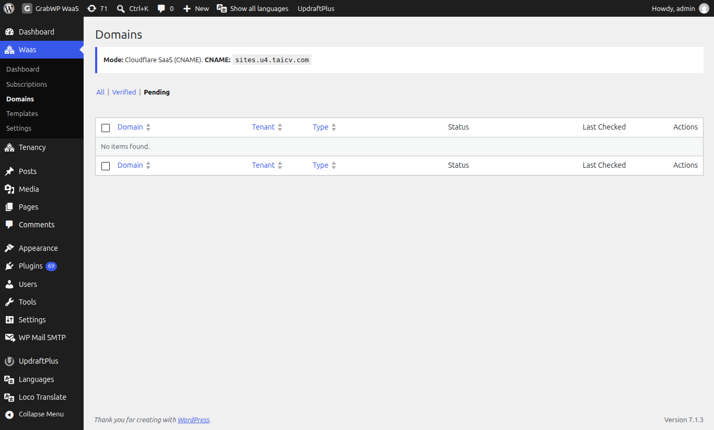

**Short answer:** a custom domain must both point to your server in DNS and be accepted as a domain alias by your web server or Cloudflare for SaaS setup. Check the exact verification message in the customer dashboard or wp-admin to see whether the issue is DNS, server routing, or plan benefits.
**Needs:** Pro + WaaS

## Symptom

When adding, editing, or verifying a custom domain in the customer dashboard or in wp-admin, one of these messages appears:

- `Domain did not respond. Point DNS and add it on the server, then try again.`
- `Domain is reachable but is not serving this site yet.`
- `Domain is not mapped to a tenant.`
- `Verify this domain before setting it as primary.`
- `Custom domains are not available while sites use path URLs.`
- `Custom domains are not available for your current plan.`
- `Maximum 2 custom domains allowed.`
- `Cannot remove your platform subdomain.`
- `Domain(s) already in use by other tenants` (or `Domain(s) already in use`)
- `Invalid domain format(s)`

The domain may also show the wrong site, an SSL error, or a hosting default landing page.

## Cause

| If you see | It means |
|---|---|
| `Domain did not respond. Point DNS and add it on the server, then try again.` | The HTTP verification check could not reach the domain over the network. DNS is not pointing to the server yet, or SSL/firewall blocked the request. |
| `Domain is reachable but is not serving this site yet.` | The domain resolved and answered over HTTP, but the web server served a default host page or another site instead of routing the hostname to this WordPress install. |
| `Domain is not mapped to a tenant.` | The domain is not saved in `tenants.php` for this site yet. |
| `Verify this domain before setting it as primary.` | A domain must pass the HTTP verification check before it can become the primary address. |
| `Custom domains are not available while sites use path URLs.` | The platform is running in path routing mode (`path`), which does not use per-site hostnames. |
| `Custom domains are not available for your current plan.` | The customer's current plan does not have the `allow_custom_domain` benefit enabled. |
| `Maximum 2 custom domains allowed.` | The site already has 2 custom domains attached, which is the per-site limit. |
| `Cannot remove your platform subdomain.` | The default platform subdomain remains attached as a fallback and cannot be deleted by the customer. |
| `Domain(s) already in use by other tenants` | Each domain can belong to only one site across the platform. |
| `Invalid domain format(s)` | The entered domain has invalid characters. Use `example.com` or `subdomain.example.com` without `http://`, `https://`, or IP addresses. |

## Check

### Checking domain status in wp-admin

Navigate to **Waas > Domains** (`page=grabwp-tenancy-waas-domains`) to see domain verification statuses across all customer sites.

| What you see on Waas > Domains | What to do |
|---|---|
| Warning: domain settings not configured | Set **Domain Mode** under **Waas > Settings > General**. |
| **Unknown** | Never checked. Click the **Actions** checkmark to run verification. |
| **Pending**, did not respond | DNS or the web server is not accepting the hostname yet. Wait for DNS propagation, then click **Verify**. |
| **Pending**, not serving this site | The hostname reaches a different site or host page. Add the domain alias to the web server, then click **Verify**. |
| **(stale)** | Last check is older than 24 hours. Run **Verify** again. |
| **Verified** filter is empty | No domain has passed a check yet. |

### General environment checks

1. In the main site admin, go to **Tenancy > Settings > Routing** and confirm **Routing Mode** is set to `domain` or `both` (not `path`).
2. Go to **Waas > Settings > General** and confirm **Platform Domain** is filled in and **Domain Mode** is set to **Cloudflare SaaS (CNAME)** or **Direct IP (A record)** with a matching **CNAME Target** or **Server Public IP**.
3. Go to **Waas > Settings > Plans**, edit the customer's plan, and confirm the custom domain benefit (`allow_custom_domain`) is turned on.
4. Check the domain's live DNS records using a tool like [dnschecker.org](https://dnschecker.org) to confirm the `CNAME` or `A` record matches the target shown in the dashboard.

## Fix

### If the custom domain section is blocked

1. For `Custom domains are not available while sites use path URLs.`, switch **Routing Mode** to `both` or `domain` under **Tenancy > Settings > Routing** and set a **Platform Domain** under **Waas > Settings > General**.
2. For `Custom domains are not available for your current plan.`, enable `allow_custom_domain` on the plan under **Waas > Settings > Plans**, or ask the customer to upgrade to a plan that includes custom domains.
3. For `Maximum 2 custom domains allowed.`, remove one of the existing custom domains before adding a new one.

### If verification fails

1. Ensure the site owner points their domain DNS (`CNAME` or `A` record, depending on your **Domain Mode**) to the target shown in their dashboard.
2. Add the custom domain as an alias (parked domain) on your web server or hosting panel, or complete the custom hostname check in Cloudflare for SaaS so the web server routes traffic for that hostname to your main WordPress root directory.
3. If using Direct IP mode, ensure an SSL certificate covers the custom domain on this server. Cloudflare SaaS handles certificates automatically if **DCV Delegation** and **CNAME Target** are configured.
4. Once DNS propagates and the web server serves the WordPress root for that hostname, click **Verify** again in the dashboard and then set the domain as primary.

### If domain is already in use

If you see `Domain(s) already in use by other tenants`:
1. Search for the domain under **Tenancy > All Tenants** or **Waas > Domains**.
2. Remove the domain from the previous site.
3. Assign and verify it on the new site.

## Still stuck

If DNS points to the server and the domain alias is added on the server panel but verification still fails, send the exact error message, the **Domain Mode** setting from **Waas > Settings > General**, and the site's domain list. See [What to send when you ask for help](/help/getting-help).

## Related

- [Client custom domains](/sell-sites/client-domains)
- [Site addresses, domains and DNS](/manage-sites/domains-and-dns)
- [Web server guide](/help/web-server-guide)
- [What to send when you ask for help](/help/getting-help)
