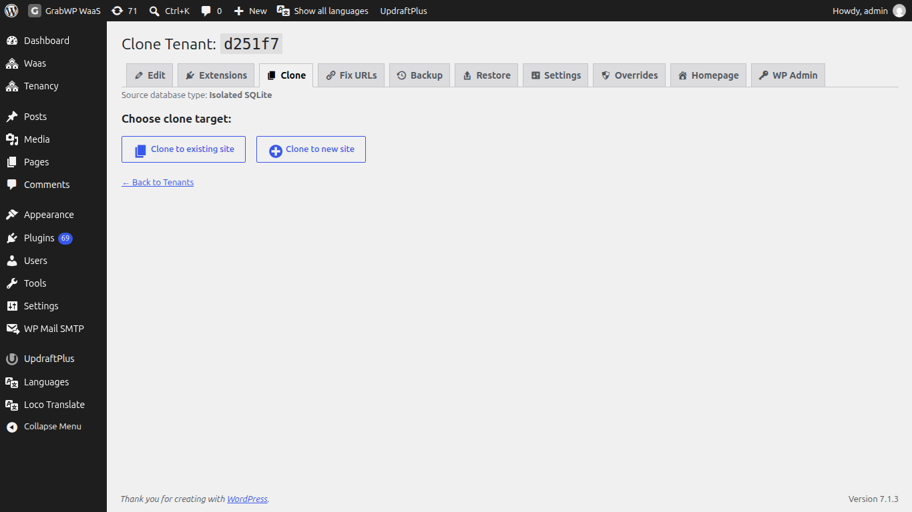

**Short answer:** click the **Clone Tenant** icon on a site's row in **Tenancy > All Tenants**, pick a target site (or create a new one), and click **Clone Tenant**. The target gets a copy of the source's content and uploads, with its addresses updated. Everything that was on the target before is replaced.

**Needs:** Free (Pro adds plugins and themes, other database types and S3 storage)

## How it works

Cloning copies the source site's database and uploads into a target site, then rewrites the stored addresses so they point at the target. After that the two sites are separate: later edits on one do not change the other.

Use it to start a new client site from a finished one, or to make a test copy before a big change.

| | Free | Pro |
|---|---|---|
| Copies database and uploads | Yes | Yes |
| Links or copies the source's own plugins and themes | No | Yes |
| Source and target on different database types (shared MySQL, isolated MySQL, SQLite) | No, shared database only | Yes |
| Converts files when the source and target use different storage (local or S3) | No | Yes |
| Steps | 6 | 7 |

## Open Clone

Open **Tenancy > All Tenants** and click the **Clone Tenant** icon on the source row. With Pro you can also use the **Clone** tab on a site.

To clone your main site, use the clone icon on the starred **Main Site** row (named **Clone to Tenant** with Pro). The page title is then **Clone Main Site**. For any other source it is **Clone Tenant:** plus the site ID.

The page shows **Source database type:** (**Shared MySQL**, **Isolated MySQL** or **Isolated SQLite**).

## Clone into a site

Under **Choose clone target:**

| Choice | What happens |
|---|---|
| **Clone to existing site** | Pick the **Target Tenant** from the list. The summary shows its **Tenant ID**, **Domains**, **Database Type** and **Uploads**. If no site qualifies the list says **No eligible tenants found**. |
| **Clone to new site** | You go to **Add New Tenant** with a note that you will be redirected to clone the source into the new site. Fill in the form and click **Create Tenant & Clone**. |

:::warning
The page warns: `This will overwrite all data in the target tenant (database, uploads, extensions). This action cannot be undone.` On Free the list in brackets is database and uploads.
:::

1. Choose the target.
2. Click **Clone Tenant** and confirm `Are you sure? All data in the target tenant will be overwritten.`
3. Keep the browser tab open while the steps run.

| Step | What happens |
|---|---|
| **Validating source & target tenants** | Checks both sites. |
| **Exporting source database** | Exports the source content. |
| **Importing database into target tenant** | Imports into the target. With Pro this works across database types. |
| **Symlinking extensions** (Pro only) | Links the source's own plugins and themes into the target. |
| **Updating site URLs** | Rewrites stored addresses to the target's address. |
| **Copying uploads** | Copies media files. With Pro, files are converted when the storage driver differs. |
| **Cleaning up** | Removes temporary files. |

When it finishes you see **Clone complete!** and `The source tenant data has been cloned into the target tenant.` with links to **Edit tenant**, **Homepage** and **Dashboard**.

**Cancel** or **Back to Tenants** leaves without cloning.

## After cloning

- Open **Homepage** and check the theme, plugins and content.
- The target keeps its own ID and domains.
- If images or links still point at the source address, run [Fix URLs](/manage-sites/fix-urls) on the target (Pro).
- With Pro and S3 storage, copying a large media library can finish in the background after the screen says it is done. This uses a scheduled job, so WP-Cron or a server cron must be running. See [Scheduled jobs and server cron](/manage-sites/scheduled-jobs).

## Limits

- You cannot clone a site into itself.
- Third-party premium plugins may ask for their license key again on the copy. That depends on the plugin vendor's terms.

:::info If you sell sites
WaaS builds each new customer site by cloning one of your templates, so the same rules apply: the template's content, plugins and themes are what the customer starts with. See [Templates](/sell-sites/templates).
:::

## Related

- [Backup and restore](/manage-sites/backup-and-restore)
- [Fix URLs](/manage-sites/fix-urls)
- [Per-site plugins and themes](/manage-sites/plugins-and-themes)
- [Database options](/manage-sites/database-options)
