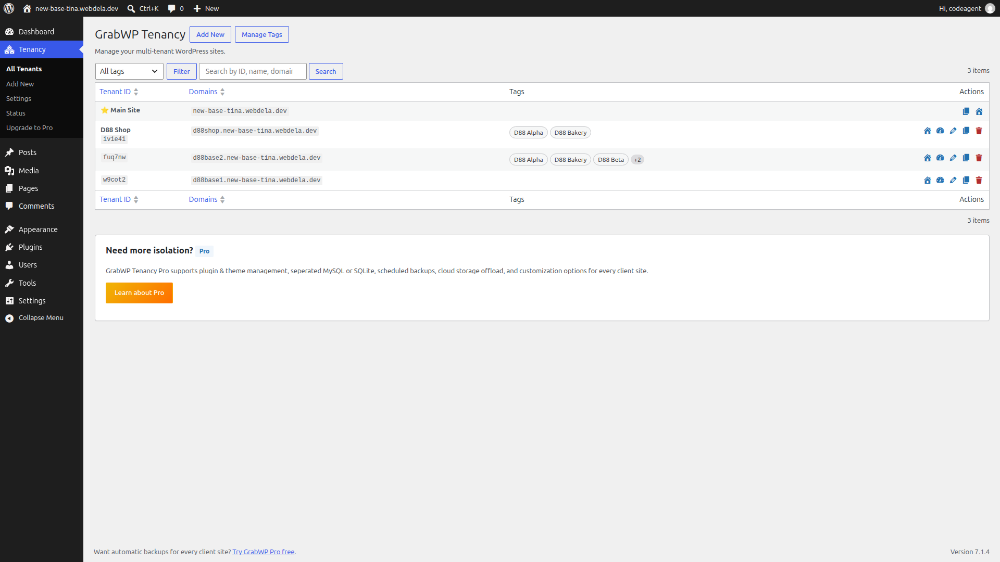
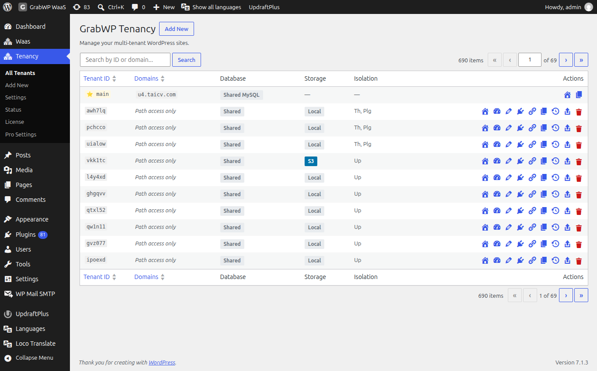
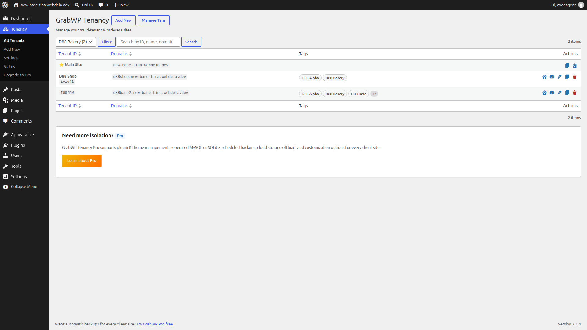
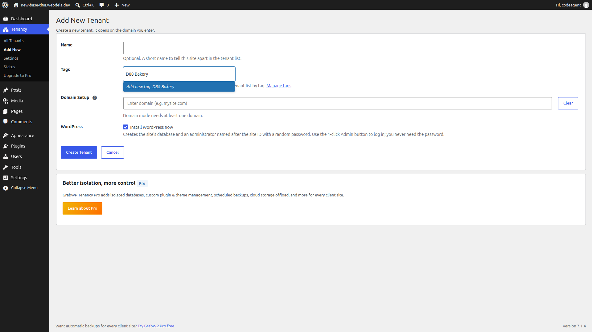
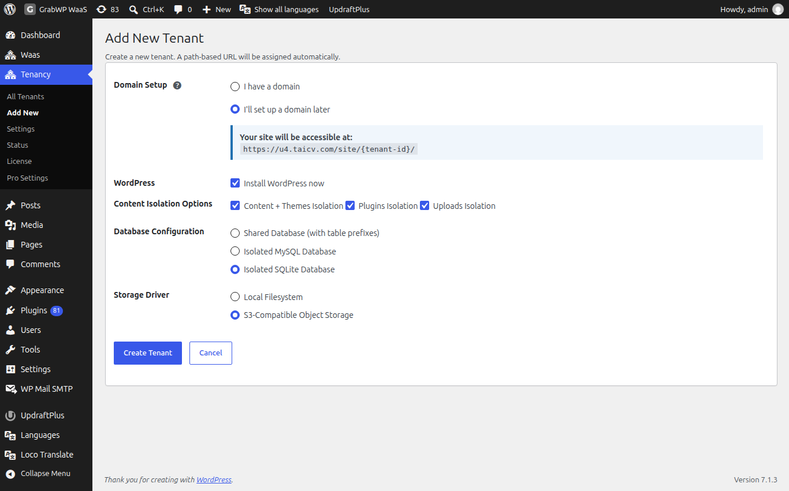
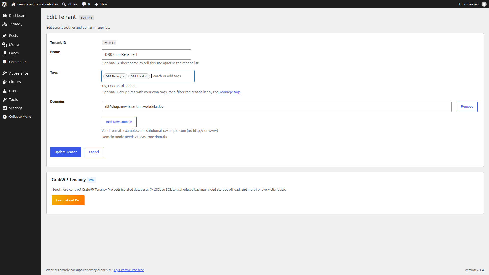
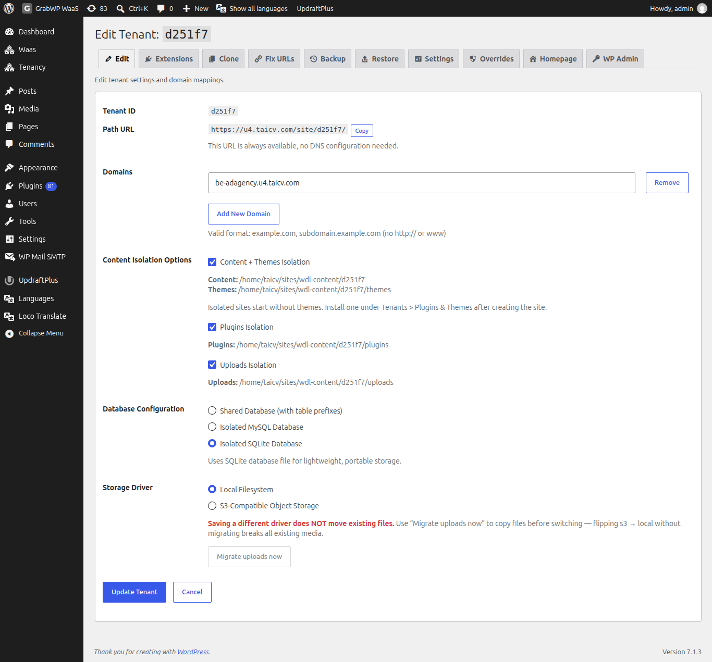
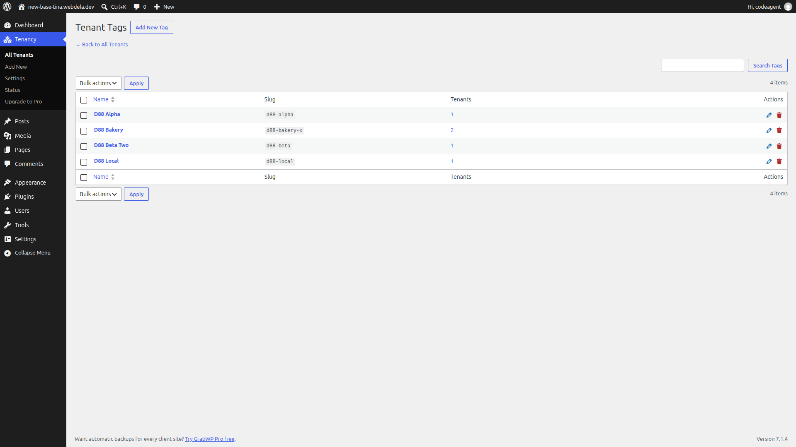
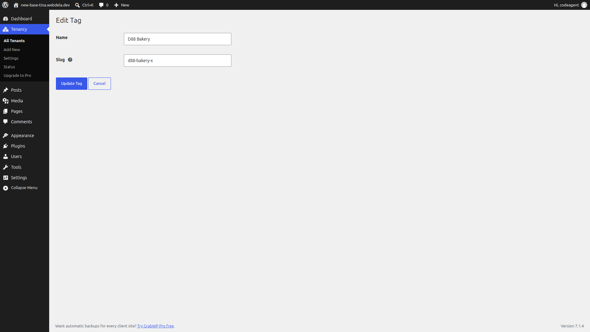

**Short answer:** every client site is a "tenant": a separate WordPress site that runs on the same install as your main site. Create one on **Tenancy > Add New**, give it an optional **Name** and **Tags**, find and filter it on **Tenancy > All Tenants**, manage your tag list from **Manage Tags**, change a site's details with the **Settings** icon, and delete it with the trash icon.

**Needs:** Free (Pro adds isolation, database and storage options)

## What a site is

A site has its own content, users, settings and uploads, and its own admin area. Each site has a **Tenant ID**: exactly 6 characters, lowercase letters and digits, for example `abc123`. GrabWP creates it for you. Some IDs are reserved and never used, such as `admin1`, `test01`, `public`, `system`, `config` and `backup`.

The ID shows up in the site's path address, its database table names and its folder name. For a readable label in wp-admin, give the site a **Name** and **Tags**. For a readable public address, give the site a domain, or use a path alias with Pro (see [Domains and DNS](/manage-sites/domains-and-dns)).

By default a client cannot install or delete plugins and themes on their site. See [Per-site plugins and themes](/manage-sites/plugins-and-themes).

## The site list

Open **Tenancy > All Tenants**. The page title is **GrabWP Tenancy**, with **Add New** and **Manage Tags** buttons at the top.

| Column | What it shows |
|---|---|
| **Tenant ID** | The site's **Name** in bold (when set) above its 6-character ID. Your main install is the starred **Main Site** row. |
| **Domains** | Domains linked to the site. **Path access only** means no domain yet. **No domains assigned** means the list is empty. |
| **Tags** | Up to 3 tags in alphabetical order as clickable filter chips, plus `+N` when the site has more (hover to see the rest). Shown when **Show tenant names and tags** is on. |
| **Actions** | Icons. Hover for the name. See [Where things are in wp-admin](/manage-sites/wp-admin-map). |
| **Database**, **Storage**, **Isolation** (Pro) | Database type (**Shared MySQL**, **Isolated MySQL**, **Isolated SQLite**), uploads storage (**Local** or **S3**), and short isolation labels: **WPC** (WP Content), **Th** (Themes), **Plg** (Plugins), **Up** (Uploads). |

To filter and search the list:

- **Filter by tag:** pick a tag in the **All tags** dropdown (each option shows the tag name and site count, such as `D88 Bakery (2)`) and click **Filter**, or click any tag chip in the **Tags** column. If no site has that tag, the table shows `No tenants found with this tag.`
- **Search:** type in **Search by ID, name, domain or tag...** (or **Search by ID or domain...** when names and tags are turned off) and click **Search**. Search matches the exact Tenant ID or any part of a site's name, domain or assigned tag names. You can combine the tag filter and search.

An empty list shows **No Tenants Found** and a **Create Your First Tenant** button.

## Create a site

Open **Tenancy > Add New**, or click **Add New** on the list.

1. Optionally fill in **Name** (up to 100 characters; `Optional. A short name to tell this site apart in the tenant list.`) and **Tags** (`Optional. Group sites with your own tags, then filter the tenant list by tag.`):
   - Click in **Search or add tags** to pick from existing tags, or type a new tag name and click **Add new tag:** to create and assign it right away (confirmed by `Tag ... added.`).
   - Click `×` on a chip to remove it from the site.
   - Without JavaScript, tick existing tags or type new ones in **New tags, comma separated**.
2. Under **Domain Setup**, pick one:
   - **I'll set up a domain later** (the default). The site opens on a path address right away.
   - **I have a domain**. Type it in the **Enter domain (e.g. mysite.com)** field, without `http://` or `www`. Use **Clear** or **Remove** on a row.
3. Leave **Install WordPress now** ticked so the site is ready to use.
4. With Pro, check **Content Isolation Options**, **Database Configuration** and (once S3 is set up) **Storage Driver**. The defaults come from **Tenancy > Pro Settings**.
5. Click **Create Tenant**. **Cancel** goes back to the list.

What you see under **Domain Setup** depends on the routing mode on **Tenancy > Settings > Routing**:

| Routing mode | Add New shows |
|---|---|
| **Path** | Only the address the site will get. No domain field. |
| **Domain** | A required domain field. `Domain mode needs at least one domain.` |
| **Path and domain** | The two choices above. |

**Check:** the new ID (and its **Name** and **Tags**, if you set them) appears on **All Tenants**, with the domain you typed or **Path access only**.

## Edit a site's name, tags and domains

Click the **Settings** icon on the row. The title is **Edit Tenant:** plus the ID.

| Field | Notes |
|---|---|
| **Tenant ID** | Read only. |
| **Name** | Optional display name (up to 100 characters) shown above the ID on **All Tenants**. Clear it to show only the ID. |
| **Tags** | Chip selector (**Search or add tags**) to assign or remove tags, with a **Manage tags** link below. |
| **Path URL** | The path address, with **Copy**. `This URL is always available, no DNS configuration needed.` With Pro and path aliases on, this row becomes **Path Alias** with **Copy URL**. |
| **Domains** | One field per domain. **Remove** deletes a row, **Add New Domain** adds one. |

The domain help text says `Valid format: example.com, subdomain.example.com (no http:// or www)`.

Click **Update Tenant**. You see `Tenant updated successfully.` If the site is saved but `management.php` in the data folder cannot be written, GrabWP keeps the site update and shows `Tenant saved, but names and tags could not be written. Check that the GrabWP data folder is writable.`

A site can answer on more than one domain, for example `www.client.com` and `client.com`. Add each one here, then point each one at this server. See [Domains and DNS](/manage-sites/domains-and-dns).

With Pro, a tab bar across the top of this screen leads to the site's other tools: **Edit**, **Extensions**, **Clone**, **Fix URLs**, **Backup**, **Restore**, **Settings**, **Overrides**, **Homepage**, **WP Admin**.

:::note
Changing a domain here does not change the addresses stored inside the site's content. After a domain change, run [Fix URLs](/manage-sites/fix-urls) (Pro).
:::

## Manage tags

Open the **Tenant Tags** screen from the **Manage Tags** button at the top of **Tenancy > All Tenants**, or from the **Manage tags** link under the **Tags** field on **Add New** and **Edit Tenant**.

**Tenant Tags** is not a separate item in the left sidebar menu; **Tenancy > All Tenants** stays highlighted while you use it, and **← Back to All Tenants** returns to the site list.

The table lists every tag with **Name**, **Slug**, **Tenants** (how many sites carry the tag, linking to **All Tenants** filtered by that tag) and **Actions** (edit and trash icons). When no tags exist yet, the table says `No tags yet.` with an **Add New Tag** link.

- **Add a tag:** click **Add New Tag**, enter a **Name** (up to 50 characters) and an optional **Slug** (up to 50 characters; `Lowercase letters, numbers and hyphens. Leave it empty to make it from the name.`), then click **Add Tag**. You see `Tag saved.`
- **Search tags:** type a name or slug and click **Search Tags**. If nothing matches, the table shows `No tags found.`
- **Rename or change a slug:** click the tag name or its edit icon to open **Edit Tag**, update **Name** or **Slug** (`Lowercase letters, numbers and hyphens. Changing it updates every tenant that has this tag.`) and click **Update Tag** (**Cancel** goes back without saving).
- **Delete tags:** click the trash icon on a row and confirm (`Delete this tag?` or `Delete this tag? It is removed from N tenant(s).`) to see `Tag deleted.`, or tick multiple rows, choose **Delete** under **Bulk actions** and click **Apply**. Deleting a tag removes it from every site that carried it.

### Turn names and tags off or on

Names and tags are on by default. To hide them, go to **Tenancy > Settings**, open the **Management** tab, untick **Show tenant names and tags** (**Yes**) and click **Save Settings**.

Turning the setting off hides the **Name** and **Tags** fields, the **Tags** column, the tag filter and the **Manage Tags** button, while keeping everything you already saved in `wp-content/grabwp-tenancy/management.php`. See [Free settings](/manage-sites/free-settings#management).

## Delete a site

:::danger
Deleting a site removes its database tables (or its isolated SQLite database folder), its uploads and content folder, and its saved name and tag assignments. This cannot be undone. Take a backup first if you might need it (see [Backup and restore](/manage-sites/backup-and-restore)).
:::

1. Click the trash icon on the row.
2. When asked `To confirm deletion, type the tenant ID:`, type the ID exactly.
3. If it does not match you see `Incorrect tenant ID. Deletion cancelled.`

With Pro, deleting a site that uses **Isolated SQLite Database** also deletes its SQLite database folder (`wp-content/grabwp-tenancy-sqlite/{tenant_id}/`). On earlier Pro versions, that folder stayed on disk after deletion and can be removed by hand.

**Check:** the ID is gone from the list.

## Limits

- Each domain can belong to only one site. Otherwise you see `Each domain can only be assigned to one tenant.`
- The ID cannot be changed after creation. Use a domain or path alias for the address people see.
- With Pro active, an inactive or invalid license blocks creating and editing sites. See [Pro license](/manage-sites/licence).

:::info If you sell sites
With WaaS, sites created by your signup flow also appear on this list. Their plans and payments are managed under **Waas > Subscriptions**, not here. See [Trials and subscriptions](/sell-sites/trials-and-subscriptions).
:::

## Related

- [Your first site](/manage-sites/first-site)
- [Domains and DNS](/manage-sites/domains-and-dns)
- [Log in to a client site](/manage-sites/direct-login)
- [Clone a site](/manage-sites/clone-a-site)
- [Where site data lives](/manage-sites/where-site-data-lives)
