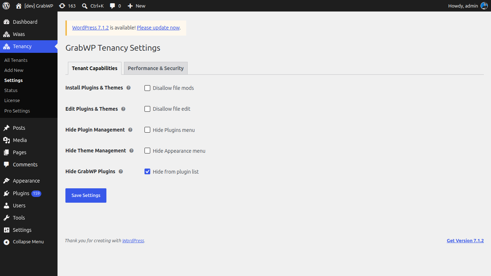
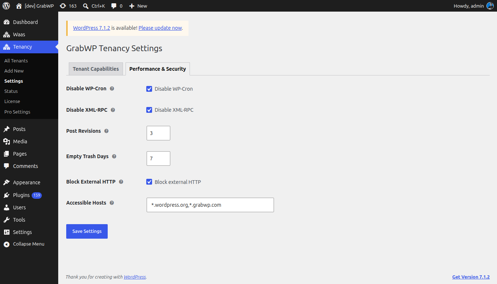
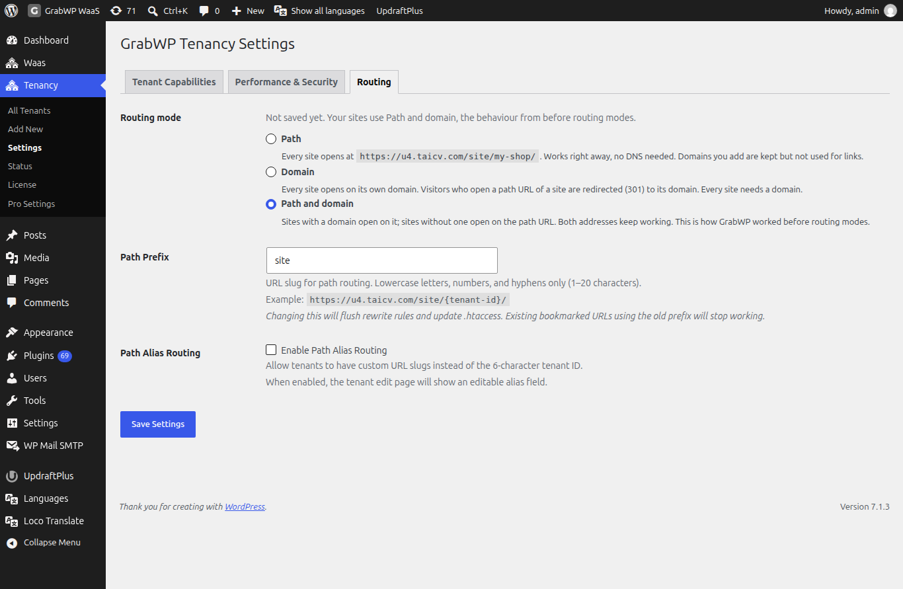

**Short answer:** **Tenancy > Settings** sets what admins of your sites can do and a few speed and security limits. These settings apply to every site, not to the main site. With Pro you can change them for one site on its **Overrides** tab.

**Needs:** Free. Pro adds per-site overrides and more routing options.

## How it works

The page title is **GrabWP Tenancy Settings**. It has three tabs: **Tenant Capabilities**, **Performance & Security** and **Routing**. Change what you need and click **Save Settings**.

Each setting turns into a standard WordPress setting (a constant) when one of your sites loads. The main site is never affected.

## Tenant Capabilities

What admins of your sites can do.

| Setting | Default | What it does |
|---|---|---|
| **Disable Install Plugins & Themes** | On | Site admins cannot install, update or delete plugins and themes. |
| **Disable Plugin & Theme File Editor** | On | Site admins cannot use the built-in code editor for plugin and theme files. |
| **Hide Plugins Menu** | Off | Removes the Plugins menu from site dashboards. |
| **Hide Appearance Menu** | Off | Removes the Appearance menu (themes) from site dashboards. |
| **Hide GrabWP Plugins** | On | Hides every GrabWP plugin and the SQLite plugin from the site's Plugins list, so admins cannot turn them off by mistake. |

To let clients add their own plugins safely, see [Plugins and themes](/manage-sites/plugins-and-themes).

## Performance & Security

| Setting | Default | What it does |
|---|---|---|
| **Disable WP-Cron** | On | Turns off the built-in task scheduler on your sites. Run a server cron job instead. See [Scheduled jobs](/manage-sites/scheduled-jobs). |
| **Disable XML-RPC** | On | Turns off the old remote publishing API, a common target of password-guessing attacks. |
| **Post Revisions to Keep** | `3` | How many older versions of each post to keep, from `0` to `100`. `0` turns revisions off. |
| **Days Before Trash Is Emptied** | `7` | Deleted items stay in the Trash this many days, from `0` to `365`. `0` deletes them right away. |
| **Block External Requests** | Off | Your sites cannot connect to other websites, except the allowed hosts below. |
| **Allowed Hosts When Blocked** | `*.wordpress.org,*.grabwp.com` | Comma-separated host names your sites can still reach when external requests are blocked. Wildcards like `*.wordpress.org` work. |

## Routing

How visitors reach your sites.

| Setting | Default | What it does |
|---|---|---|
| **Routing mode** | **Path and domain** | **Path**: sites open at `example.com/site/abc123/`. **Domain**: sites open on their own domain; a path address redirects to the domain. **Path and domain**: both work. |
| **Path prefix** | `site` | The word in path addresses. Fixed in Free. |

Pro adds **Path Prefix** (change the word) and **Path Alias Routing** (a readable name instead of the site ID) on this tab. See [Domains and DNS](/manage-sites/domains-and-dns).

## When a setting has no effect

- **Set in `wp-config.php`.** If `wp-config.php` already sets the same WordPress constant, a notice under the setting names the constant and its value and says the setting has no effect. Remove that line from `wp-config.php` to let GrabWP control it.
- **Set by another plugin.** A similar notice says another plugin or file already sets the constant.
- **Routing mode locked.** If `GRABWP_TENANCY_ROUTING_MODE` is in `wp-config.php`, the **Routing** tab says the routing mode is set in `wp-config.php` and you must remove the constant to change it here. If its value is not `path`, `domain` or `both`, it is ignored and the tab says so.

A constant set in `wp-config.php` also wins over a per-site override.

## Change it for one site

With Pro, open the site and its **Overrides** tab. Each setting can use the global value, **Yes**, **No** or a custom value. See [Site settings and overrides](/manage-sites/site-settings).

## Limits

- These settings are saved in `settings.php` inside the data folder. The routing mode is saved in `tenants.php`. See [Where site data lives](/manage-sites/where-site-data-lives).
- If the data folder is not writable, saving shows `Failed to save settings. Please check file permissions.`

## Related

- [Pro settings](/manage-sites/pro-settings)
- [Site settings and overrides](/manage-sites/site-settings)
- [Plugins and themes](/manage-sites/plugins-and-themes)
- [Domains and DNS](/manage-sites/domains-and-dns)
- [Client cannot install plugins](/help/client-cannot-install-plugins)
