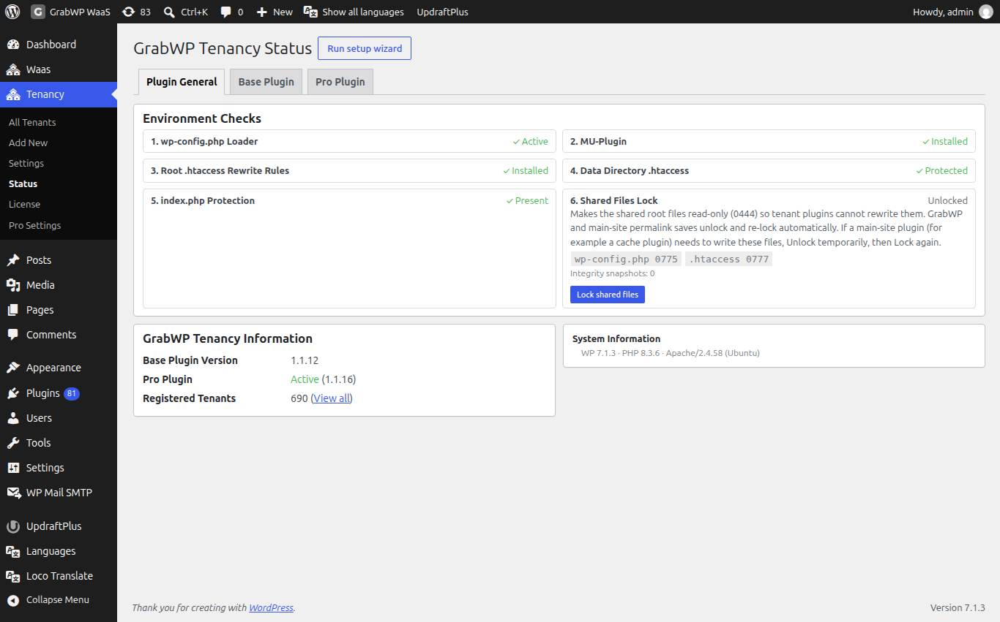
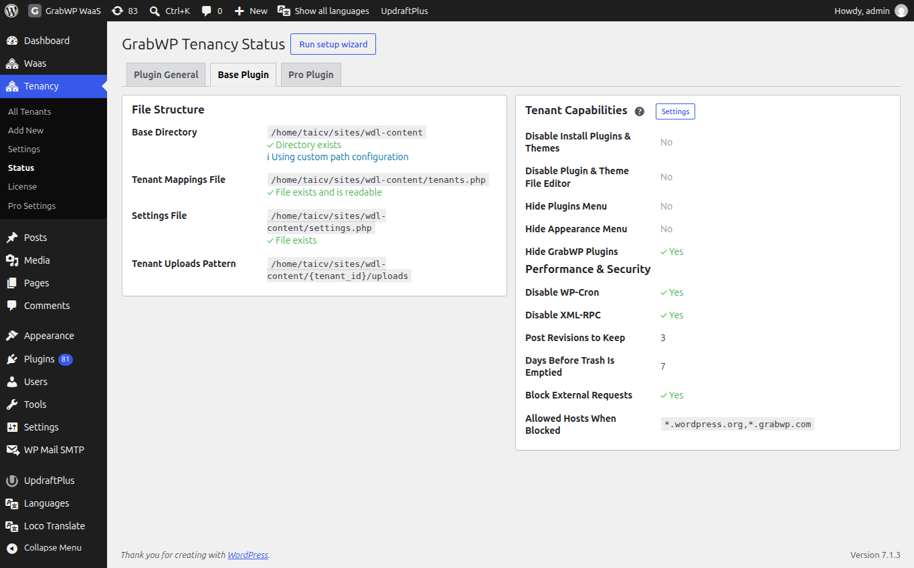
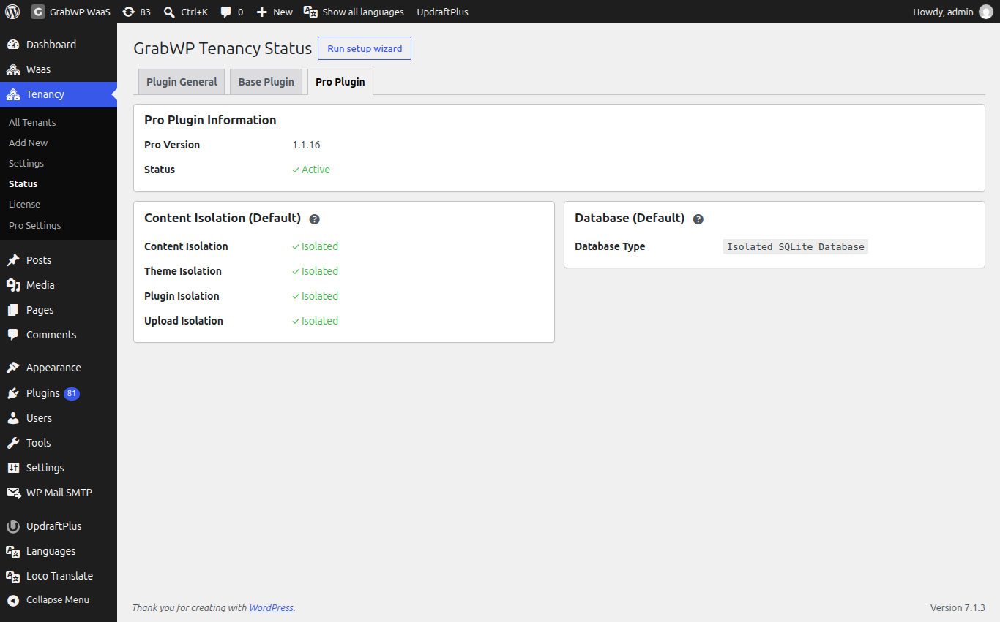

**Short answer:** install the free **GrabWP Tenancy** plugin from **Plugins > Add New**, then upload **GrabWP Tenancy Pro** if you bought it. A setup wizard opens and checks your server. When **Tenancy > Status** shows no warnings, you are ready to create sites.

**Needs:** Free (Pro is optional and needs the free plugin)

## Before you start

- WordPress 5.0 or later (tested up to 7.1).
- PHP 7.4 or later.
- An administrator account on the main site (the `manage_options` capability).
- A normal WordPress install. GrabWP is not built for WordPress Multisite and you do not need to turn Multisite on.

Not sure your hosting fits? Read [Hosting requirements](/help/hosting-requirements).

Install in this order: the free plugin, then Pro, then WaaS and any add-ons if you sell sites.

## Install the free plugin

1. Go to **Plugins > Add New**.
2. Search for **GrabWP Tenancy**.
3. Click **Install Now**, then **Activate**.

You can also download the ZIP from [wordpress.org/plugins/grabwp-tenancy](https://wordpress.org/plugins/grabwp-tenancy/) and upload it under **Plugins > Add New > Upload Plugin**.

## Install Pro

Pro does not run without the free plugin, so install that first.

1. After purchase you get an email with a **Customer Portal** link. Open it and download the Pro ZIP. If the email is missing, search your mail (and spam) for "Polar" or "GrabWP".
2. Go to **Plugins > Add New > Upload Plugin**.
3. Upload the ZIP, click **Install Now**, then **Activate Plugin**.
4. Activate your license key on **Tenancy > License**. See [Pro license](/manage-sites/licence).

Until the license is active, Pro blocks creating and editing sites with the message `Please activate your GrabWP Tenancy Pro license before managing tenants.`

## The setup wizard

When you activate a GrabWP plugin on its own from wp-admin, the **GrabWP setup** wizard opens once. Every step has a working default, and **Skip this step** and **Exit setup** are always there.

| Step | What it does |
|---|---|
| **Welcome** | Explains what GrabWP does and runs a **Server check**. Click **Fix automatically** if something is missing, then **Check again**. |
| **Routing** | Choose how visitors reach your sites: by **Path** (no DNS needed) or by **Domain** (a subdomain or the site's own domain, marked **Recommended**). Using both is set later in **Tenancy > Settings > Routing**. If `tenants.php` is missing, saving this step creates it. If the file cannot be written, the step names the real cause. See [Domains and DNS](/manage-sites/domains-and-dns). |
| **License** (Pro) | Paste your Pro key. No key yet? Skip it and activate later on **Tenancy > License**. |
| **Site defaults** (Pro) | **Choose each setting** (selected and marked **Recommended**) lets you pick the database, plugins and themes, and uploads of new sites. For plugins and themes you choose **Shared from the main site**, **Own themes**, **Own plugins** or **Own plugins and themes**. **Own plugins and themes** and **Own uploads folder** are preselected on a fresh install and marked **Recommended**. **Use the simple setup** is still there if you want one short screen. |
| **First site** | Creates your first site, with WordPress already installed. When the main site has a domain name, the **Custom domain** field suggests a subdomain made from the site title (for example `my-first-site.example.com`). It follows the title until you type your own domain. |
| **Done** | Shows the new site and its login details, then **Manage sites**: **Open site admin (1-click)**, **Visit site** and **All sites**. |

{/* TODO screenshot: setup wizard Welcome step with "Show the server checks" open (Hosting setup, Tenant file safety, System Information, Support diagnostics). No such shot exists in the admin screenshot library yet (library shots predate Base 1.1.15). */}

The **Server check** on the Welcome step shows the same checks as **Tenancy > Status > Plugin General**: the environment cards, **Hosting setup**, **Site can reach itself (loopback)**, **Tenant file safety**, **System Information** and **Support diagnostics**. They sit under **Show the server checks**, which opens by itself when something needs attention. When everything passes, the step says `Everything is ready. Nothing to do here.` **System Information** starts closed, so the step stays short. See [What the server check shows](#what-the-server-check-shows).

If **Site can reach itself (loopback)** shows **Failed**, GrabWP cannot install WordPress into new sites for you, and you finish each install in the browser instead.

To open the wizard again later, use **Run setup wizard** on **Tenancy > Status**.

## Check the Status page

Open **Tenancy > Status**. The page title is **GrabWP Tenancy Status** and it has three tabs: **Plugin General**, **Base Plugin** and **Pro Plugin**.

{/* TODO screenshot: Tenancy > Status > Plugin General on Base 1.1.15 or later, showing the Hosting setup card, Tenant file safety, the closed System Information row and Support diagnostics. The library shot used above (09-status-general) was taken on Base 1.1.12 and does not show these sections. */}

### Plugin General

These cards show the pieces GrabWP adds to your server. Expand a card for **Fix steps and install code**, **Copy Code** and **Auto Fix**.

| Card | Healthy state | What it is |
|---|---|---|
| **1. wp-config.php Loader** | **✓ Active** | A short block between `# BEGIN GrabWP Tenancy` and `# END GrabWP Tenancy` in `wp-config.php`. It loads GrabWP early so it can tell which site a visitor asked for. |
| **2. MU-Plugin** | **✓ Installed** | A must-use plugin file, `mu-grabwp-tenancy.php`, in the mu-plugins folder. |
| **3. Root .htaccess Rewrite Rules** | **✓ Installed** | A block named `GrabWP Tenancy` in the root `.htaccess`, placed before `# BEGIN WordPress`. Apache and LiteSpeed only; it makes path addresses work. |
| **Data Directory .htaccess** | **✓ Protected** | Blocks direct web access to the data folder, `wp-content/grabwp-tenancy`. |
| **index.php Protection** | **✓ Present** | A blank `index.php` so the data folder cannot be listed. |
| **Shared Files Lock** | **Locked** | Makes `wp-config.php`, `.htaccess`, `.user.ini` and `web.config` read-only so plugins on client sites cannot rewrite them. |

**Auto Fix** writes the missing piece when WordPress can write the file. If not, the card says a manual install is required: click **Copy Code** and follow the steps on the card.

Since Base 1.1.15, path addresses are routed in one rewrite pass, so pretty permalinks, REST and feed URLs of path sites also work on OpenLiteSpeed (for example on xCloud). A `.htaccess` block written by an older version shows **⚠ Invalid content** on **3. Root .htaccess Rewrite Rules**. Click **Auto Fix** once to upgrade it.

If a cache plugin on the main site needs to write one of the locked files, click **Unlock shared files**, let it save, then click **Lock shared files** again.

The lock is a separate `0444` setting. On write requests from client sites, an integrity guard watches only the pieces GrabWP owns: the loader and HTTPS proxy blocks in `wp-config.php`, the GrabWP block in `.htaccess`, the MU-plugin and the data folder protection files. If one of those pieces is removed or changed, GrabWP puts back only its own piece and keeps every other edit an admin or plugin made to `wp-config.php` or `.htaccess`. If the file itself is invalid or truncated and cannot be repaired safely, GrabWP does not replace the whole file. It keeps its protected recovery snapshot and reports the problem on **Tenancy > Status** and in the debug log. To remove a GrabWP block on purpose, first turn protection off from **Tenancy > Status**.

On Nginx the **Web Server** row in **System Information** notes `.htaccess files are not used by Nginx. Configure tenant routing in your server block instead.` See [Apache, LiteSpeed and Nginx](/help/web-server-guide).

### What the server check shows

**Plugin General** and the wizard's **Server check** show the same content, in this order:

| Section | What it tells you |
|---|---|
| **Environment Checks** | The cards in the table above. |
| **Hosting setup** | Four rows: **Multisite and wp-config.php** (the site runs as regular WordPress, with no leftover settings that stop GrabWP), **Secure address** (WordPress uses https), **HTTPS behind a proxy** (WordPress sees https from your proxy or CDN) and **Subdomains (wildcard)** (new sites at `*.your-domain` work). The header says **✓ Ready** or how many rows need attention. Some rows offer a fix button with **Undo**. See [Hosting setup checks](/help/hosting-requirements#hosting-setup-checks). |
| **Site can reach itself (loopback)** | **OK** means GrabWP can install WordPress into new sites for you. **Failed** means you finish each install in the browser. |
| **Tenant file safety** | **OK** when site admins cannot install or edit plugin and theme code. **Unsafe** when they can, with the setting, `wp-config.php` line or per-site override that allows it. See [Tenant file safety warning](/help/client-cannot-install-plugins#tenant-file-safety-warning). |
| **System Information** (closed) | Click to open. Shows GrabWP details plus WordPress, server, PHP, database, WordPress constants and writable folder values, such as **PHP Version**, **Web Server**, **WordPress Multisite**, **Data Dir Writable** and **MU-Plugins Dir Writable**. A row that needs attention is shown in red with a short note. |
| **Support diagnostics** | A summary to paste into a support request, with a **Copy diagnostics** button. See below. |

The **Hosting setup** card and **Support diagnostics** appear only on the main site.

#### Send diagnostics to support

1. Go to **Support diagnostics**, below **System Information**.
2. Click **Copy diagnostics**.
3. Paste it into your support request.

The copy includes the checks above, the **System Information** values, and up to the last 50 lines each of the GrabWP debug log and the WordPress `debug.log`. GrabWP leaves out passwords, keys, salts, emails and file paths, and removes database query text from log lines. Nothing is sent anywhere until you paste it, so read it over before you share it.

### Base Plugin

**File Structure** shows the data folder, the tenant mappings file (`tenants.php`), the settings file and where site uploads go. The capability and performance values from **Tenancy > Settings** are repeated here.

### Pro Plugin

With Pro active, **Pro Plugin Information** shows **Pro Version** and **Status** as **✓ Active**, plus the defaults for new sites. Without Pro, this tab offers **Upgrade to Pro**.

## What Pro adds to wp-admin

- **Tenancy > Pro Settings** and **Tenancy > License** in the menu.
- Extra columns on **Tenancy > All Tenants**: **Database**, **Storage**, **Isolation**.
- Extra row icons: **Plugins & Themes**, **Fix URLs**, **Backup Tenant**, **Restore Tenant**, and a Pro version of **Clone Tenant**.
- A tab bar on each site: **Edit**, **Extensions**, **Clone**, **Fix URLs**, **Backup**, **Restore**, **Settings**, **Overrides**, **Homepage**, **WP Admin**.

See [Where things are in wp-admin](/manage-sites/wp-admin-map) for the full map.

## Warnings you may see

| You see | Go to |
|---|---|
| `load.php is not included in wp-config.php.` (red, on every admin page) | [The load.php notice](/help/red-notice-load-php) |
| `MU-plugin is not installed. Tenant features may not work.` | [MU-plugin or data directory notices](/help/mu-plugin-or-data-directory-notice) |
| `Data directory is missing.` | [MU-plugin or data directory notices](/help/mu-plugin-or-data-directory-notice) |
| `Root .htaccess needs to be updated for tenant routing.` | [Path URLs return 404](/help/path-urls-return-404) |
| `Could not find the stop-editing marker in wp-config.php. Please add the line manually.` | [The load.php notice](/help/red-notice-load-php) |
| `wp-config.php has settings that stop GrabWP. Remove every line below.` (**Hosting setup**) | [Settings in wp-config.php that stop GrabWP](/help/hosting-requirements#settings-in-wp-configphp-that-stop-grabwp) |
| **Tenant file safety** shows **Unsafe** | [Tenant file safety warning](/help/client-cannot-install-plugins#tenant-file-safety-warning) |
| `GrabWP lost some of its own code in these files and put it back. Other edits were kept:` (on **Tenancy > Status**) | The integrity guard above repaired a GrabWP block. No action needed unless you removed it on purpose. |

A hosting move or a tool that rewrites `wp-config.php` can remove the loader block. Check **Tenancy > Status** after any migration.

## Deactivating or uninstalling

- Deactivating the free plugin removes the loader block, the MU-plugin and the `.htaccess` block, and unlocks the shared files. Site databases and uploads are **not** deleted. Activate it again and your sites come back.
- Deactivating Pro removes the Pro screens and clears all scheduled auto backups. Site data is not deleted.

## Related

- [Your first site](/manage-sites/first-site)
- [Pro license](/manage-sites/licence)
- [Free settings](/manage-sites/free-settings)
- [Where site data lives](/manage-sites/where-site-data-lives)
- [What to send when you ask for help](/help/getting-help)
