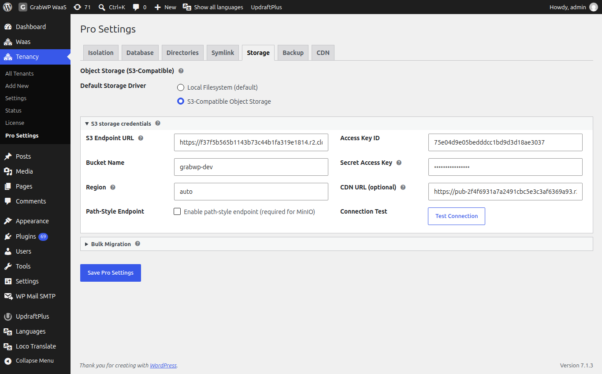

**Short answer:** by default each site's images and files stay on your server's disk. With Pro you can store them in an S3-compatible bucket instead. Add the bucket on **Tenancy > Pro Settings > Storage**, test it, then choose S3 for new sites or move existing sites' media with **Migrate uploads now**.

**Needs:** Pro (WaaS is not needed)

## How it works

There are two storage drivers:

- **Local Filesystem**: uploads stay in the site's folder on your server. This is the default.
- **S3-Compatible Object Storage**: new uploads go to your bucket. Visitors load them from your **CDN URL (optional)** or from short-lived signed links.

The platform setting is the default for new sites. Each site keeps its own driver, which you can change on its Edit screen.

Leave it on **Local Filesystem (default)** until your bucket is ready.

## Connect a bucket

Open **Tenancy > Pro Settings** and the **Storage** tab. The section is **Object Storage (S3-Compatible)**.



1. Under **Default Storage Driver**, choose **S3-Compatible Object Storage**.
2. Open **S3 storage credentials** and fill in the fields below.
3. Click **Test Connection**. You should see **Connection successful!**
4. Click **Save Pro Settings**.

| Field | Notes |
|---|---|
| **S3 Endpoint URL** | Full URL of your provider, for example `https://ACCOUNT_ID.r2.cloudflarestorage.com`. |
| **Bucket Name** | A bucket you already created, for example `grabwp-uploads`. |
| **Region** | `auto` for Cloudflare R2. Otherwise your bucket region, such as `us-east-1` or `eu-west-1`. |
| **Path-Style Endpoint** | Tick **Enable path-style endpoint (required for MinIO)** for MinIO. |
| **Access Key ID** | Your API access key. |
| **Secret Access Key** | Your API secret. On later saves, leave it blank to keep the saved one. |
| **CDN URL (optional)** | Public address for your files, for example `https://cdn.example.com`. If empty, signed links are used. |

### Provider values

| Provider | Endpoint | Region |
|---|---|---|
| Cloudflare R2 | `https://<ACCOUNT_ID>.r2.cloudflarestorage.com` | `auto` |
| AWS S3 | Regional endpoint, for example `https://s3.us-east-1.amazonaws.com` | Your bucket region |
| MinIO | Your MinIO address | Your region. Tick **Path-Style Endpoint**. |
| Backblaze B2 | `https://s3.<region>.backblazeb2.com` | Your B2 region, for example `us-west-002` |

For Cloudflare R2, turn on public access or a custom domain on the bucket, then paste that address into **CDN URL (optional)**. Provider guides: [Cloudflare R2](https://developers.cloudflare.com/r2/), [AWS S3](https://docs.aws.amazon.com/AmazonS3/latest/userguide/GetStartedWithS3.html).

**Check:** create a test site, upload an image in its media library, and confirm the image loads from your bucket or **CDN URL (optional)**.

## Choose storage for one site

Once S3 is saved, **Add New** and **Edit** show **Storage Driver** with **Local Filesystem** and **S3-Compatible Object Storage**.

- On a **new** site, pick a driver and save. No migration is needed.
- On an **existing** site, `Saving a different driver does NOT move existing files.` Click **Migrate uploads now** to move the files, which also switches the site's driver.

:::danger
Do not switch an existing site from S3 back to local without migrating. Its existing media would stop loading.
:::

## Move media for all sites

After S3 is saved and connected, **Bulk Migration** appears on the **Storage** tab.

1. Open **Bulk Migration**.
2. Click **Migrate All Tenants to S3** or **Migrate All Tenants to Local**.
3. Confirm `This will migrate uploads for ALL tenants. Continue?`
4. Wait for the result next to the buttons.

What a migration does, for one site or all:

1. Copies every file that is not already in the target.
2. If any file fails to copy, it stops. The site keeps its old driver and nothing is deleted. Fix the error and run it again.
3. When all files are copied, it updates the media addresses in the site's database and switches the site to the new driver.
4. It then **deletes the files from the old location**. Take a backup first if you want to keep them.

For big media libraries, use WP-CLI instead of the browser. It has no time limit and can keep the source files:

```bash
wp grabwp storage migrate --all --to=s3 --dry-run
wp grabwp storage migrate --all --to=s3
wp grabwp storage migrate abc123 --to=s3 --copy-only
```

`--dry-run` only lists what would be copied. `--copy-only` copies and switches the site, but keeps the original files. See [WP-CLI commands](/manage-sites/wp-cli).

The **WP-CLI reference** box in wp-admin shows the older name `wp grabwp-pro storage`. It still works and does the same thing.

**Check:** open a migrated site's media library and confirm existing images load. The **Storage** column on **Tenancy > All Tenants** shows **S3** or **Local**.

## Limits

- S3 is for site uploads (media). Plugins, themes and databases stay on your server.
- Backups can use the same bucket or a different one. See [Backup and restore](/manage-sites/backup-and-restore).
- Clone converts uploads when the source and target sites use different drivers. See [Clone a site](/manage-sites/clone-a-site).

## Related

- [Pro settings](/manage-sites/pro-settings)
- [Backup and restore](/manage-sites/backup-and-restore)
- [WP-CLI commands](/manage-sites/wp-cli)
- [Where site data lives](/manage-sites/where-site-data-lives)
