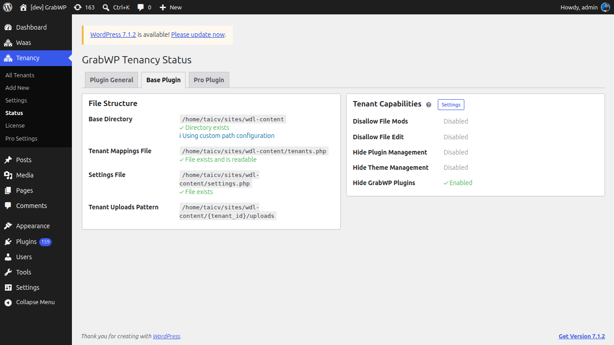

**Short answer:** GrabWP keeps everything about your sites in one data folder, by default `wp-content/grabwp-tenancy`. Each site has a subfolder named after its ID. Pro adds a config folder and, for SQLite sites, a database folder. **Tenancy > Status** warns if a folder is missing or in a risky place.

**Needs:** Free. Pro adds the config and SQLite folders.

## The data folder

Default: `wp-content/grabwp-tenancy`. Inside it:

| Path | What it holds |
|---|---|
| `tenants.php` | The list of sites, their domains and the routing mode. |
| `settings.php` | The [Free settings](/manage-sites/free-settings). |
| `{tenant_id}/uploads` | One site's images and files (when it has its own uploads folder). |
| `{tenant_id}/plugins` and `{tenant_id}/themes` | One site's own plugins and themes (Pro, when the site has its own). |
| `suspended/{tenant_id}.php` | Present while a site is blocked (Pro + WaaS). |

Sites that share uploads with the main site use the main `wp-content/uploads` folder instead. With [S3 storage](/manage-sites/s3-storage), uploads are in your bucket.

## Pro folders

| Folder | Default | What it holds |
|---|---|---|
| Pro config | `wp-content/grabwp-tenancy-pro` | `config.php` with the [Pro settings](/manage-sites/pro-settings), and one `{tenant_id}/config.php` per site with that site's Pro settings. |
| SQLite databases | `wp-content/grabwp-tenancy-sqlite` | One folder per site with its database file. |
| Domain symlinks | `wp-content/grabwp-tenancy-domains` | Only used when **Enable Domain Symlink** is on. |

You can move these folders on **Tenancy > Pro Settings > Directories** (or **Domains Directory** on the **Symlink** tab), or with constants in `wp-config.php`. Moving **Pro Config Dir** moves the per-site config files only. The main `config.php` always stays in `wp-content/grabwp-tenancy-pro`.

Sites on a MySQL database (shared or their own) keep their data in MySQL, not in these folders. See [Database options](/manage-sites/database-options).

## Check on the Status page

Open **Tenancy > Status**.

| Warning | What to do |
|---|---|
| `Data directory is missing.` | Create the folder or check its permissions, then reload the page. |
| `Data directory inside uploads/` | The data folder is inside `wp-content/uploads`, where files are easier to expose or delete by mistake. Move it (see below). |
| `Pro config directory inside uploads/` | Same, for the Pro config folder. |
| `SQLite directory inside uploads/` | Same, for the SQLite folder. |

If the folders are not writable, you cannot create sites or save settings. See [MU-plugin or data directory notice](/help/mu-plugin-or-data-directory-notice).

## Move an older folder

Older installs used `wp-content/grabwp` or `wp-content/uploads/grabwp-tenancy`. GrabWP still reads them, and the **Status** page shows `You're using a legacy path structure. To comply with WordPress standards:` with three steps:

1. Deactivate the plugin.
2. Rename and move the whole old folder to `wp-content/grabwp-tenancy`. The notice shows both paths.
3. Reactivate the plugin.

Do not move the folder while the plugin is active, and take a full backup of the files first.

**Check:** reload **Tenancy > Status**. The legacy notice is gone, and your sites open as before.

## Limits

- Back up the whole data folder (and the Pro folders) together with your database. A site is not complete without its files.
- Do not edit `tenants.php` or the config files by hand. Use wp-admin or [WP-CLI](/manage-sites/wp-cli).

## Related

- [Install GrabWP](/manage-sites/install)
- [Backup and restore](/manage-sites/backup-and-restore)
- [Pro settings](/manage-sites/pro-settings)
- [MU-plugin or data directory notice](/help/mu-plugin-or-data-directory-notice)
