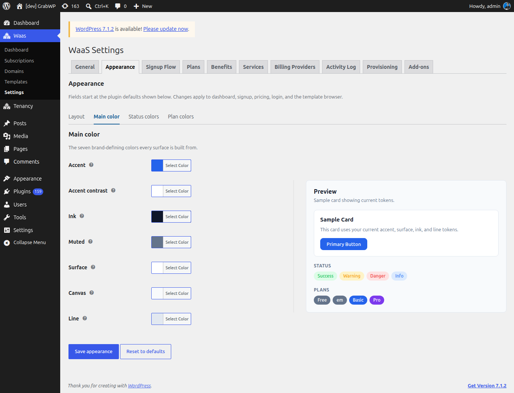

**Short answer:** **Waas > Settings > Appearance** sets the colors, corners, width and text size of everything your customers see from WaaS: signup, pricing, login, the template gallery and the customer dashboard. A live preview shows your changes before you save. It does not change the look of customer sites themselves; their theme does that.

**Needs:** Pro + WaaS

## How it works

- The page has four sub-tabs: **Layout**, **Main color**, **Status colors** and **Plan colors**. The **Preview** column stays visible on each.
- One **Save appearance** stores every sub-tab, so you do not need to save between them.
- The **Accent color** you picked in the setup wizard is the same value as **Accent** here.

## Layout

| Field | Default | Notes |
|---|---|---|
| **Corner radius** | `0.5` rem | Base radius from 0 to 2, in steps of 0.05. Smaller and larger corners scale from it. |
| **Container max-width** | `1140` px | The widest page content grows, from 720 to 1920, in steps of 10. |
| **Font size** | `1` rem | Base size from 0.5 to 2, in steps of 0.05. Other text scales from it. |

## Main color

Every screen is built from these seven colors.

| Field | Default | Used for |
|---|---|---|
| **Accent** | `#2563eb` | Main buttons, links and the active menu item. |
| **Accent contrast** | `#ffffff` | Text on accent backgrounds. |
| **Ink** | `#0f172a` | Main text. |
| **Muted** | `#64748b` | Secondary text and hints. |
| **Surface** | `#ffffff` | Card and form backgrounds. |
| **Canvas** | `#f8fafc` | The page background behind cards. |
| **Line** | `#e2e8f0` | Borders and dividers. |

## Status colors

Each status has a base color (text, icons, solid badges) and a light surface (notice backgrounds). These fields are optional.

| Field | Default | Used for |
|---|---|---|
| **Success** | `#22c55e` | Confirmations, active states and paid badges. |
| **Success surface** | `#dcfce7` | Background behind success notices and badges. |
| **Warning** | `#f59e0b` | Expiring sites, grace periods and cautions. |
| **Warning surface** | `#fef3c7` | Background behind warning notices and badges. |
| **Danger** | `#ef4444` | Errors, destructive actions and suspended sites. |
| **Danger surface** | `#fee2e2` | Background behind error notices and badges. |
| **Info** | `#3b82f6` | Neutral notices, trials and information badges. |
| **Info surface** | `#dbeafe` | Background behind information notices and badges. |

## Plan colors

Each plan gets a **Badge background** and a **Label text** color. The badges show on the dashboard, the pricing table and the signup form. If the sub-tab says no plans exist, create one first on [Plans](/sell-sites/plans).

| Plan slug | Badge background | Label text |
|---|---|---|
| `free` | `#64748b` | `#ffffff` |
| `basic` | `#2563eb` | `#ffffff` |
| `pro` | `#7c3aed` | `#ffffff` |
| Any other slug | `#64748b` | `#ffffff` |

## Preview

**Preview** is titled **Sample card showing current tokens.** It shows:

- a **Sample Card** with the line "This card uses your current accent, surface, ink, and line tokens." and a **Primary Button**,
- **Status** badges for **Success**, **Warning**, **Danger** and **Info**,
- **Plans** badges, one per plan.

Color and corner changes show in the preview before you save. **Container max-width** is saved but not drawn in the sample card.

## Save or reset

1. Change any sub-tab.
2. Click **Save appearance**. The notice **Settings saved.** appears, and the signup page and customer dashboard use the new look.

**Reset to defaults** clears your changes and returns every field to the defaults above.

## Languages and right-to-left (RTL)

- GrabWP Tenancy, Pro, WaaS and the Sepay add-on include translations for Arabic, Spanish, French, Indonesian, Vietnamese and Simplified Chinese. They follow the WordPress site language.
- Since WaaS 1.1.20, Arabic and other right-to-left languages get a mirrored layout on the customer dashboard, signup, pricing, the template gallery and preview, the WaaS admin screens and the emails.
- To translate plan, benefit and service names, use Polylang or WPML String Translation. The strings are in the group "GrabWP WaaS". To change a specific wording, a plugin such as Loco Translate works.
- On customer sites, right-to-left display depends on the theme and CSS installed on that site.

## Related

- [Frontend pages](/sell-sites/frontend-pages)
- [Signup flow](/sell-sites/signup-flow)
- [Plans](/sell-sites/plans)
- [Emails](/sell-sites/emails)
