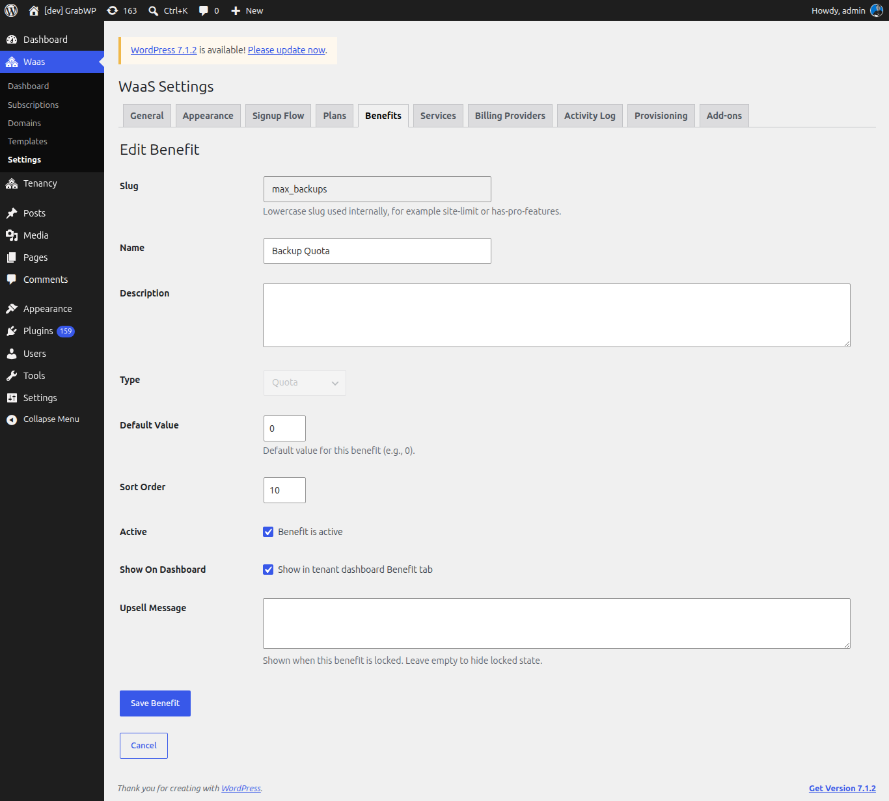
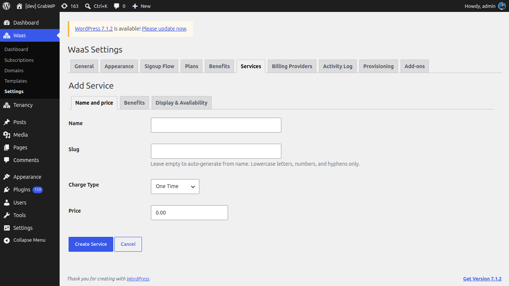
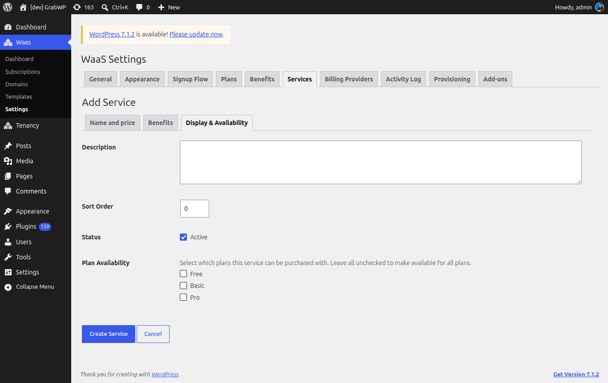

**Short answer:** a benefit is something a site gets, like a number of backups or permission to use a custom domain. A service is a paid extra customers can buy on top of their plan. The **Add-ons** tab is something else: a catalog of GrabWP plugins (such as the Stripe add-on) that you download and install.

**Needs:** Pro + WaaS

## How it fits together

- You create **benefits** once, then give each plan a value for each benefit (for example **Backup Quota** 3 on one plan, 10 on another).
- You create **services** with their own price and the benefits they add. Customers buy them at signup (**Optional Services** step) or later on the dashboard **Service** tab.
- Customers see their benefits on the dashboard **Benefit** tab, each marked **Included** or **Locked**.

## Benefits

Go to **Waas > Settings > Benefits**.

The list columns are **Benefit**, **Slug**, **Type**, **Default Value**, **Status**, **Order** and **Actions**. **Edit** opens the benefit. **Delete** asks **Delete this benefit?** System benefits show a **System** badge and cannot be deleted.

### Add a benefit

1. Click **Add New**.
2. Fill the form below.
3. Click **Create Benefit**. The notice **Benefit saved.** appears and the row is on the list.

| Field | Notes |
|---|---|
| **System Capability** | **Custom benefit...** or one of the built-in capabilities below. Shown only when creating. Choosing one fills the slug and locks the type. A capability that already exists is left out of the list. |
| **Slug** | Lowercase letters, numbers and hyphens. Read-only after save. |
| **Name** | The label customers and plan forms use. |
| **Description** | Shown on the customer **Benefit** tab. |
| **Type** | **Quota**, **Flag** or **Custom HTML**. Locked for a system capability. |
| **Default Value** | Quota: a number. Flag: **Enabled by default**. Custom HTML: the visual editor. |
| **Sort Order** | Whole number, 0 or more. Lower numbers are listed first. |
| **Active** | **Benefit is active**. Inactive benefits are left out of plan and service forms. |
| **Show On Dashboard** | **Show in tenant dashboard Benefit tab**. |
| **Upsell Message** | Text shown when the benefit is locked. Leave it empty to show no message. |

### Edit a benefit

Click the benefit name or the edit icon. **Slug** is read-only, and on a system benefit **Type** is locked. Click **Save Benefit**, or **Cancel** to go back.

### Benefit types

| Type | What you store | What the customer sees when it is included |
|---|---|---|
| **Quota** | A number | A limit. **Backup Quota** and **Storage (MB)** also show usage, as "3 of 10 used". Other quotas show "10 included". |
| **Flag** | On or off | **Included** when the value is on. For the system flags, the related tools open inside the benefit panel. |
| **Custom HTML** | HTML from the editor | That HTML, when the site's value is not empty. |

### System capabilities

| Name | Slug | Type | What the customer panel shows |
|---|---|---|---|
| **Backup Quota** | `max_backups` | Quota | Backup tools, with usage against the quota. |
| **Storage (MB)** | `storage_mb` | Quota | Storage usage in megabytes. |
| **Custom Domains** | `allow_custom_domain` | Flag | Custom domain tools when the flag is on. |

## Services

Go to **Waas > Settings > Services**. Services are separate from the **Add-ons** plugin catalog.

The columns are **Name**, **Slug**, **Charge Type**, **Price**, **Status**, **Sort Order** and **Actions**. A recurring price shows as monthly and yearly amounts. Click the name to edit. **Delete** asks **Are you sure you want to delete this service?** If the service is in use, the notice is **Failed to delete service. It may be in use.**

### Add a service

Click **Add New**. The form has three tabs: **Name and price**, **Benefits** and **Display & Availability**. Click **Create Service** (or **Save Service** when editing). The notice **Service saved.** appears and the row shows the charge type and **Active** or **Inactive**.

**Name and price**

| Field | Notes |
|---|---|
| **Name** | Customer-facing name. |
| **Slug** | Leave empty to generate it from the name. Lowercase letters, numbers and hyphens. Read-only after save. |
| **Charge Type** | **One Time**, **Non-Recurring** or **Recurring**. |
| **Price** | For **One Time** and **Non-Recurring**. Not billed on a renewal cycle. |
| **Monthly Price**, **Yearly Price** | For **Recurring**. In your primary currency; a secondary-currency estimate shows when one is set. |
| **Billing Cycle** | **Monthly** or **Yearly**, for **Recurring**. This is the service's own cycle. |

For a **Recurring** service, a payment provider that needs its own IDs adds a section under the prices. With Stripe, the heading is **Stripe Configuration**, with **Resync**, **Monthly Price ID**, **Yearly Price ID** and **Find existing**. Leave an ID blank and WaaS creates it on save when Stripe is configured, or paste your own.

**Benefits**

The intro line is **Specify which benefits this service provides.** Quotas take a number, flags take **None**, **Yes** or **No**, and custom benefits use the editor. The same table is on **Edit Service**.

**Display & Availability**

| Field | Notes |
|---|---|
| **Description** | Shown on service cards. |
| **Sort Order** | Whole number, 0 or more. Lower numbers are listed first. |
| **Status** | **Active**. Inactive services are not offered. |
| **Plan Availability** | Check the plans that may sell this service. Leave every box unchecked to offer it on all plans. |

## Attach benefits and services to a plan

1. Open **Waas > Settings > Plans** and edit a plan (or click **Add New**).
2. Open **Benefits & Services**.
3. Under **Benefits**, set a value for each active benefit: a number for a quota, **Enabled** for a flag, the editor for custom HTML.
4. Under **Available Services**, check the services this plan may sell. Leave every box unchecked to allow all services (the same rule as **Plan Availability** on the service).
5. Save the plan, then reopen the tab to confirm the values stayed.

More plan fields are on [Plans](/sell-sites/plans).

## What customers see

On the customer dashboard, the tabs are **Benefit** and **Service**.

**Benefit** lists benefits that have **Show On Dashboard** checked, each **Included** or **Locked**.

- Included **Backup Quota**, **Storage (MB)** and **Custom Domains** show their tools in the panel.
- A **Manage** link shows when a benefit points at **Plan & Billing**, **Overview** or **Service**.
- A locked benefit shows **Locked** and your **Upsell Message**, if set. If a service the customer can still buy grants that benefit, the button is **Buy Service**. Otherwise the link is **Plan & Billing**.
- With nothing to show, the tab says **No benefits are available for this site yet.**

**Service** has two sections:

- **Active Services**. Recurring ones show a **Recurring** badge and **Renews** or **Ends** with a date. **Cancel** asks **Cancel this service? It will keep working until the end of your current billing period, then stop.** The confirm button is **Cancel service**.
- **Available Services**. Cards show the description, price (or **Free**) and **Buy**. A recurring service with both prices shows **Billing cycle** with **Monthly** and **Yearly**.

With nothing in either section, the tab says **No services are active or available for your plan.**

At signup, services show on the **Optional Services** step. Card text follows that step's **Details** setting (**Description** or **Benefits**). See [Signup flow](/sell-sites/signup-flow).

## Add-ons tab

**Waas > Settings > Add-ons** lists GrabWP plugins you can install, grouped by category. It does not create services. Each card shows the name, a badge, a short description and a version.

| Badge | Meaning |
|---|---|
| **Available** | Not installed. The card has **Download ZIP**. |
| **Installed** | Installed but not active. |
| **Active** | The plugin is active. |
| **Update available** | Shown next to the state badge when a newer version is out. |
| **Requires WaaS Update** | The add-on needs a newer WaaS. The card shows the WaaS version it needs and offers no download. |

**To install an add-on**

1. Activate your Pro license under **Tenancy > License**. Downloads need it, and you need permission to install plugins.
2. Click **Download ZIP** on the card.
3. Install it with **Plugins > Add New > Upload Plugin**, then activate it. The card badge changes to **Active**.

**To update an add-on**, click **Update now** on its card. It needs an active license; without one, the card links to **Activate your license to update**. **Check for updates** at the top of the tab refreshes the catalog.

If the catalog is empty, the tab says **No add-ons available right now.**

## Related

- [Plans](/sell-sites/plans)
- [Signup flow](/sell-sites/signup-flow)
- [Payments](/sell-sites/payments)
- [Client custom domains](/sell-sites/client-domains)
