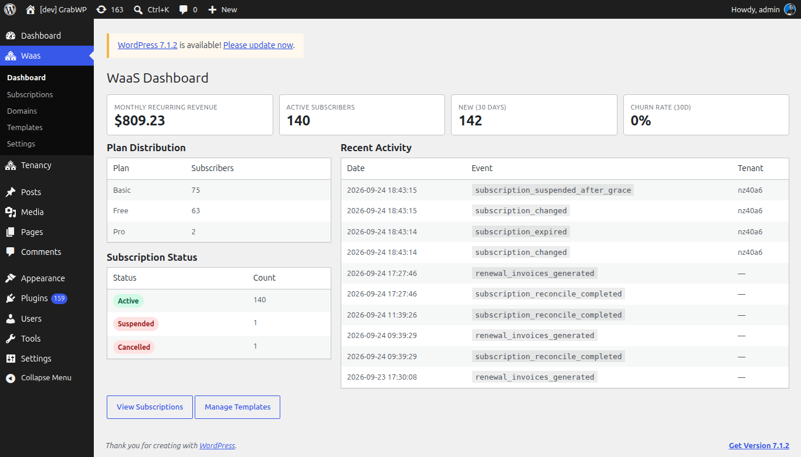

**Short answer:** **Waas > Dashboard** shows your revenue, subscriber, signup, churn and trial numbers at a glance. **Waas > Settings > Activity Log** lists what happened and when. **Waas > Settings > Provisioning** shows site builds still in progress or failed, with **Retry** and **Dismiss** buttons.

**Needs:** Pro + WaaS

## WaaS Dashboard

Go to **Waas > Dashboard**. The page heading is **WaaS Dashboard**.

### Summary cards

| Card | Notes |
|---|---|
| **Monthly Recurring Revenue** | Current monthly recurring revenue. It always shows a `$` sign, whatever your currency. |
| **Active Subscribers** | Number of active subscriptions. |
| **New (30 days)** | Signups in the last 30 days. |
| **Churn Rate (30d)** | Churn over the last 30 days, in percent. |

Four more cards track built-in trials: **Trials started**, **Trials converted**, **Trials expired** and **Trial conversion rate**.

{/* TODO screenshot: WaaS Dashboard with the trial cards */}

### Panels

- **Plan Distribution**: **Plan** and **Subscribers**, shown once a plan has subscribers.
- **Subscription Status**: **Status** and **Count**. Click a status badge to open **Waas > Subscriptions** filtered to it. See [Free trials and subscriptions](/sell-sites/trials-and-subscriptions).
- **Recent Activity**: **Date**, **Event** and **Tenant** for the latest events. The full list is on **Activity Log**.

**View Subscriptions** opens the subscriptions list and **Manage Templates** opens the templates. To reopen the setup wizard, use **Run setup wizard** on **Tenancy > Status**.

## Activity log

Go to **Waas > Settings > Activity Log**.

| Column | Notes |
|---|---|
| **Date** | When the event was recorded. Sortable. |
| **Event** | The event code. Sortable. |
| **Actor** | `cron`, another actor type, or the WordPress user's display name. |
| **Tenant** | The site ID, when the event has one. |
| **Details** | A short summary. Hover the cell for the full data. |
| **IP** | The request IP, when recorded. |

Pick an event in the dropdown and click **Filter**. **All events** clears the filter. The dropdown lists `tenant_created`, `tenant_deleted`, `tenant_updated`, `token_generated`, `api_request`, `settings_changed`, `subscription_created`, `subscription_changed` and `webhook_received`. Other events, such as renewals or trial events, still show under **All events**.

How long rows are kept is **Retention (days)** under **Waas > Settings > General**, **Retention and grace period** (7 to 365, default 90).

## Provisioning

Go to **Waas > Settings > Provisioning**. The page is titled **Provisioning Intents**. Each row is one job that builds or updates a site after a signup, an upgrade or a service purchase.

| Column | Notes |
|---|---|
| **Intent ID** | The job ID. |
| **Flow** | **Signup**, **Upgrade**, **Service purchase** or **Renewal invoice**. |
| **State** | The current state, as a badge. |
| **Clone Progress** | Step and total (`step / total`) while a template copy runs. |
| **Last Error** | The latest error, if any. |
| **Retries** | How many retries so far. |
| **Updated** | The last update time. |
| **Actions** | **Retry** and **Dismiss**. |

Filter with **All active states** or one state, then click **Filter**. Finished jobs are not in this list.

| State | Meaning |
|---|---|
| `checkout_pending` | Checkout has not finished yet. |
| `payment_confirmed` | Payment is confirmed and the build continues. |
| `finalizing` | The job is finishing the site. |
| `tenant_created` | The site exists and later steps are still running. |
| `clone_running` | A template copy is in progress. **Clone Progress** shows the step. |
| `failed_retriable` | The job failed and can run again. |

An hourly job re-queues stuck signups by itself, up to 12 retries. How a signup turns into a site is on [How WaaS works](/sell-sites/how-waas-works).

### Retry a build

**Retry** shows for `failed_retriable` and `clone_running`. Click it on the row. The notice is **Intent re-queued for retry.** The job goes back to `failed_retriable` with **Retries** reset to 0 and runs again.

### Dismiss a build

Click **Dismiss** and confirm **Mark this intent as dismissed (failed_terminal)?** The notice is **Intent dismissed.** and the job leaves the list.

## Check that it works

1. The summary cards show on **Waas > Dashboard**, and **View Subscriptions** opens the list.
2. On **Activity Log**, choose `subscription_changed` and click **Filter**: only that event shows. **All events** brings the full list back.

## Related

- [How WaaS works](/sell-sites/how-waas-works)
- [Free trials and subscriptions](/sell-sites/trials-and-subscriptions)
- [Statuses](/sell-sites/statuses)
- [WaaS settings](/sell-sites/waas-settings)
