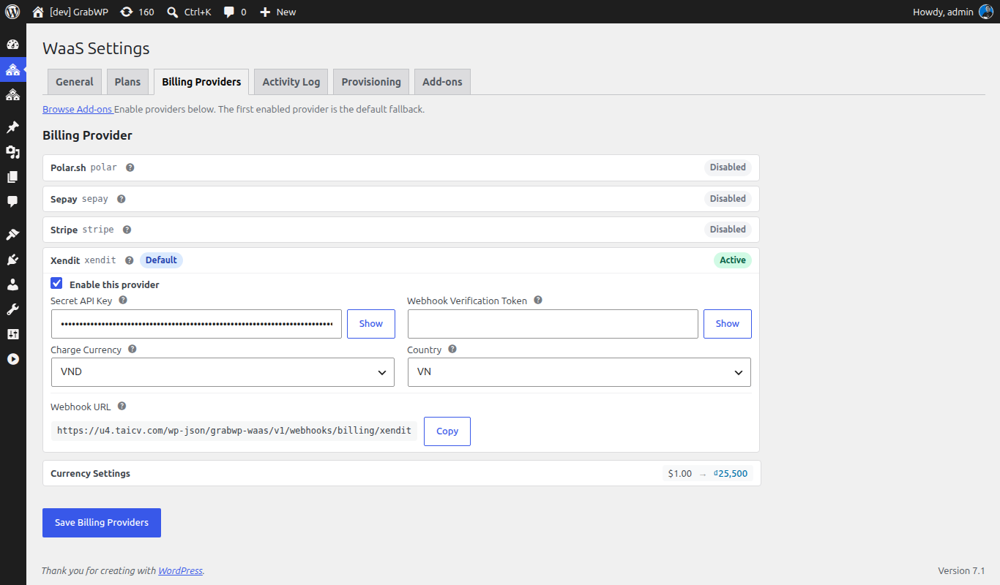

**Short answer:** WaaS takes payments through a provider you connect under **Waas > Settings > Billing Providers**. **Polar.sh** and **WooCommerce** are built in; **Stripe**, **Sepay** and **Xendit** need their add-on plugin. You can also start without any provider by offering a Free plan or a built-in free trial.

**Needs:** Pro + WaaS

Stripe, Sepay and Xendit each also need their add-on plugin, listed in their section below.

## Which provider fits

| Provider | How it ships | How customers pay | Renews by itself | Notes |
|---|---|---|---|---|
| **Polar.sh** | Built into WaaS | Polar checkout | Yes | Can run its own trials. |
| **WooCommerce** | Built into WaaS, needs the WooCommerce plugin | Your WooCommerce checkout and its gateways | Only with WooCommerce Subscriptions | Locks your primary currency to the store currency. |
| **Stripe** | Add-on: GrabWP Tenancy Stripe | Stripe Checkout | Yes | Can run its own trials (at least 48 hours). |
| **Sepay** | Add-on: GrabWP Tenancy Sepay | Vietnamese bank transfer by QR code | No: customers get renewal reminders | Needs VND as primary or secondary currency. |
| **Xendit** | Add-on: GrabWP Tenancy Xendit | Xendit checkout | Yes | No product IDs on plans. |

With a provider that does not renew by itself, customers pay each renewal from the reminder email or the dashboard. Install add-ons from **Waas > Settings > Add-ons** (see [Benefits, services and add-ons](/sell-sites/benefits-and-add-ons#add-ons-tab)).

## The Billing Providers screen

Go to **Waas > Settings > Billing Providers**.

The top line reads **Enable providers below. The first enabled provider is the default fallback.**, next to a **Browse Add-ons** link.

- Each provider is a card. A card is **Disabled** until you tick **Enable this provider**.
- **Polar.sh** shows **Needs Config** until **API Token** and **Webhook Secret** are saved, then **Active**. Other enabled providers show **Active**.
- The fallback provider (the first one enabled) has a **Default** badge. It is used when signup does not pick another provider.
- Click **Save Billing Providers** after filling the fields. The notice is **Billing provider settings saved.**
- Cards with a webhook have a **Webhook URL** with a **Copy** button. Hover the help icon next to it to see **Last webhook received** with a time, or **No webhook events received yet.**

Webhook URLs look like `https://yoursaas.com/wp-json/grabwp-waas/v1/webhooks/billing/polar`, ending in `polar`, `stripe`, `sepay` or `xendit`. Use **Copy** instead of typing them.

## Currency settings

**Currency Settings** is the card under the providers. Set it before you enable a provider that needs a specific currency.

| Field | Notes |
|---|---|
| **Primary Currency** | Shown on pricing pages. Plan prices are stored in it. Default `USD`. With WooCommerce enabled it is locked: "Locked to WooCommerce store currency". Change it in **WooCommerce > Settings > General**. |
| **Secondary Currency** | Optional. **None (single currency)** keeps one currency. Set it when a provider needs a different currency (Sepay needs VND). |
| **Exchange Rate** | How many secondary units equal 1 primary unit (default `25500`). Used before charging a provider that needs the secondary currency. Polar.sh and Stripe charge in their own catalog currency and do not use it. |
| **Display formatting** | **Currency Position**, **Thousand Separator**, **Decimal Separator**. |

**Currency Position** options: **Left ($99.99)**, **Left with space ($ 99.99)**, **Right (99.99$)**, **Right with space (99.99 $)**.

A provider that needs a currency cannot be enabled until that currency is primary or secondary. The error starts with **Currency change blocked:**

## Polar.sh

**Needs:** Pro + WaaS

**1. Prepare Polar**

1. Create an account at [polar.sh](https://polar.sh) and an organization.
2. In the organization settings, create an API token.
3. Copy the organization ID.

You do not need to create products in Polar by hand. Saving a plan with Polar configured can create them.

**2. Connect it**

1. On the **Polar.sh** card, tick **Enable this provider**.
2. Fill the fields:

   | Field | Value |
   |---|---|
   | **API Base URL** | `https://api.polar.sh/v1` for live payments. Sandbox: `https://sandbox-api.polar.sh/v1`. |
   | **API Token** | Your Polar API token. **Show** reveals it. |
   | **Webhook Secret** | The secret Polar signs webhooks with. |
   | **Organization ID** | Your Polar organization ID. |

3. Copy the **Webhook URL** with **Copy**.
4. In Polar, add that URL as a webhook endpoint and use the same secret as in **Webhook Secret**.
5. Click **Save Billing Providers**. The card changes from **Needs Config** to **Active**.

**3. Link your plans**

1. Go to **Waas > Settings > Plans**, edit a paid plan and open **Payment Configuration**.
2. Leave **Polar Monthly Product ID** and **Polar Yearly Product ID** blank so WaaS creates them, paste product UUIDs, or click **Find existing**.
3. Click **Save Plan**.

**Resync** under **Polar.sh Configuration** refreshes the linked products. A value WaaS created shows **Auto-created**.

## Stripe

**Needs:** add-on: GrabWP Tenancy Stripe

1. Install and activate the add-on.
2. On the **Stripe** card, tick **Enable this provider** and fill **Secret Key**, **Publishable Key** and **Webhook Signing Secret**. **Thin Signing Secret (v2 Events)** is optional.
3. Copy the **Webhook URL** and add it as a webhook endpoint in your Stripe dashboard. Send at least these events: `checkout.session.completed`, `customer.subscription.updated`, `customer.subscription.deleted`, `invoice.paid` and `charge.refunded`.
4. Click **Save Billing Providers**.
5. On each paid plan, open **Payment Configuration** and leave **Stripe Monthly Price ID** and **Stripe Yearly Price ID** blank so WaaS creates them, or paste your own price IDs, then **Save Plan**.

Recurring services get their own **Stripe Configuration** section on the service form. See [Benefits, services and add-ons](/sell-sites/benefits-and-add-ons#add-a-service).

## Sepay

**Needs:** add-on: GrabWP Tenancy Sepay

Sepay takes Vietnamese bank transfers by QR code and confirms them through its webhook. It does not renew by itself: customers get renewal reminders and pay again.

1. Set VND as **Primary Currency** or **Secondary Currency** first (see [Currency settings](#currency-settings)). Without it, checkout stops with "Sepay requires VND currency. Please set VND as primary or secondary currency in WaaS settings first."
2. Install and activate the add-on.
3. On the **Sepay** card, tick **Enable this provider** and fill:

   | Field | Notes |
   |---|---|
   | **API URL** | Default `https://my.sepay.vn`. |
   | **QR URL** | Default `https://qr.sepay.vn/img`. |
   | **API Key** | From your Sepay account. |
   | **Bank**, **Account Number**, **Account Holder** | The account customers pay into. |
   | **Payment Code Prefix** | Default `DH`. Starts the code customers put in the transfer note. |

4. Copy the **Webhook URL** into your Sepay account.
5. Click **Save Billing Providers**.

Sepay adds no product ID fields to plans; the amount comes from the plan price.

## Xendit

**Needs:** add-on: GrabWP Tenancy Xendit

1. Install and activate the add-on.
2. On the **Xendit** card, tick **Enable this provider** and fill **Secret API Key** and **Webhook Verification Token**.
3. Set **Charge Currency** (`IDR` by default; also `PHP`, `VND`, `THB`, `SGD`, `MYR`, `USD`) and **Country** (Indonesia by default; also the Philippines, Vietnam, Thailand, Singapore and Malaysia).
4. Copy the **Webhook URL** into your Xendit dashboard.
5. Click **Save Billing Providers**.

Xendit adds no product ID fields to plans.

## WooCommerce

**Needs:** Pro + WaaS

You also need the free WooCommerce plugin. Checkout runs on your own WooCommerce checkout page, with any WooCommerce payment gateway (card, PayPal, bank transfer and others). WaaS puts the plan price on one shared hidden product, the anchor product. Plans do not store WooCommerce product IDs.

**1. Install WooCommerce**

1. Go to **Plugins > Add New**, install and activate **WooCommerce**, and finish its setup wizard, including the store currency. See [WooCommerce: getting started](https://woocommerce.com/document/woocommerce-getting-started/).
2. In **WooCommerce > Settings > Payments**, turn on the gateways you want.

**2. Enable the provider**

1. On **Waas > Settings > Billing Providers**, open the **WooCommerce** card. It shows only while WooCommerce is active, with the description **WordPress-native checkout powered by WooCommerce.**
2. Tick **Enable this provider**.
3. Leave **Anchor Product** at `0` to create the product on the first checkout, or enter an existing product ID.
4. Click **Save Billing Providers**. The card shows **Active**.

The card has no **Webhook URL**: WooCommerce updates WaaS from its own order events.

**3. Create or repair the anchor product (optional)**

1. On **Waas > Settings > General**, open **Repair tools**.
2. Click **Create/Repair WooCommerce Anchor Product**. The notice **WooCommerce anchor product is ready.** shows the product ID.

The anchor product must stay purchasable. Otherwise checkout fails with **The WaaS anchor product is not available for purchase.**

**What the customer does:** they pick a paid plan on signup, WaaS adds the anchor product to the cart with the plan price, the customer pays on the WooCommerce checkout, and WaaS builds the site once the order is paid.

**Renewals.** For WooCommerce to own the renewal schedule, install [WooCommerce Subscriptions](https://woocommerce.com/products/woocommerce-subscriptions/). Without it, checkout still works but renewals are not synced (the message is **WooCommerce Subscriptions is not active.**), so handle renewals with the admin actions on [Free trials and subscriptions](/sell-sites/trials-and-subscriptions#admin-actions).

## Test a payment

1. For Polar.sh, set **API Base URL** to `https://sandbox-api.polar.sh/v1` and use sandbox credentials. For other providers, use their test mode.
2. In a private window, sign up for a paid plan and finish checkout.
3. Check that the **Webhook URL** help tip shows a last-received time (not for WooCommerce).
4. Check the new site under **Tenancy > All Tenants** and the subscription under **Waas > Subscriptions**.
5. Switch back to live settings (for Polar.sh, `https://api.polar.sh/v1`) before you launch.

## Bank transfer and offline payments

There is no built-in checkout where customers submit a bank transfer reference for you to approve. Today you can:

- use WooCommerce with its bank transfer or cash on delivery gateways, or
- let customers start on a built-in free trial or a zero-priced plan, and once you confirm their payment, use **Convert manually (paid offline, days)**, **Change Plan** or **Extend Period** on **Waas > Subscriptions**.

To ask whether something is planned, see the [GrabWP roadmap](https://grabwp.com/roadmap).

## Discount codes

With the **GrabWP Tenancy Discounts** add-on, customers enter discount codes at WaaS signup. Manage codes under **Waas > Discounts**. While a WaaS checkout runs, Polar's own discount field and WooCommerce cart coupons are hidden, so a provider coupon cannot change the price behind WaaS's back.

## Check that it works

1. The provider you charge with shows **Active**.
2. **Currency Settings** includes every currency that provider needs.
3. Each paid plan has a product or price ID on **Payment Configuration** for each cycle you sell, or you saved it once so WaaS could create them.

## Related

- [Plans](/sell-sites/plans)
- [Free trials and subscriptions](/sell-sites/trials-and-subscriptions)
- [Go-live checklist](/sell-sites/go-live-checklist)
- [WaaS settings](/sell-sites/waas-settings)
