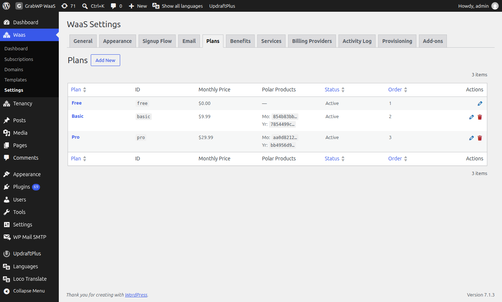
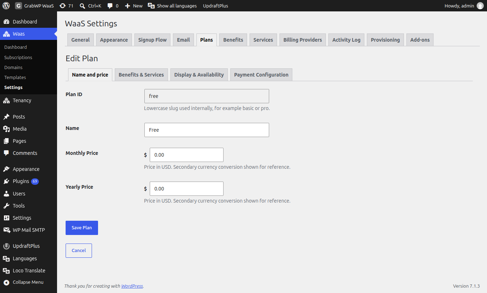
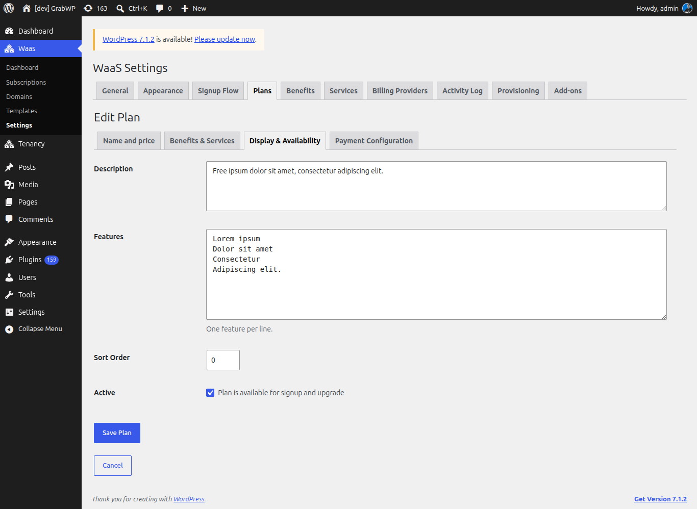
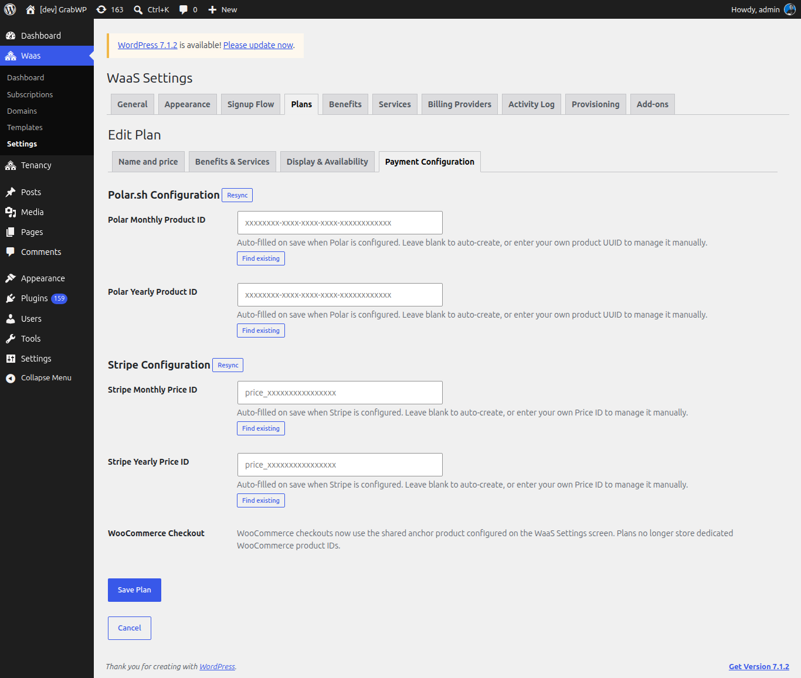

**Short answer:** plans are what customers choose at signup. WaaS creates three to start with: **Free** (active) and **Basic** and **Pro** (inactive until you set them up). Edit them under **Waas > Settings > Plans**, set the prices and limits, and tick **Active** when a paid plan is ready to sell.

**Needs:** Pro + WaaS

## How plans work

A plan holds:

- a monthly price and a yearly price (`0` means that cycle is free),
- benefit values, such as how many backups the site may keep or whether custom domains are allowed,
- which optional services can be bought with it,
- the text shown on the pricing page,
- an optional free trial,
- the product or price IDs your payment provider uses.

A fresh install seeds **Free**, **Basic** and **Pro** when the plans table is empty. Only **Free** starts active: paid plans wait until you have a payment provider or a free trial set up. The **free** plan cannot be deleted (notice: **The free plan cannot be deleted.**).

## Open the plans list

Go to **Waas > Settings > Plans**.

The list columns are **Plan**, **ID**, **Monthly Price**, **Polar Products**, **Status**, **Order** and **Actions**. Click **Add New** to create a plan. The pencil icon opens **Edit Plan**. The trash icon deletes any plan except **free**.

## Edit a plan

The **Add Plan** and **Edit Plan** screens have four tabs. Click **Create Plan** on a new plan, or **Save Plan** when editing. **Cancel** returns to the list. The notice **Plan saved.** confirms the save.

### Name and price

| Field | Notes |
|---|---|
| **Plan ID** | Lowercase letters, numbers and hyphens, for example `basic` or `pro`. Read-only after the plan is created. |
| **Name** | The label customers see. |
| **Monthly Price** | In your primary currency. `0` means the monthly cycle is not charged. |
| **Yearly Price** | Same rules as monthly. |
| **Built-in trial** | Shown only for a plan with a price. **Offer a free trial that needs no payment and no payment provider**, with **Trial length (days)** (1 to 365, default 14). |
| **Provider trial (days)** | Shown only when a provider that supports trials (Polar.sh or Stripe) is available. `0` turns it off. |

If a secondary currency is set, the converted amount shows next to each price for reference. Currency is set on [Payments](/sell-sites/payments#currency-settings). How the two trial types work is on [Free trials and subscriptions](/sell-sites/trials-and-subscriptions).

### Benefits & Services

| Section | Notes |
|---|---|
| **Benefits** | Columns **Benefit**, **Type**, **Value**. Flags use an **Enabled** checkbox, quotas take a number, custom benefits use the editor. |
| **Available Services** | Check the services customers may buy on this plan. Leave all unchecked to allow every active service. |

If there are no services yet, the form links to **Create a service**. Define your benefits and services first on [Benefits, services and add-ons](/sell-sites/benefits-and-add-ons), then come back here to set values.

The seeded plans start with these benefit values: **Free** allows 1 backup and no custom domain, **Basic** 3 backups and custom domains, **Pro** 10 backups and custom domains. Change them to fit what you sell.

### Display & Availability

| Field | Notes |
|---|---|
| **Description** | Shown with the plan. |
| **Features** | One feature per line. Shown on the plan card. |
| **Sort Order** | Lower numbers appear first. |
| **Active** | **Plan is available for signup and upgrade**. |

Inactive plans stay in the list with status **Inactive** and are not offered at signup.

### Payment Configuration

Open this tab after you enable a payment provider. You can save the plan now and come back after [Payments](/sell-sites/payments).

Providers that keep a product catalog show a heading such as **Polar.sh Configuration** or **Stripe Configuration**, with a **Resync** button.

| Field | Notes |
|---|---|
| **Polar Monthly Product ID**, **Polar Yearly Product ID** | Leave blank and save: WaaS creates the products in Polar when Polar.sh is configured. Or paste a product UUID. |
| **Stripe Monthly Price ID**, **Stripe Yearly Price ID** | Shown when the Stripe add-on is active. Same leave-blank-to-create behavior. |

Under each ID, **Find existing** searches the provider catalog. A value WaaS created is badged **Auto-created**; a value you typed is badged **Manual**.

- **WooCommerce Checkout** stores no product ID on the plan. The form says: "WooCommerce checkouts now use the shared anchor product configured on the WaaS Settings screen. Plans no longer store dedicated WooCommerce product IDs."
- Sepay and Xendit add no product ID fields. The amount comes from the plan price.

## Limit a template to some plans

A template's **Allowed Plans** setting can limit which plans may use it. See [Templates](/sell-sites/templates).

## Check that it works

1. **Free** is **Active** with both prices at `0`, and it has no delete icon.
2. Each plan you sell is **Active** with a monthly or yearly price above `0`.
3. **Sort Order** matches the order you want on the pricing page.
4. Paid plans have IDs on **Payment Configuration** for each cycle you sell, or you saved them once with the provider configured.

## Related

- [Benefits, services and add-ons](/sell-sites/benefits-and-add-ons)
- [Payments](/sell-sites/payments)
- [Free trials and subscriptions](/sell-sites/trials-and-subscriptions)
- [Appearance](/sell-sites/appearance) (plan badge colors)
