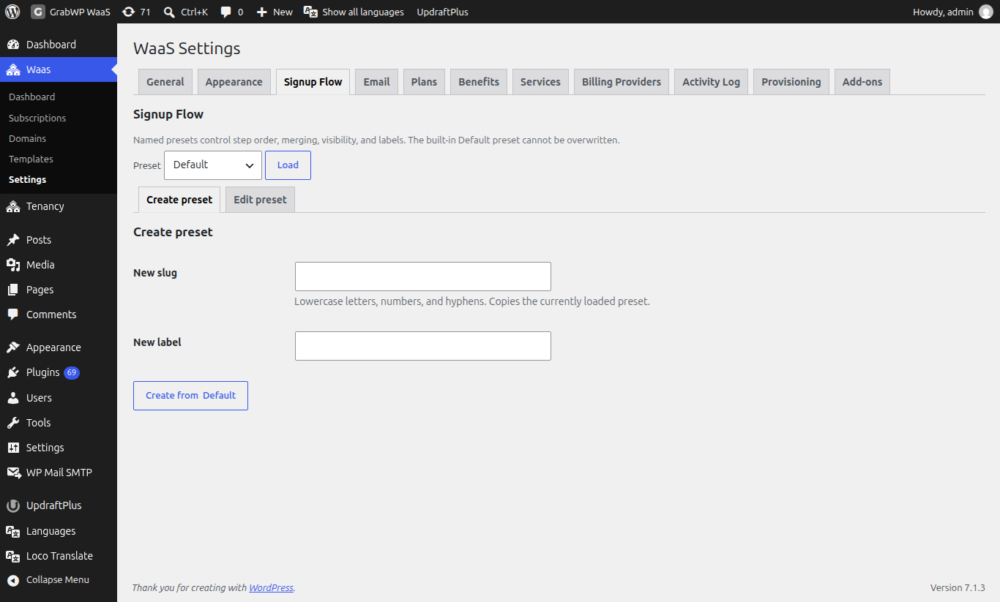
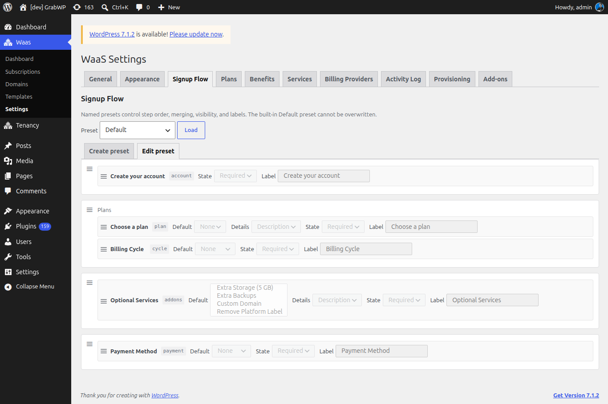

**Short answer:** a signup flow preset decides which steps customers see on your signup page, their order and which steps share a screen. The built-in **Default** preset works out of the box. To change it, copy it into your own preset under **Waas > Settings > Signup Flow**, then name that preset on the signup page.

**Needs:** Pro + WaaS

## How it works

- The signup page shortcode and the **WaaS Signup** block both load a preset by its slug.
- **Default** is read-only. You make changes in a copy.
- Steps in the same group show on one screen, under one heading, with one set of buttons.
- The customer does not type a site address. WaaS gives each new site an address on its own.

## The Default preset

Go to **Waas > Settings > Signup Flow**, load **Default** and open **Edit preset**.





Its fields are disabled and **Save preset** and **Delete preset** are not shown. **Default** uses these screens:

| Group heading | Steps on that screen |
|---|---|
| (none) | **Create your account** (`account`) |
| Plans | **Choose a plan** (`plan`) and **Billing Cycle** (`cycle`) |
| (none) | **Optional Services** (`addons`) |
| (none) | **Payment Method** (`payment`) |

Two steps are not cards in the builder; the form adds them when they apply:

- **Verify your email** (`otp`): when **Auth Mode** is **WAAS Auth (Email signup)** and the visitor is signed out.
- **Create your website** (`free`): when there are no plans and the account step is not shown.

## Load a preset

1. Choose a preset in **Preset**.
2. Click **Load**.

**Load** only opens the preset; it does not save anything.

## Create a preset

1. Load the preset you want to copy (**Default** or one of yours).
2. Open **Create preset**.
3. Enter **New slug** (lowercase letters, numbers and hyphens).
4. Enter **New label**, the name shown in **Preset** and in the block settings.
5. Click **Create from** followed by the loaded preset's name, for example **Create from Default**.

The notice **Signup flow preset saved.** appears and the new preset is in **Preset**.

## Edit a preset

1. **Load** your preset and open **Edit preset**.
2. Change **Preset label** if you want a different name.
3. Drag a step by its handle to reorder it or move it to another group. Steps not on the canvas wait in the palette; drag one onto a group to place it.
4. Click **Add group** for an empty group, then drag steps into it. Type a heading in the **Group heading** field if that screen needs one.
5. Click **Remove group** to drop a group. Every group needs at least one step before you save.
6. Click **Save preset**. The notice **Signup flow preset saved.** appears. Reload the preset to confirm.

To remove your preset, open it and click **Delete preset**. The notice is **Signup flow preset deleted.** **Default** cannot be deleted.

:::tip
With JavaScript off, the same screen uses **Up**, **Down**, **Remove**, **Add step** and **Add as new group** instead of drag and drop.
:::

## Step controls

Each placed step shows its name, its ID and these controls:

| Control | What it does |
|---|---|
| **Default** | The value filled in on the form. **None** leaves it empty. **Optional Services** accepts more than one service. Setting a value is what allows **Hidden** on **Choose a plan**. |
| **Details** | On **Choose a plan** and **Optional Services**: what each card shows under its name and price, **Description**, **Features** (plans only) or **Benefits**. |
| **State** | **Required**, **Optional** or **Hidden**. |
| **Label** | The heading for this step. Leave it as the placeholder to keep the built-in wording. |

| State | What the customer gets |
|---|---|
| **Required** | The step stays until it is completed. |
| **Optional** | The step can be skipped once it has a value, including a **Default**. |
| **Hidden** | The step is left off the form. **Choose a plan** offers **Hidden** only after you set **Default**. **Billing Cycle**, **Payment Method** and **Optional Services** offer it right away. |

## Steps you can place

| Step | ID | Notes |
|---|---|---|
| **Create your account** | `account` | Shown to signed-out visitors when **Auth Mode** is **WAAS Auth (Email signup)**. |
| **Choose a plan** | `plan` | Moves on when the customer picks a plan. |
| **Optional Services** | `addons` | Must come after **Choose a plan**. Does not move on by itself. |
| **Billing Cycle** | `cycle` | **Monthly** or **Yearly**. Skipped when nothing in the order renews. |
| **Payment Method** | `payment` | Must come after **Choose a plan**. Skipped when nothing in the order needs payment. |

Saving fails when a step depends on one that is missing or comes later, when a group is empty, when a step is listed twice, or when **Choose a plan** is **Hidden** without a **Default**.

## Use your preset on the signup page

With the shortcode, set `flow` to the preset slug:

```
[grabwp_waas_signup flow="quick-checkout"]
```

An empty `flow`, `default` or an unknown slug uses **Default**. You can also hide headings and override labels:

```
[grabwp_waas_signup flow="quick-checkout" hide-titles="1" hide-labels="1" hide-thumbnail="1"]
```

| Attribute | Notes |
|---|---|
| `flow` | The preset slug. |
| `hide-titles` | `1`, `true`, `yes` or `on` hides the heading at the top of each step. |
| `hide-labels` | Same values. Hides the short description under each heading. |
| `hide-thumbnail` | Same values. Hides the template thumbnail. |
| `label-account`, `label-plan`, `label-addons`, `label-cycle`, `label-payment`, `label-otp` | Replace the heading of that step. Blank keeps the preset or built-in label. |

With the block:

1. Edit the signup page and select the **WaaS Signup** block.
2. In the block settings, open **Signup flow** and set **Flow preset**.
3. Under **Display**, turn on any of **Hide step descriptions**, **Hide step titles** or **Hide template thumbnail**.
4. Under **Step labels**, override **Account**, **Plan**, **Add-ons**, **Billing cycle**, **Payment** or **Email verification**, or leave them blank.
5. Update the page.

## Check that it works

Open the signup page in a private window. The steps, headings and card details match the preset. A hidden step does not show, and its **Default** is the value that gets sent.

## Related

- [Frontend pages](/sell-sites/frontend-pages)
- [Appearance](/sell-sites/appearance)
- [Benefits, services and add-ons](/sell-sites/benefits-and-add-ons)
- [Free trials and subscriptions](/sell-sites/trials-and-subscriptions)
