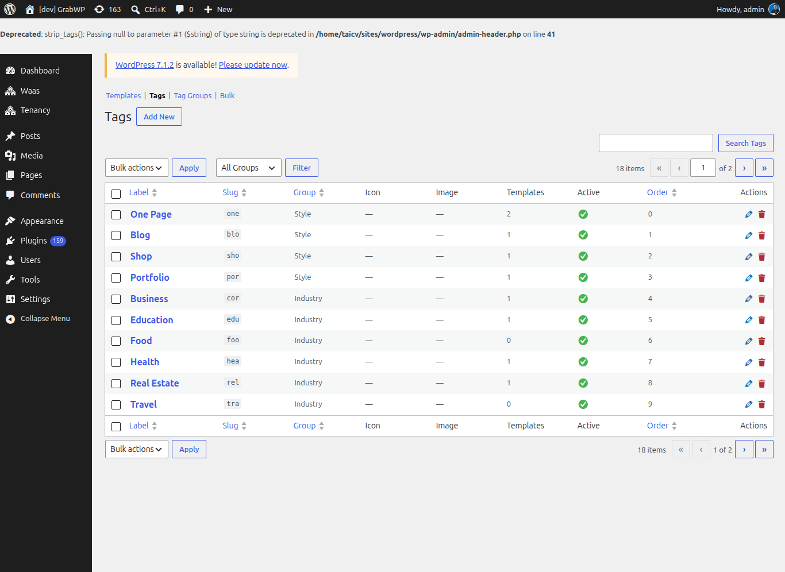
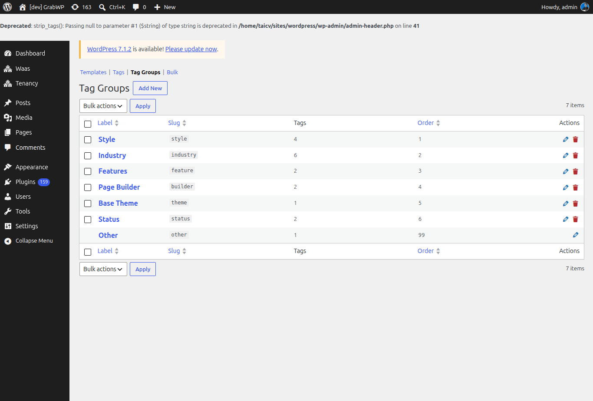

**Short answer:** a template is one of your sites marked as a starting point. When a customer signs up with it, WaaS copies that site to make theirs. Build the site the way you want every copy to start, then add it under **Waas > Templates**. Keep the source site: deleting it breaks the template.

**Needs:** Pro + WaaS

## How templates work

- The setup wizard already made your first template from the starter site (the **Starter site** and **Storefront** steps). See [Set up WaaS](/sell-sites/set-up-waas).
- Each template points at one source site. A signup copies its pages, settings and content into the new customer site.
- Templates can be limited to some plans, can carry their own price, and are grouped with tags in the gallery.

## The templates screen

Go to **Waas > Templates**. The sub-menu is **Templates**, **Tags**, **Tag Groups** and **Bulk**.

List columns: **Template Name**, **Slug**, **Source Tenant**, **Tags**, **Price**, **Active**, **Order**, **Actions**.

## Step 1: Build the source site

1. Go to **Tenancy > Add New** and create a site, for example `template-starter.yoursaas.com`.
2. Open that site's WordPress admin and set the theme, pages, menus and demo content every copy should start with.

## Step 2: Add the template

1. Go to **Waas > Templates** and click **Add New**.
2. Fill the fields below.
3. Click **Save as Template**. The notice **Template saved.** appears.

When you edit later, the screen is **Edit Template** and the button is **Update Template**. **Back to Templates** returns to the list.

| Field | Notes |
|---|---|
| **Source Tenant** | Required, only when adding. Not shown when editing. |
| **Template Name** | Required. The title in the gallery. |
| **Slug** | Required. Lowercase letters, numbers and hyphens. |
| **Tags** | Pick tags, or follow **manage tags**. |
| **Allowed Plans** | Leave all unchecked to allow every plan. Check plans to limit the template to them. The free plan is labeled **Free tier**. |
| **Price** | An extra charge for this template. `0` means no template fee. |
| **Discount Price** | An optional lower price. `0` means none. |
| **Description** | Text for the gallery. |
| **Thumbnail** | **Select** from the media library or paste an image URL. **Remove** clears it. |
| **Active** | **Show in signup form**. |
| **Sort Order** | Lower numbers appear first. |

:::note
A template with a price cannot be combined with a built-in free trial. On a trial plan, the signup badge then reads **Trial not available with this template**. See [Free trials and subscriptions](/sell-sites/trials-and-subscriptions).
:::

**Rebuild Index** on the list rewrites the templates index file. Use it when the gallery and the list disagree. The notice is **Templates index rebuilt.**

## Step 3: Tags

Tags filter the gallery. Open **Waas > Templates > Tags** and click **Add New**.

| Field | Notes |
|---|---|
| **Slug** | Lowercase letters, numbers and hyphens. |
| **Label** | The name shown in the gallery and the template selector. |
| **Group** | The tag group it belongs to. |
| **Icon** | A small image used as a feature indicator. **Select** or **Remove**. |
| **Image** | An optional larger image. |
| **Sort Order** | The order inside the group. |
| **Active** | **Show in tag selectors**. |

Filter the list by group, or search with **Search Tags**.

## Step 4: Tag groups

Open **Tag Groups**.

Until you add your own, WaaS uses these groups: **Style**, **Industry**, **Features**, **Page Builder**, **Base Theme**, **Status** and **Other**. Click **Add New** to add a group with a **Slug**, **Label** and **Sort Order**.

Which groups show as pills and which as dropdowns is set by the template browser's `filter-tags` attribute, or the block control **Pill filter groups (filter-tags)**. See [Shortcodes, blocks and emails](/sell-sites/shortcodes-blocks-emails).

## Step 5: Import from CSV

Open **Bulk**.

1. Click **Download templates CSV** to export the current templates.
2. Edit the file. A header row is required; column order does not matter. Each row needs `tenant_id`, `name` and `slug`.
3. Choose **Source**: **Upload file** or **Paste CSV text**.
4. Tick **Overwrite** to **Overwrite existing templates with the same tenant_id**.
5. Set **Missing tags**: **Skip missing (drop unknown tag slugs)** or **Create missing (add to the "other" tag group)**.
6. Click **Import CSV**.

Columns: `tenant_id`, `name`, `slug`, `category`, `tags`, `allowed_plans`, `price`, `discount_price`, `is_active`, `sort_order`, `description`, `thumbnail_url`. `tags` and `allowed_plans` are separated by a pipe (`business|portfolio`). `is_active` is `1` or `0`.

## Premium plugins on templates

A plugin license you activate on the main site does not carry over to customer sites: each site has its own database and options. Whether one license can cover many sites depends on that vendor's terms and domain checks. If the vendor allows it, activate the plugin on the template site; new sites copied from it start with it.

## Check that it works

1. The template row shows **Active**.
2. The templates page on your site lists it.
3. The tags you assigned show on the row.

## Related

- [Frontend pages](/sell-sites/frontend-pages)
- [Plans](/sell-sites/plans)
- [Signup flow](/sell-sites/signup-flow)
- [Shortcodes, blocks and emails](/sell-sites/shortcodes-blocks-emails)
