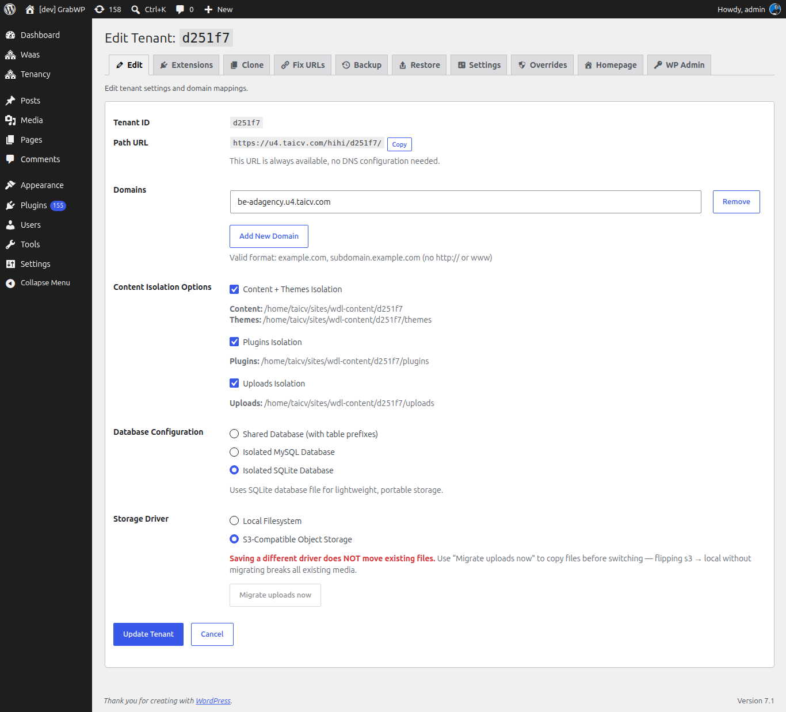
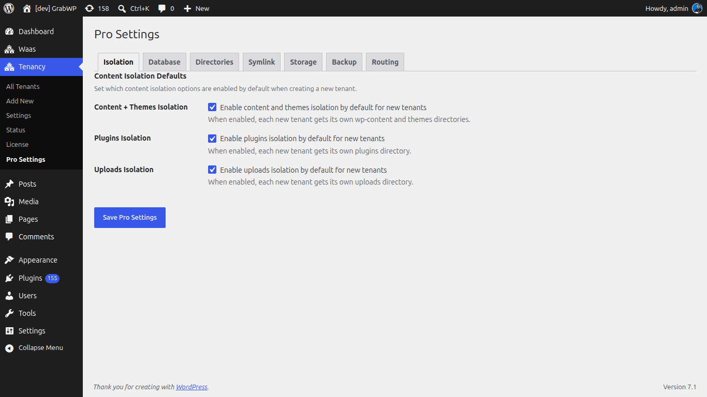

# Cô lập cơ sở dữ liệu & nội dung

Pro cho phép bạn cấu hình cách dữ liệu của từng tenant site được tách biệt với các site khác.

## Tùy chọn cơ sở dữ liệu

Vào **GrabWP Tenancy → Tenants → Edit** site. Các trường Pro sẽ xuất hiện trong form chỉnh sửa bên dưới phần cài đặt domain.

### Cơ sở dữ liệu dùng chung (Mặc định)
Tất cả site dùng chung một cơ sở dữ liệu MySQL với tiền tố bảng riêng, tương tự bản miễn phí. Thiết lập đơn giản nhất, chi phí vận hành thấp nhất.

### Cơ sở dữ liệu MySQL cô lập
Mỗi site kết nối tới một cơ sở dữ liệu MySQL riêng. Cô lập hoàn toàn ở cấp cơ sở dữ liệu.

Để cấu hình:
1. Mở **Edit** cho site
2. Trong **Database Type**, chọn **Isolated MySQL Database**
3. Nhập thông tin kết nối cơ sở dữ liệu gồm host, tên DB, user và password
4. Lưu lại

### Cơ sở dữ liệu SQLite cô lập
Mỗi site dùng một file SQLite thay cho MySQL.

Để cấu hình:
1. Mở **Edit** cho site
2. Trong **Database Type**, chọn **Isolated SQLite Database**
3. Lưu lại, file SQLite sẽ được tạo tự động

## Cô lập nội dung

Kiểm soát những phần nào được cô lập trong từng tenant site. Trong form **Edit** của site:

| Thiết lập | Phần được kiểm soát |
|---------|-----------------|
| Content + Themes Isolation | Tenant có thư mục `wp-content` và themes riêng |
| Plugins Isolation | Tenant có thư mục plugins riêng |
| Uploads Isolation | Tenant có thư mục uploads riêng |

Bật hoặc tắt từng thiết lập theo nhu cầu cho mỗi site.

## Thiết lập mặc định cho site mới

Vào **GrabWP Tenancy → Pro Settings** để cấu hình các tùy chọn cô lập mặc định. Mọi site mới tạo sẽ kế thừa các giá trị này và bạn vẫn có thể ghi đè cho từng site bất kỳ lúc nào.

Đường dẫn thư mục mặc định và đường dẫn uploads cũng được cấu hình trong cùng màn hình Pro Settings (xem [Cài đặt Pro](/grabwp-tenancy-pro/pro-installation)). Dùng các công tắc bên dưới để đặt mặc định cho **content**, **plugins** và **uploads** isolation của site mới:

