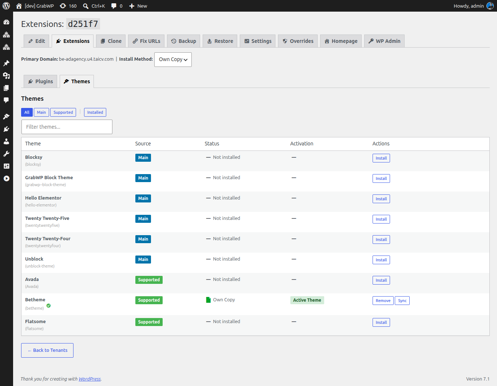

# Plugin & Theme theo từng site

Với Pro, mỗi tenant site có thể có bộ plugin và theme riêng, tách biệt với site chính của bạn và với các site khác.

## Trước khi bắt đầu

Trước tiên bạn phải bật cô lập plugin và theme cho site:

1. Vào **GrabWP Tenancy → Tenants → Edit** site
2. Trong phần các trường cô lập của Pro, bật **Plugins Isolation** và/hoặc **Content + Themes Isolation**
3. Lưu lại

Sau khi bật, liên kết **Extensions** sẽ xuất hiện trong dòng của tenant ở danh sách tenant.

## Quản lý extensions cho một site

1. Vào **GrabWP Tenancy → Tenants**
2. Tìm site rồi nhấn liên kết thao tác **Extensions**
3. Bạn sẽ thấy toàn bộ plugin và theme hiện có từ cài đặt chính

### Cấp quyền dùng plugin cho một site

1. Tìm plugin trong danh sách
2. Nhấn **Install**, plugin sẽ được cài vào thư mục của tenant site theo kiểu copy hoặc symlink dựa trên thiết lập Install Method
3. Tenant admin sau đó có thể kích hoạt plugin từ trang Plugins của riêng họ

### Gỡ plugin khỏi một site

1. Tìm plugin trong danh sách
2. Nhấn **Remove**, plugin sẽ bị xóa khỏi thư mục của tenant site

### Themes

Trang Extensions có hai sub-tab: **Plugins** (mặc định) và **Themes**. Tab **Themes** hoạt động giống **Plugins**: Install / Remove / kích hoạt theo từng tenant, với cùng **Install Method** (**Symlink** hoặc **Own Copy**).

Các thao tác plugin và theme (install, remove, sync, convert, copy to main, activate, deactivate) cập nhật ngay dòng bị ảnh hưởng thay vì tải lại cả trang, nên tab hiện tại và vị trí cuộn được giữ nguyên.

## Phương thức cài đặt

Ở đầu trang Extensions, bạn có thể đặt **Install Method** cho site:

| Phương thức | Cách hoạt động | Khi nào nên dùng |
|--------|-------------|-------------|
| **Symlink** | Một symlink trỏ tới file plugin của site chính | Tiết kiệm dung lượng; khi cập nhật plugin ở site chính thì site tenant cũng nhận cập nhật |
| **Own Copy** | File plugin được sao chép vào thư mục của tenant | Khi tenant cần bộ file hoàn toàn độc lập |

Khi đổi phương thức và lưu lại, toàn bộ extensions đã cài sẽ được chuyển đổi lại tự động.
