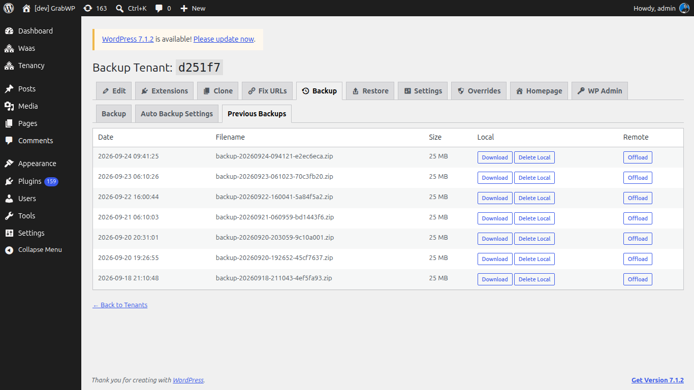
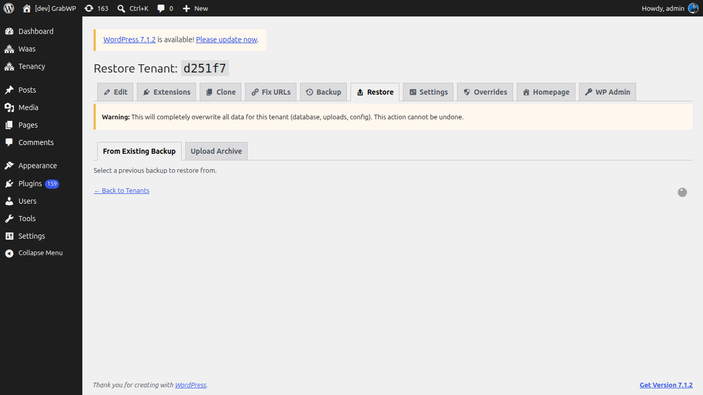

# Backup và restore

Sao lưu từng tenant: database, isolated content, Pro config, và upload. Mặc định offload và lịch nằm ở **Tenancy → Pro Settings**, tab **Backup**. Xem [Pro Settings](/grabwp-tenancy-pro/pro-settings).

## Tạo backup

**Vào Tenancy → All Tenants**, rồi **Backup Tenant** trên dòng (`page=grabwp-tenancy-pro-backup`).

Tiêu đề là **Backup Tenant:** cộng tenant ID. Tab: **Backup**, **Auto Backup Settings**, **Previous Backups**.

1. Ở tab **Backup**.
2. Nhấn **Start Backup**.

Tiến trình chạy trong trình duyệt:

1. Validating tenant
2. Exporting database
3. Exporting isolated content
4. Exporting Pro config
5. Exporting uploads
6. Packaging archive
7. Cleaning up

Khi xong: **Backup complete!** và **Your backup archive is ready.** Nhấn **Download Backup**.

Giữ tab trình duyệt mở cho đến khi các bước kết thúc.

## Lên lịch backup cho tenant này

Mở **Auto Backup Settings**.

Mỗi trường có thể kế thừa mặc định toàn cục từ **Pro Settings → Backup** (**Auto Backup**). Màn hình hiện **Effective:** dưới mỗi control.

| Trường | Ghi chú |
|-------|--------|
| Scheduled Backups | **Inherit global default**, **Enabled**, hoặc **Disabled**. |
| Schedule | **Inherit global default**, hoặc **Manual only (no schedule)**, **Daily**, **Weekly**, **Every two weeks**, **Monthly**. |
| Backups to Keep | Số archive giữ lại (1 đến 30). Bản cũ bị xóa sau một lần chạy thành công. |

Nhấn **Save Auto Backup Settings**.

Lần chạy theo lịch dùng WP-Cron. Nếu **DISABLE_WP_CRON** đang bật, hãy cấu hình system cron. **Pro Settings → Backup** có **Schedule Assurance** cho lần chạy tiếp theo.

## Các backup trước đó

Mở **Previous Backups**.

Cột: **Date**, **Filename**, **Size**, **Local**, **Remote**.

| Khi nào | Thao tác |
|------|---------|
| File nằm trên máy chủ | **Download**, **Delete Local** |
| Offload đã cấu hình và file vẫn ở local | **Offload** |
| File chỉ ở remote | **Download to Local** |
| File ở remote | **Delete Remote** |

**Delete Local** hỏi **Delete local backup `{file}`? This cannot be undone.** **Delete Remote** hỏi tương tự cho bản remote.

## Restore

**Vào Tenancy → All Tenants**, rồi **Restore Tenant** (`page=grabwp-tenancy-pro-restore`).

> **Warning:** **This will completely overwrite all data for this tenant (database, uploads, config). This action cannot be undone.**

Tab:

| Tab | Việc cần làm |
|-----|------------|
| From Existing Backup | Chọn một dòng và nhấn **Restore**. Xác nhận **Restore from `{file}`? This will OVERWRITE all tenant data and cannot be undone.** |
| Upload Archive | Chọn **Backup Archive (.zip)** và nhấn **Upload & Start Restore**. Màn hình hiện dung lượng upload tối đa. |

Các bước restore:

1. Validating archive
2. Extracting archive
3. Verifying contents
4. Restoring database
5. Restoring isolated content
6. Restoring Pro config
7. Restoring uploads
8. Cleaning up

Thành công: **Restore complete!**

Một lần restore có thể vào kiểu database khác với bản backup (shared MySQL, isolated MySQL, hoặc SQLite).

Nếu URL trong database vừa khôi phục không khớp domain của tenant, dùng [Fix URLs](/grabwp-tenancy-pro/pro-fix-urls).

**Verify:** Mở **Homepage** hoặc domain của tenant và xác nhận nội dung đã khôi phục. **Previous Backups** liệt kê archive bạn vừa tạo.
