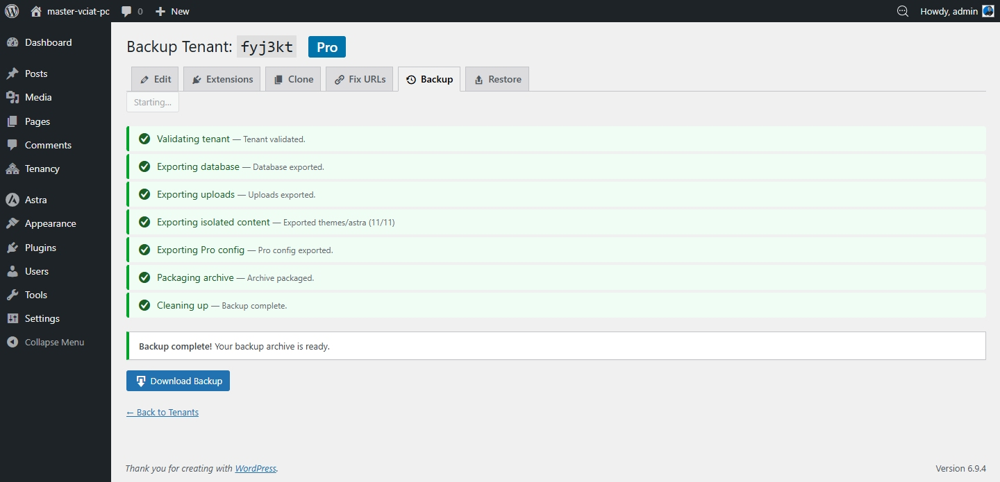
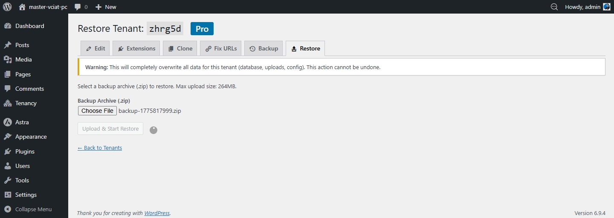
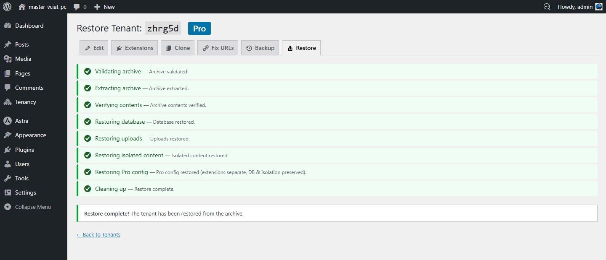

# Sao lưu & khôi phục

Pro cho phép bạn sao lưu và khôi phục từng tenant site riêng lẻ, bao gồm cơ sở dữ liệu, uploads, cấu hình Pro và nội dung cô lập.

## Tạo bản sao lưu

1. Vào **GrabWP Tenancy → Tenants**
2. Tìm site rồi nhấn liên kết thao tác **Backup**
3. Nhấn **Start Backup**

Quá trình sao lưu chạy từng bước ngay trong trình duyệt:

1. Xác thực tenant
2. Xuất cơ sở dữ liệu
3. Xuất uploads
4. Xuất nội dung cô lập
5. Xuất cấu hình Pro
6. Đóng gói archive
7. Dọn dẹp

Khi hoàn tất, một file ZIP sẽ được tạo. **Hãy tải và lưu file này**. File được lưu trên máy chủ của bạn và sẽ cần dùng khi khôi phục.

## Khôi phục từ bản sao lưu

1. Vào **GrabWP Tenancy → Tenants**
2. Tìm site rồi nhấn liên kết thao tác **Restore**
3. Tải lên file ZIP sao lưu
4. Nhấn **Upload & Start Restore**

> ⚠ **Cảnh báo:** Khôi phục sẽ ghi đè hoàn toàn cơ sở dữ liệu, uploads và cấu hình hiện tại của site. Không thể hoàn tác. Hãy sao lưu trạng thái hiện tại trước nếu bạn cần giữ lại.

Quá trình khôi phục chạy qua 8 bước và hiển thị tiến trình trực tiếp trong trình duyệt.

## Quản lý file sao lưu

Các file sao lưu được lưu trên máy chủ của bạn. Để quản lý dung lượng, hãy tải các bản sao lưu cũ về qua FTP/SFTP rồi xóa chúng khỏi máy chủ. Nên giữ thêm bản sao ở một nơi an toàn ngoài máy chủ.
