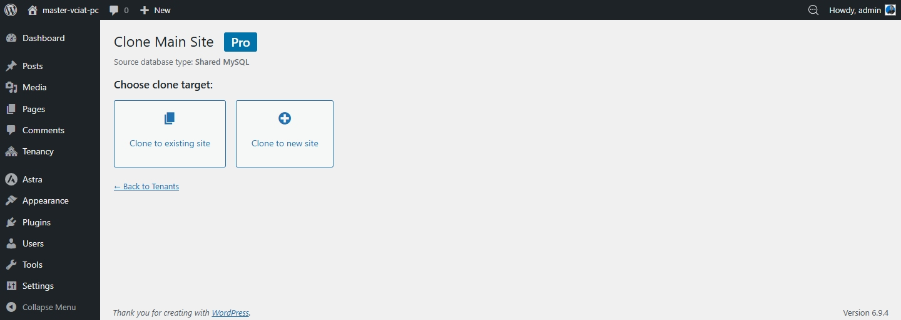
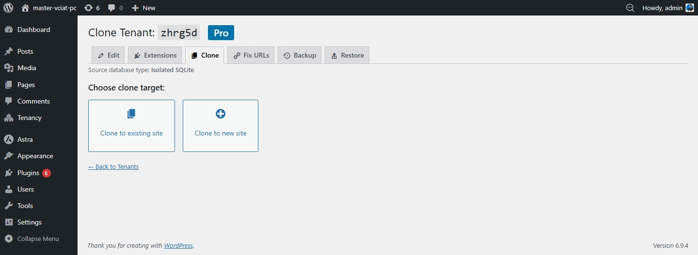
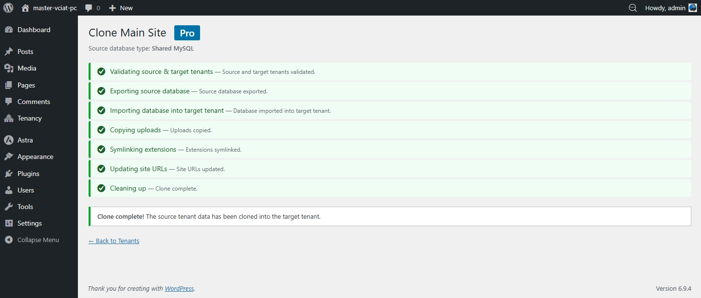

# Nhân bản tenant

Pro cho phép bạn sao chép bất kỳ tenant site hiện có nào sang một site mới. Quá trình nhân bản sẽ sao chép cơ sở dữ liệu, uploads, nội dung cô lập và cấu hình Pro, sau đó ghi lại URL để khớp với site mới. Phù hợp cho môi trường staging, mẫu site dựng sẵn hoặc triển khai nhanh.

## Trước khi bắt đầu

- Cả site nguồn và site đích đều phải là tenant site được quản lý bởi GrabWP Tenancy Pro
- Hãy tạo tenant đích trước dưới dạng site rỗng, sau đó mới nhân bản vào đó
- Dữ liệu hiện có của site đích sẽ bị ghi đè bởi bản nhân bản

## Cách nhân bản

1. Vào **GrabWP Tenancy → Tenants**
2. Tìm **site nguồn** là site bạn muốn sao chép và nhấn liên kết thao tác **Clone**
3. Chọn **site đích** từ danh sách thả xuống
4. Nhấn **Start Clone**

Quá trình nhân bản chạy qua 7 bước và hiển thị tiến trình trực tiếp trong trình duyệt:

| Bước | Diễn ra điều gì |
|------|-------------|
| 1. Validate | Kiểm tra site nguồn và site đích hợp lệ, có thể truy cập |
| 2. Export | Xuất cơ sở dữ liệu của site nguồn kèm thay thế prefix |
| 3. Import | Nhập cơ sở dữ liệu đã xuất vào site đích |
| 4. Copy uploads | Sao chép thư mục uploads từ site nguồn sang site đích |
| 5. Symlink extensions | Liên kết plugin/theme theo site từ nguồn sang đích |
| 6. Fix URLs | Ghi lại toàn bộ URL đã lưu để khớp với domain của site đích |
| 7. Cleanup | Xóa các file xuất tạm |

## Sau khi nhân bản

- Truy cập site đích và kiểm tra nội dung, theme và plugin đã tải đúng chưa
- Nếu site đích dùng domain khác, hãy kiểm tra toàn bộ URL media có hoạt động đúng không
- Site đích có cơ sở dữ liệu độc lập riêng, thay đổi ở một site sẽ không ảnh hưởng site còn lại

## Lưu ý

- Tính năng clone không chuyển các phiên đăng nhập đang hoạt động hoặc transient
- Nếu source bật cô lập plugin/theme nhưng destination không bật, bước symlink extensions sẽ bị bỏ qua
- Với site lớn, tab trình duyệt phải được mở trong suốt quá trình clone
