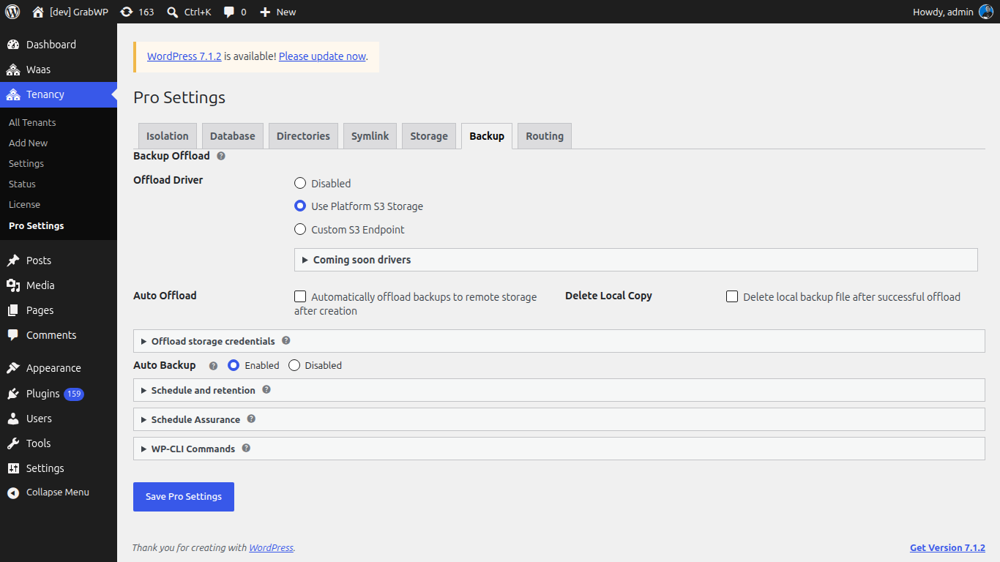
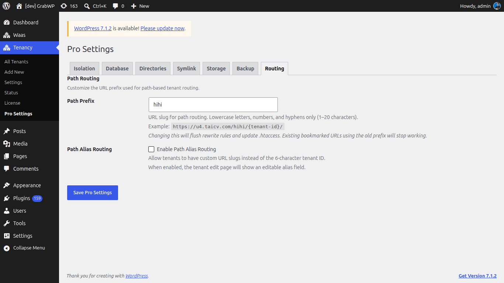

# Pro Settings

**Vào Tenancy → Pro Settings** (`page=grabwp-tenancy-pro-settings`).

Tiêu đề trang là **Pro Settings**. Tab: **Isolation**, **Database**, **Directories**, **Symlink**, **Storage**, **Backup**, **Routing**. Tab đang mở được nhớ lại. Nhấn **Save Pro Settings** trên tab nào cũng lưu form.

Đây là mặc định cho tenant mới, cùng storage, symlink, và offload backup cho cả site. Tenant đã có giữ config riêng cho đến khi bạn sửa tenant đó.

## Isolation


**Content Isolation Defaults**. Xem bảng trường trong [Database và cô lập nội dung](/grabwp-tenancy-pro/pro-database-isolation).

## Database


**Database Defaults** và, khi chọn **Isolated MySQL Database**, **Default MySQL Connection** (**MySQL Host**, **MySQL Database**, **MySQL Username**). Mật khẩu đặt trên từng tenant, không đặt ở đây.

## Directories


**Directory Configuration**. Để trống một trường để giữ mặc định. Dòng **Effective:** hiện đường dẫn đang dùng. Nếu đường dẫn được đặt trong `wp-config.php`, trường bị khóa và ghi **set in wp-config.php**.

| Trường | Vị trí mặc định |
|-------|------------------|
| Tenant Base Dir | `wp-content/grabwp-tenancy` |
| Pro Config Dir | `wp-content/grabwp-tenancy-pro` (file `config.php` của tenant, và config toàn cục ở gốc thư mục này) |
| SQLite Database Dir | `wp-content/grabwp-tenancy-sqlite` |

Thay đổi có hiệu lực ở lần tải trang sau. Thông báo **Directory validation errors:** liệt kê đường dẫn WordPress từ chối.

## Symlink


**Domain Symlink (Clean URLs)** viết lại URL asset của tenant để phục vụ từ `/wp-content/` qua symlink theo domain. Việc này tách khỏi cách khách mở site. Khách vẫn dùng domain của tenant.

| Trường | Ghi chú |
|-------|--------|
| Enable Domain Symlink | **Enable clean /wp-content/ URLs via domain symlinks**. Bị khóa khi thiếu `symlink()`. Dòng hiện **symlink() is available** hoặc **symlink() is not available. Feature cannot be enabled.** |
| Domains Directory | Đường dẫn tuyệt đối cho các symlink. Để trống thì dùng mặc định. **Effective:** hiện đường dẫn. Thư mục được tạo tự động. |

Mở **Required server rules** và sao chép khối Nginx, hoặc khối LiteSpeed và Apache cho `wp-content/uploads/.htaccess`, rồi khởi động lại web server. Đường dẫn trong khối đó khớp **Domains Directory** trên màn này.

**Tenant Maintenance:**

| Nút | Ghi chú |
|--------|--------|
| Fix All Tenant Broken Symlinks | Sửa symlink plugin và theme bị gãy trên mọi tenant. Bị khóa khi thiếu `symlink()`. |
| Sync All Tenant Domain Symlinks | Tạo symlink domain còn thiếu và gỡ symlink cũ. Bị khóa cho đến khi domain symlink được bật, có domains directory, và `symlink()` dùng được. |

## Storage


**Object Storage (S3-Compatible)** dùng cho upload của tenant. Chữ trợ giúp nêu: Cloudflare R2, AWS S3, MinIO, Backblaze B2.

| Trường | Ghi chú |
|-------|--------|
| Default Storage Driver | **Local Filesystem (default)** hoặc **S3-Compatible Object Storage**. |

Chọn S3 sẽ mở **S3 storage credentials**:

| Trường | Ghi chú |
|-------|--------|
| S3 Endpoint URL | URL endpoint đầy đủ. |
| Bucket Name | Bucket cho upload. |
| Region | `auto` cho Cloudflare R2. Ví dụ: `us-east-1`, `eu-west-1`. |
| Path-Style Endpoint | **Enable path-style endpoint (required for MinIO)**. |
| Access Key ID | Access key. |
| Secret Access Key | Để trống để giữ secret đã lưu. |
| CDN URL (optional) | Tiền tố URL công khai. Nếu trống, dùng pre-signed URL. |
| Connection Test | **Test Connection**. Thành công: **Connection successful!** |

Sau khi S3 đã lưu và cấu hình xong, **Bulk Migration** có thể hiện **Migrate All Tenants to S3** và **Migrate All Tenants to Local**. Xác nhận **This will migrate uploads for ALL tenants. Continue?** Với site lớn, cùng màn hình liệt kê WP-CLI trong **WP-CLI reference**:

```
wp grabwp-pro storage migrate --all --to=s3
```

Driver theo tenant và **Migrate uploads now** nằm trên màn Edit của tenant. Xem [Database và cô lập nội dung](/grabwp-tenancy-pro/pro-database-isolation).

## Backup



### Backup Offload

| Trường | Ghi chú |
|-------|--------|
| Offload Driver | **Disabled**, **Use Platform S3 Storage** (cần S3 ở tab Storage trước), hoặc **Custom S3 Endpoint**. |
| Coming soon drivers | **Google Drive (Coming Soon)** và **FTP / SFTP (Coming Soon)** đang bị khóa. |
| Auto Offload | **Automatically offload backups to remote storage after creation**. |
| Delete Local Copy | **Delete local backup file after successful offload**. |

**Offload storage credentials** (sau khi chọn driver):

- **Use Platform S3 Storage**: **Backup Prefix** và **Test Connection**.
- **Custom S3 Endpoint**: **S3 Endpoint URL**, **Bucket Name**, **Region**, **Backup Prefix**, **Access Key ID**, **Secret Access Key**, **Path-Style Endpoint**, **Test Connection**. Để trống secret để giữ key đã lưu.

### Auto Backup

Lịch toàn cục cho tenant đang kế thừa. Mỗi tenant có thể ghi đè trên **Auto Backup Settings**. Xem [Backup và restore](/grabwp-tenancy-pro/pro-backup-restore).

| Trường | Ghi chú |
|-------|--------|
| Auto Backup | **Enabled** hoặc **Disabled**. |
| Default Schedule | **Manual only (no schedule)**, **Daily**, **Weekly**, **Every two weeks**, **Monthly**. Nằm trong **Schedule and retention**. |
| Backups to Keep | 1 đến 30. Archive local và remote cũ bị xóa sau một lần chạy thành công. |

**Schedule Assurance** hiện **WP-Cron Status** (**Active (WordPress pseudo-cron)** hoặc **Disabled (system cron required)**) và **Next Scheduled Backup**. Nếu WP-Cron bị tắt, thông báo nói backup theo lịch sẽ không chạy cho đến khi có system cron.

**WP-CLI Commands** trên cùng tab:

```
wp grabwp backup run <tenant_id>
wp grabwp backup schedule <tenant_id> --enabled=enabled --schedule=daily --retain=7
wp grabwp backup show <tenant_id>
wp grabwp backup reschedule-all
```

## Routing



Khách nên dùng domain riêng của tenant. Xem [Domain và DNS](/grabwp-tenancy/hosting-dns-setup).

Tab này chỉ đổi địa chỉ xem trước tạm thời hiện là **Path URL** trên Edit (hoặc trường **Path Alias** khi alias routing đang bật).

| Trường | Ghi chú |
|-------|--------|
| Path Prefix | Slug dùng trong địa chỉ xem trước đó. Chữ thường, số, và dấu gạch ngang, 1 đến 20 ký tự. Mặc định `site`. Lưu sẽ flush rewrite rules và cập nhật `.htaccess`. Bookmark xem trước cũ sẽ hết tác dụng. |
| Path Alias Routing | **Enable Path Alias Routing**. Khi bật, Edit hiện **Path Alias** (3 đến 30 ký tự) và **Copy URL** thay cho dòng **Path URL** thường. |

> **Note:** Để nguyên tab này trừ khi bạn cần đổi địa chỉ xem trước dùng trước lúc domain được gắn.

**Verify:** **Save Pro Settings** đưa bạn về màn này mà không có thông báo lỗi. Tạo một tenant và xác nhận **Database** cùng **Isolation** trên **All Tenants** khớp mặc định bạn đã lưu.
