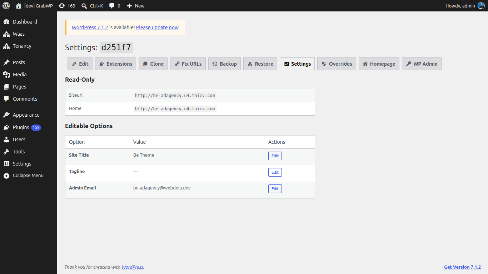

# Tenant Settings và Overrides

Mặc định toàn cục cho mọi tenant nằm ở **Tenancy → Settings**. Xem [Cài đặt](/grabwp-tenancy/installation-guide). Pro thêm hai tab trên tenant: **Settings** (tùy chọn WordPress của site đó) và **Overrides** (thiết lập GrabWP chỉ cho site đó).

Mở tab từ tenant: **Tenancy → All Tenants**, icon **Settings** (`page=grabwp-tenancy-edit`), rồi chọn tab. **Homepage** và **WP Admin** trên cùng thanh mở site tenant.

## Settings

`page=grabwp-tenancy-pro-tenant-settings`

Tiêu đề là **Settings:** cộng tenant ID.

Nếu không đọc được database của tenant: **Cannot read tenant database. Settings are unavailable.**

### Read-Only

| Option | Ghi chú |
|--------|--------|
| Siteurl | `siteurl` hiện tại trong database của tenant. Không sửa ở đây. |
| Home | Giá trị `home` hiện tại. Không sửa ở đây. |

Để đổi URL lưu trong database, dùng [Fix URLs](/grabwp-tenancy-pro/pro-fix-urls).

### Editable Options

| Option | Ghi chú |
|--------|--------|
| Site Title | `blogname` |
| Tagline | `blogdescription` |
| Admin Email | `admin_email` |

1. Nhấn **Edit** trên dòng.
2. Đổi **Value**.
3. Nhấn **Save**. **Cancel** trả lại giá trị trước.

**Verify:** Tải lại tab. **Site Title**, **Tagline**, và **Admin Email** hiện giá trị bạn đã lưu. **Siteurl** và **Home** không đổi.

## Overrides

`page=grabwp-tenancy-pro-overrides`

Tab **Overrides** được đăng ký khi bản cài này hỗ trợ override theo tenant.

Tiêu đề là **Overrides:** cộng tenant ID. Dòng giới thiệu: **Override individual GrabWP Tenancy settings for this tenant. Unchecked rows inherit the global value.**

Các nhóm khớp **Tenancy → Settings**:

- **Tenant Capabilities**
- **Performance & Security**

| Control | Ghi chú |
|---------|--------|
| Override | Chọn để ngừng kế thừa giá trị toàn cục của dòng đó. |
| Value | On/Off, một số, hoặc control riêng của thiết lập, tùy dòng. |
| Global: | Gợi ý giá trị toàn cục hiện tại (**On**, **Off**, hoặc số hay chữ). |

Nhấn **Save Overrides**. Thành công: **Overrides saved.** Nếu file config của tenant không ghi được: **Failed to save overrides. Check that the tenant config file is writable.**

Bỏ mọi checkbox **Override** rồi lưu để kế thừa lại toàn bộ thiết lập toàn cục.

**Verify:** Đổi một capability chỉ trên tenant này. **Tenancy → Settings** vẫn hiện giá trị toàn cục. Dòng override hiện **Global:** với giá trị toàn cục đó và giá trị của tenant bên cạnh.
