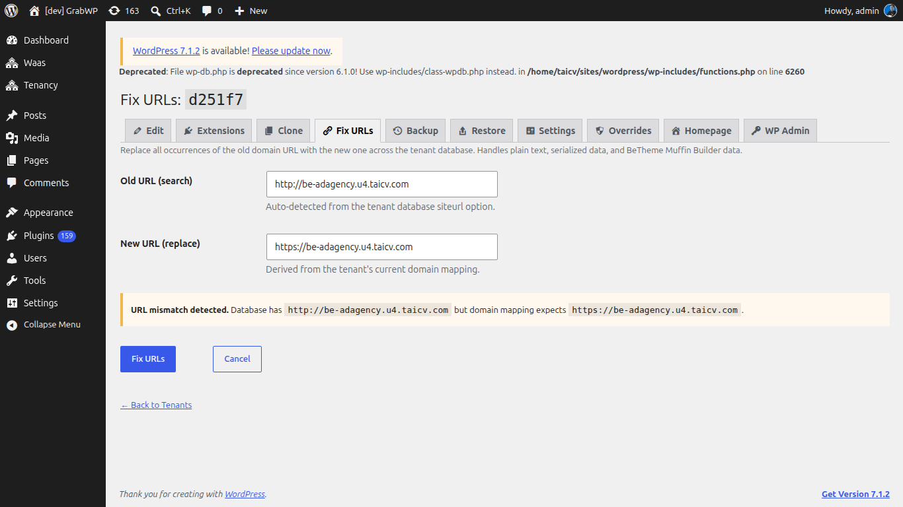

# Fix URLs

Dùng sau khi bạn đổi domain của tenant, clone một site, hoặc restore một backup mà URL đã lưu không khớp domain trên tenant.

**Vào Tenancy → All Tenants**, rồi **Fix URLs** trên dòng (`page=grabwp-tenancy-pro-fix-urls`).

Bạn cũng có thể mở tab **Fix URLs** trên tenant.

Tiêu đề là **Fix URLs:** cộng tenant ID.

Trang thay URL cũ trong database của tenant đó, gồm plain text, dữ liệu serialized, và dữ liệu BeTheme Muffin Builder.

| Trường | Ghi chú |
|-------|--------|
| Old URL (search) | Điền sẵn từ `siteurl` trong database của tenant. Trợ giúp: **Auto-detected from the tenant database siteurl option.** |
| New URL (replace) | Điền sẵn từ domain mapping của tenant. Trợ giúp: **Derived from the tenant's current domain mapping.** |

- Nếu hai URL đã khớp: **The database URL already matches the expected domain. You can still run the replacement if you need to fix a different URL.**
- Nếu khác nhau: **URL mismatch detected.** Thông báo hiện **Database has `{old}` but domain mapping expects `{new}`.**

1. Kiểm tra cả hai URL. Sửa nếu bạn cần một cặp khác.
2. Nhấn **Fix URLs**.
3. Xác nhận **This will replace all occurrences of the old URL in the tenant database. Continue?**

**Cancel** quay lại **All Tenants** mà không đổi database. Hai URL giống nhau bị từ chối với **Old and new URLs are identical.**

**Verify:** Mở tab **Settings** của tenant. **Siteurl** và **Home** khớp domain mới. Mở **Homepage** và xác nhận media cùng liên kết dùng domain đó.

Domain của tenant được sửa trên **Edit**, không phải ở đây. Xem [Quản lý tenant site](/grabwp-tenancy/creating-tenants) và [Domain và DNS](/grabwp-tenancy/hosting-dns-setup).
