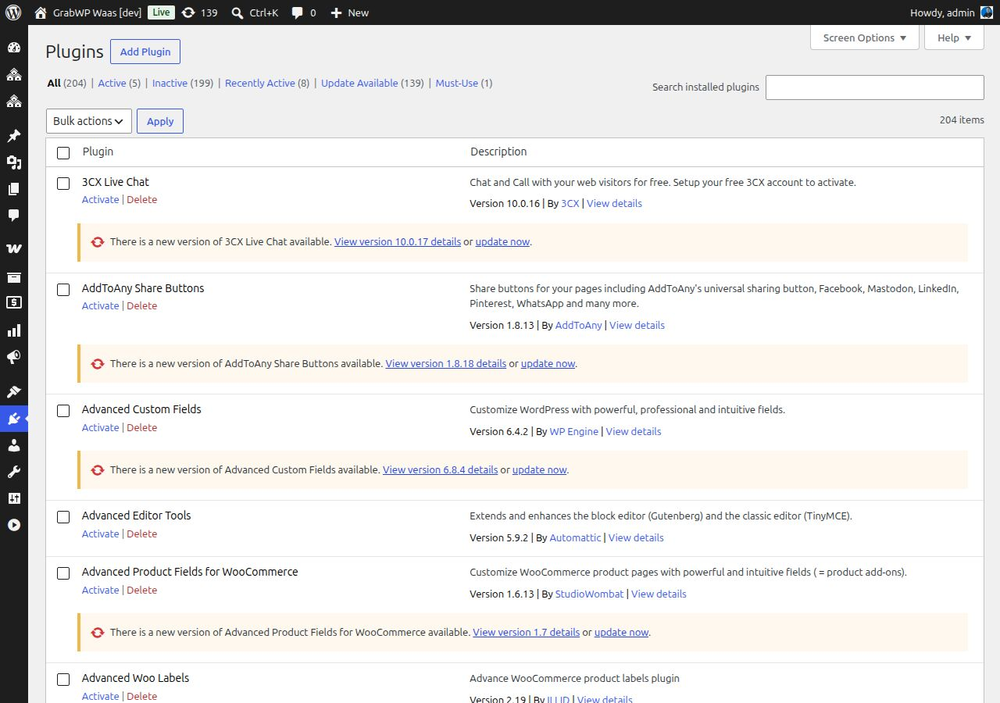

# Cài đặt Plugin

Bạn cần cài đặt ba plugin của GrabWP WaaS theo một thứ tự cụ thể. Mỗi plugin phụ thuộc vào plugin đứng trước nó.

## Thứ tự cài đặt

```
1. GrabWP Tenancy (nền tảng)  ← phải kích hoạt đầu tiên
2. GrabWP Tenancy Pro         ← cần nền tảng
3. GrabWP Tenancy WaaS        ← cần nền tảng + pro
```

## Bước 1: Cài đặt GrabWP Tenancy (nền tảng)

1. Vào **Plugins → Add New → Upload Plugin**
2. Tải lên `grabwp-tenancy.zip`
3. Nhấn **Install Now**, sau đó **Activate**
4. Bạn sẽ thấy một menu **Tenancy** mới trong thanh bên trang quản trị

## Bước 2: Cài đặt GrabWP Tenancy Pro

1. Vào **Plugins → Add New → Upload Plugin**
2. Tải lên `grabwp-tenancy-pro.zip`
3. Nhấn **Install Now**, sau đó **Activate**
4. Menu **Tenancy** giờ hiển thị thêm các mục: **Pro Settings**, **Tenant Extensions**

> **Lưu ý:** Nếu kích hoạt thất bại với lỗi phụ thuộc, hãy đảm bảo GrabWP Tenancy (nền tảng) đã được kích hoạt trước.

## Bước 3: Cài đặt GrabWP Tenancy WaaS

1. Vào **Plugins → Add New → Upload Plugin**
2. Tải lên `grabwp-tenancy-waas.zip`
3. Nhấn **Install Now**, sau đó **Activate**
4. Một menu **WaaS** mới xuất hiện trong thanh bên trang quản trị với:
   - Dashboard
   - Subscriptions
   - Domains
   - Templates
   - Settings

## Xác minh cài đặt

Sau khi kích hoạt cả ba plugin, vào **Tenancy → Status**. Trang này chạy các kiểm tra hệ thống và báo cáo mọi vấn đề:

- Quyền truy cập hệ thống tệp
- Các extension PHP bắt buộc
- Tính tương thích database
- Tính tương thích phiên bản plugin

Khắc phục mọi vấn đề được báo cáo trước khi tiếp tục.

## Danh sách plugin

Các plugin đang kích hoạt của bạn nên bao gồm:

| Plugin | Trạng thái |
|--------|--------|
| GrabWP Tenancy | Active |
| GrabWP Tenancy Pro | Active |
| GrabWP Tenancy WaaS | Active |



## Tùy chọn: Cài đặt plugin SePay

Nếu bạn dự định nhận thanh toán chuyển khoản ngân hàng Việt Nam (VietQR), hãy cài thêm:

1. Tải lên `grabwp-tenancy-sepay.zip`
2. Kích hoạt

Việc này thêm SePay làm một tùy chọn nhà cung cấp thanh toán trong cài đặt WaaS.

---

**Tiếp theo:** [Cấu hình Pro Settings](/vi/grabwp-tenancy-waas/waas-configure-pro-settings)
