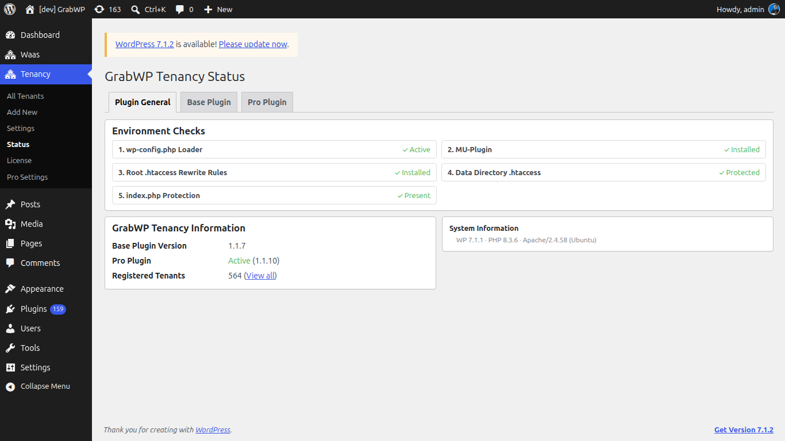

# Cài plugin

GrabWP WaaS cần ba plugin, kích hoạt đúng thứ tự. Plugin sau phụ thuộc plugin trước.

## Thứ tự cài

```
1. GrabWP Tenancy (base)  ← phải active trước
2. GrabWP Tenancy Pro     ← cần base
3. GrabWP Tenancy WaaS    ← cần base + pro
```

## Bước 1: Cài GrabWP Tenancy (base)

1. Vào **Plugins → Add New → Upload Plugin**
2. Tải lên `grabwp-tenancy.zip`
3. Bấm **Install Now**, rồi **Activate**
4. Menu **Tenancy** xuất hiện, với **All Tenants**, **Add New**, **Settings** và **Status**

## Bước 2: Cài GrabWP Tenancy Pro

1. Vào **Plugins → Add New → Upload Plugin**
2. Tải lên `grabwp-tenancy-pro.zip`
3. Bấm **Install Now**, rồi **Activate**
4. **Tenancy** có thêm **License** và **Pro Settings**

> **Note:** Nếu kích hoạt báo lỗi phụ thuộc, hãy active GrabWP Tenancy (base) trước.

## Bước 3: Kích hoạt Pro license

Vào **Tenancy → License** (`/wp-admin/admin.php?page=grabwp-tenancy-license`).


1. Dán **License key**
2. Bấm **Activate License**

Tiêu đề màn hình là **GrabWP Tenancy Pro License**. Hãy kích hoạt license trước khi tải add-on. Request tải gửi kèm license đó, và key không hiện trên trang Add-ons.

## Bước 4: Cài GrabWP Tenancy WaaS

1. Vào **Plugins → Add New → Upload Plugin**
2. Tải lên `grabwp-tenancy-waas.zip`
3. Bấm **Install Now**, rồi **Activate**
4. Menu **Waas** xuất hiện với:
   - **Dashboard**
   - **Subscriptions**
   - **Domains**
   - **Templates**
   - **Settings**

## Kiểm tra cài đặt

Vào **Tenancy → Status** (`/wp-admin/admin.php?page=grabwp-tenancy-status`).



Xử lý những gì màn hình status báo trước khi tiếp tục.

Plugin đang active nên gồm:

| Plugin | Status |
|--------|--------|
| GrabWP Tenancy | Active |
| GrabWP Tenancy Pro | Active |
| GrabWP Tenancy WaaS | Active |

## Cài billing add-on

**Polar.sh** nằm sẵn trong WaaS. **Stripe**, **Sepay** và **Xendit** là plugin riêng.

Vào **Waas → Settings → Add-ons** (`/wp-admin/admin.php?page=grabwp-tenancy-waas-settings&tab=addons`).


Catalog được nhóm theo category. **Billing Providers** cũng có link **Browse Add-ons** mở tab này.

1. Tìm thẻ add-on (ví dụ **GrabWP Tenancy Stripe**)
2. Bấm **Download ZIP**
3. Cài ZIP đó bằng **Plugins → Add New → Upload Plugin**, rồi **Activate**

Trang ghi: **After downloading, install via Plugins → Add New → Upload Plugin.**

| Badge | Ý nghĩa |
|-------|---------|
| **Available** | Tương thích và sẵn sàng tải |
| **Installed** | Đã có file, chưa kích hoạt |
| **Active** | Đã cài và đang chạy |
| **Update Available** | Có bản mới tương thích |
| **Requires WaaS Update** | Bản WaaS này cũ hơn yêu cầu của add-on |

> **Note:** **Download ZIP** hiện với trạng thái **Available** và **Update Available**. Request tải dùng Pro license phía server. License key không in trong HTML của trang.

WooCommerce không phải add-on. Tự cài plugin WooCommerce nếu bạn muốn provider đó. Nó chỉ được đăng ký khi WooCommerce đang active.

---

**Tiếp theo:** [Configure Pro Settings](/grabwp-tenancy-waas/waas-configure-pro-settings)
