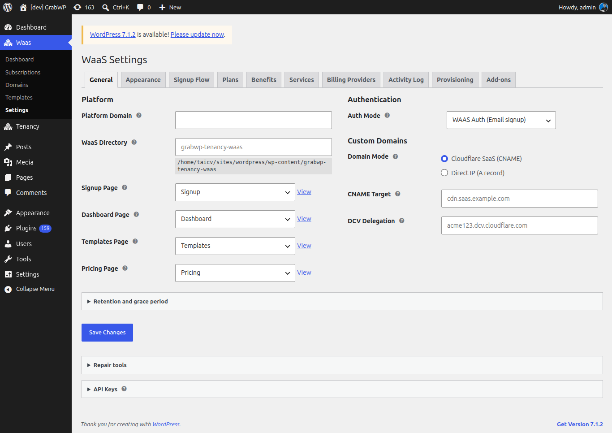

# Cấu hình cài đặt chung cho WaaS

Các thiết lập WaaS General Settings định hình danh tính nền tảng của bạn: domain, phương thức xác thực và các trang frontend mà khách hàng sẽ thao tác.

Bạn hãy truy cập vào **WaaS → Settings → General** (`/wp-admin/admin.php?page=grabwp-tenancy-waas-settings`).



## Cài đặt nền tảng

### Platform Domain

Đây là domain gốc dùng để cấp subdomain cho các tenant.

| Trường | Ví dụ | Ghi chú |
|-------|---------|-------|
| **Platform Domain** | `yoursaas.com` | Tenant sẽ nhận các subdomain dạng `customer.yoursaas.com` |

Nhập tên domain gốc của bạn, bỏ qua phần `http://` hoặc dấu gạch chéo ở cuối. Bạn cần cấu hình wildcard DNS để trỏ `*.yoursaas.com` về server của mình.

> **Thiết lập DNS:** Thêm một bản ghi wildcard A vào cấu hình DNS của bạn:
> ```
> *.yoursaas.com  →  A  →  YOUR_SERVER_IP
> ```
> Bước này đảm bảo mọi subdomain đều phân giải đúng về server.

### WaaS Data Directory

Vị trí để WaaS lưu trữ các dữ liệu vận hành (như template, thông tin provisioning).

| Trường | Mặc định |
|-------|---------|
| **WaaS Data Directory** | `grabwp-tenancy-waas` |

Đường dẫn này mang tính tương đối so với thư mục uploads của WordPress. Thông thường bạn cứ giữ nguyên giá trị mặc định là ổn.

### Authentication Mode

Phương thức xác thực khi khách hàng đăng nhập vào nền tảng.

| Chế độ | Mô tả |
|------|-------------|
| **WaaS Auth** (khuyên dùng) | Hệ thống tự động tạo user mới trong lúc đăng ký. Khách hàng đăng nhập qua mã OTP (mã dùng một lần gửi về email). Không cần dùng đến form đăng nhập mặc định của WordPress. |
| **WP Auth** | Yêu cầu khách phải có sẵn tài khoản WordPress mới tạo được site. Khách hàng sử dụng form đăng nhập WordPress chuẩn. |

**Khuyên dùng:** Hãy chọn **WaaS Auth** để mang lại trải nghiệm SaaS self-service mượt mà nhất.

## Cấu hình trang frontend

WaaS cần ba trang WordPress cơ bản làm giao diện cho khách hàng. Bạn có thể tự tạo tay hoặc dùng chức năng tạo tự động.

### Tạo trang tự động

Bạn chỉ cần bấm nút **Create/Repair Signup and Dashboard Pages** ở cuối trang cài đặt. Hệ thống sẽ tự động sinh ra ba trang này kèm theo các shortcode chuẩn.

### Thiết lập thủ công

Nếu bạn muốn tự thiết kế các trang này:

1. Tạo một trang tên là **Signup** với nội dung: `[grabwp_waas_signup]`
2. Tạo một trang tên là **Dashboard** với nội dung: `[grabwp_waas_dashboard]`
3. Tạo một trang tên là **Templates** với nội dung: `[grabwp_waas_templates]`

Sau đó, hãy chọn từng trang tương ứng trong menu xổ xuống:

| Cài đặt | Trang | Nội dung |
|---------|------|---------|
| **Signup Page** | Signup | `[grabwp_waas_signup]` hoặc dùng block Signup |
| **Dashboard Page** | Dashboard | `[grabwp_waas_dashboard]` hoặc dùng block Dashboard |
| **Templates Page** | Templates | `[grabwp_waas_templates]` hoặc dùng block Template Browser |

> **Mẹo:** Bạn cũng có thể dùng các block Gutenberg thay cho shortcode. Xem thêm chi tiết tại [Thiết lập trang frontend](/grabwp-tenancy-waas/waas-setup-frontend-pages).

## Cài đặt custom domain

Phần này cấu hình cách custom domain của tenant hoạt động, đồng thời quyết định hướng dẫn DNS nào sẽ được hiển thị cho khách hàng.

| Cài đặt | Tùy chọn | Mô tả |
|---------|---------|-------------|
| **Domain Mode** | Cloudflare SaaS / Direct IP | Phương thức để khách hàng kết nối domain của họ |
| **CNAME Target** | ví dụ, `cdn.saas.yoursaas.com` | (Chế độ Cloudflare) Giá trị để khách hàng nhập vào bản ghi CNAME của họ |
| **Server Public IP** | ví dụ, `203.0.113.50` | (Chế độ Direct IP) Giá trị để khách nhập vào bản ghi A của họ |

**Trong bài hướng dẫn này:** Bạn chọn chế độ nào cũng được. Xem chi tiết tại [Quản lý custom domain](/grabwp-tenancy-waas/waas-managing-domains).

## Activity log

| Cài đặt | Mặc định | Mô tả |
|---------|---------|-------------|
| **Retention (days)** | 90 | Thời gian lưu trữ các bản ghi activity log (từ 7 đến 365 ngày) |
| **Grace Period (days)** | 7 | Số ngày gia hạn trước khi tenant bị đình chỉ do hủy subscription. Đặt 0 = đình chỉ ngay lập tức. |

## API key

API key cho phép các hệ thống bên ngoài tương tác với nền tảng WaaS của bạn thông qua REST API.

Để tạo một key mới:
1. Nhập một cái tên gợi nhớ vào **Key Label** (ví dụ, "CI/CD pipeline"), không bắt buộc
2. Bấm **Generate New API Key**
3. **Copy the key immediately** (sao chép key ngay lập tức), vì hệ thống chỉ hiển thị mã này một lần duy nhất

Các key đã tạo sẽ được liệt kê bên dưới kèm theo label, prefix và ngày tạo. Bạn có thể bấm **Revoke** để vô hiệu hóa một key bất kỳ.

> **Lưu ý:** API key chủ yếu dùng cho programmatic access (truy cập qua code/script). Hầu hết các setup thông thường sẽ không cần tới chúng trừ khi bạn muốn tích hợp với các công cụ bên ngoài.

## Lưu cài đặt

Bấm **Save Settings**. Đảm bảo bạn nhìn thấy thông báo thành công hiện lên ở đầu trang nhé.

---

**Tiếp theo:** [Tạo plan](/grabwp-tenancy-waas/waas-create-plans)
