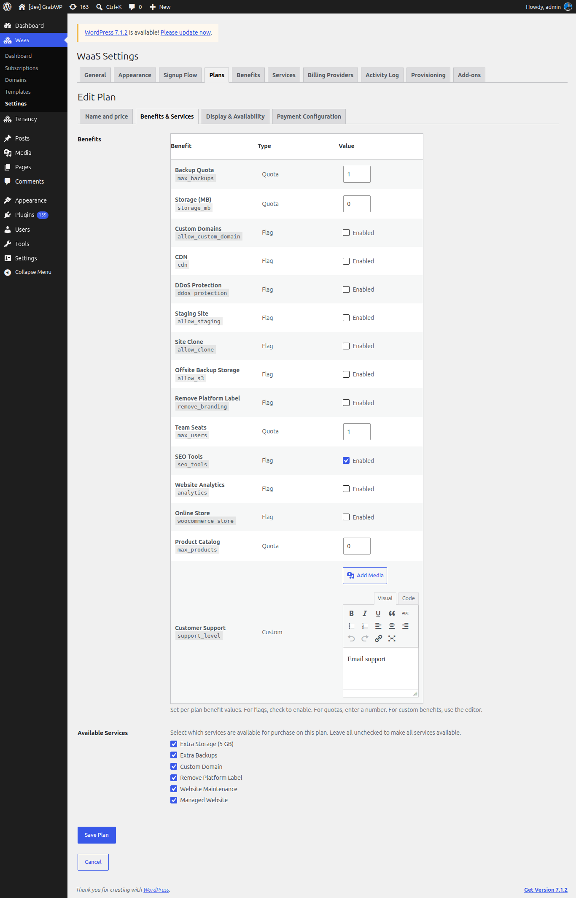

# Tạo plan

Plan là thứ khách chọn lúc signup. Cài mới seed **Free**, **Basic** và **Pro** khi bảng plan còn trống. Sửa các dòng đó cho khớp thứ bạn bán. Plan **free** không xóa được.

Vào **Waas → Settings → Plans** (`/wp-admin/admin.php?page=grabwp-tenancy-waas-settings&tab=plans`).

Cột danh sách: **Plan**, **ID**, **Monthly Price**, **Polar Products**, **Status**, **Order** và **Actions**. Bấm **Add New** để tạo plan khác. Biểu tượng bút mở **Edit Plan**. Biểu tượng thùng rác xóa plan khác **free**.

## Các tab của form plan

**Add Plan** và **Edit Plan** có bốn tab:

| Tab | Việc bạn đặt |
|-----|----------------|
| **Name and price** | **Plan ID**, **Name**, **Monthly Price**, **Yearly Price** |
| **Benefits & Services** | Giá trị benefit của plan và service nào được mua |
| **Display & Availability** | **Description**, **Features**, **Sort Order**, **Active** |
| **Payment Configuration** | Product ID hoặc price ID của provider |

Bấm **Create Plan** khi tạo mới, hoặc **Save Plan** khi sửa. **Cancel** về danh sách. Thông báo thành công: **Plan saved.**

## Name and price

| Trường | Ghi chú |
|--------|---------|
| **Plan ID** | Chữ thường, số và dấu gạch ngang. Ví dụ: `basic` hoặc `pro`. Chỉ đọc sau khi tạo. |
| **Name** | Nhãn hiện cho khách |
| **Monthly Price** | Lưu theo primary currency. `0` nghĩa là chu kỳ đó không thu phí. |
| **Yearly Price** | Cùng quy tắc với monthly |

Nếu đã cấu hình secondary currency, số đã quy đổi hiện cạnh giá để tham khảo. Đặt currency ở [Set Up Billing](/grabwp-tenancy-waas/waas-setup-billing).

**Cho hướng dẫn này:**

1. Sửa **Free**. Giữ cả hai giá ở `0`.
2. Sửa **Basic** hoặc **Pro** và đặt giá tháng cùng giá năm bạn sẽ thu.
3. Để **Payment Configuration** trống đến khi Polar.sh được bật. Lưu plan trả phí sau khi Polar đã cấu hình sẽ điền product ID.

## Benefits and services

Mở **Benefits & Services**.

| Phần | Ghi chú |
|------|---------|
| **Benefits** | Cột **Benefit**, **Type**, **Value**. Flag dùng checkbox **Enabled**. Quota nhập số. Benefit custom dùng editor. |
| **Available Services** | Chọn service khách được mua trên plan này. Bỏ chọn hết để cho phép mọi service đang active. |

Nếu chưa có service, form có link **Create a service**. Định nghĩa catalog trước ở [Services and Benefits](/grabwp-tenancy-waas/waas-services-benefits), rồi quay lại đây để đặt giá trị.

Dòng trợ giúp dưới benefits: **Set per-plan benefit values. For flags, check to enable, for quotas, enter a number. For custom benefits, use the editor.**

## Display and availability

Mở **Display & Availability**.

| Trường | Ghi chú |
|--------|---------|
| **Description** | Hiện cùng plan |
| **Features** | Mỗi dòng một feature |
| **Sort Order** | Số nhỏ hơn hiện trước |
| **Active** | Nhãn checkbox: **Plan is available for signup and upgrade** |

Plan không active vẫn nằm trong danh sách admin với status **Inactive** và không được chào lúc signup.

## Payment configuration

Mở **Payment Configuration** sau khi đã bật billing provider. Có thể lưu plan một lần ngay, rồi quay lại sau [Set Up Billing](/grabwp-tenancy-waas/waas-setup-billing).

Provider cần catalog ID hiện tiêu đề kiểu **Polar.sh Configuration** hoặc **Stripe Configuration**, kèm **Resync**.

| Trường | Ghi chú |
|--------|---------|
| **Polar Monthly Product ID** | Để trống để tự tạo khi Polar.sh đã cấu hình, hoặc dán UUID sản phẩm |
| **Polar Yearly Product ID** | Tương tự, cho chu kỳ năm |
| **Stripe Monthly Price ID** | Hiện khi add-on Stripe đang active. Cùng cách để trống để tự tạo. |
| **Stripe Yearly Price ID** | Tương tự, cho chu kỳ năm |

Dưới mỗi ID, **Find existing** tìm trong catalog của provider. Giá trị WaaS tự tạo được gắn badge **Auto-created**. Giá trị bạn gõ được gắn badge **Manual**.

**WooCommerce Checkout** không lưu product ID trên plan. Dòng trên form: **WooCommerce checkouts now use the shared anchor product configured on the WaaS Settings screen. Plans no longer store dedicated WooCommerce product IDs.**

Xendit không thêm trường product ID. Số tiền thu được tính từ giá plan.

## Giới hạn template theo plan

Trên template, **Allowed Plans** có thể giới hạn ai thấy template đó. Xem [Set Up Templates](/grabwp-tenancy-waas/waas-setup-templates).

## Kiểm tra

1. **Free** đang **Active**, cả hai giá là `0`, và không có thao tác xóa
2. Ít nhất một plan trả phí đang **Active**, giá tháng hoặc năm lớn hơn `0`
3. **Sort Order** khớp thứ tự bạn muốn trên trang pricing

---

**Tiếp theo:** [Set Up Billing](/grabwp-tenancy-waas/waas-setup-billing)
