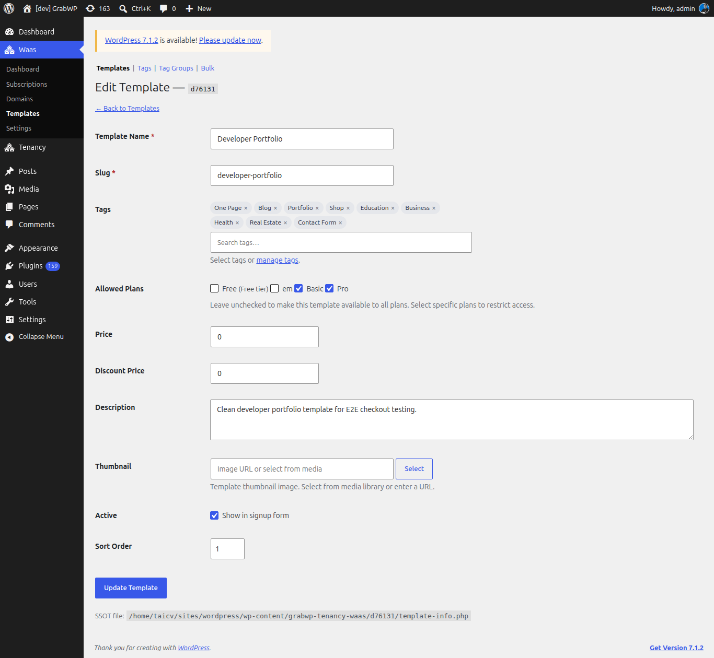
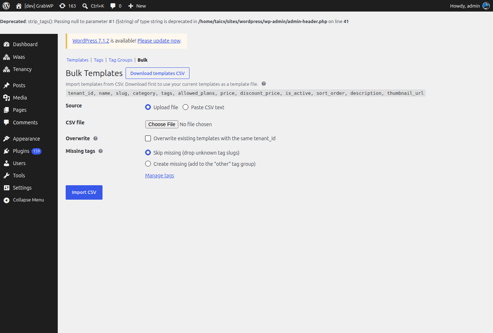

# Thiết lập template

Template là một tenant có sẵn được đánh dấu làm bản mẫu. Khi khách signup với template đó, site mới được clone từ nó. Tenant nguồn phải còn đó.

Vào **Waas → Templates** (`/wp-admin/admin.php?page=grabwp-tenancy-waas-templates`).

Thanh phụ trên màn hình này: **Templates** | **Tags** | **Tag Groups** | **Bulk**.

Cột danh sách: **Template Name**, **Slug**, **Source Tenant**, **Tags**, **Price**, **Active**, **Order**, **Actions**.

## Bước 1: Tạo tenant nguồn

1. Vào **Tenancy → Add New** (`/wp-admin/admin.php?page=grabwp-tenancy-create`)
2. Tạo tenant trên platform domain, ví dụ `template-starter.yoursaas.com`
3. Mở wp-admin của tenant đó và đặt theme, trang, menu cùng nội dung demo mà mọi bản sao sẽ bắt đầu từ đó

## Bước 2: Đăng ký template

1. Vào **Waas → Templates**
2. Bấm **Add New**

Khi sửa, tiêu đề là **Edit Template** và nút lưu là **Update Template**. Khi thêm, nút lưu là **Save as Template**. **Back to Templates** về danh sách.

| Trường | Ghi chú |
|--------|---------|
| **Source Tenant** | Chỉ lúc thêm. Bắt buộc. Không hiện khi sửa. |
| **Template Name** | Bắt buộc. Tiêu đề gallery. |
| **Slug** | Bắt buộc. Chữ thường, số và dấu gạch ngang. |
| **Tags** | Chọn tag, hoặc theo **manage tags**. |
| **Allowed Plans** | Bỏ chọn để dành cho mọi plan. Chọn plan để giới hạn template. Plan free được ghi **Free tier**. |
| **Price** | Phí thêm cho template này. `0` là không có phí template. |
| **Discount Price** | Giá thấp hơn, tùy chọn. `0` là không có giá giảm. |
| **Description** | Đoạn chữ cho gallery. |
| **Thumbnail** | **Select** từ media library, hoặc dán URL ảnh. **Remove** xóa. Placeholder: **Image URL or select from media**. |
| **Active** | **Show in signup form** |
| **Sort Order** | Số nhỏ hơn hiện trước |

Bấm **Save as Template** hoặc **Update Template**. Thông báo thành công: **Template saved.**

**Rebuild Index** trên danh sách viết lại file index template. Dùng khi gallery và danh sách không khớp. Thông báo thành công: **Templates index rebuilt.**

## Bước 3: Tags

Tag lọc gallery. Mở **Tags** (`/wp-admin/admin.php?page=grabwp-tenancy-waas-tags`).

Bấm **Add New**. Các trường:

| Trường | Ghi chú |
|--------|---------|
| **Slug** | Chỉ chữ thường, số, dấu gạch ngang |
| **Label** | Tên hiện trong gallery và trong bộ chọn tag của template |
| **Group** | Tag group mà tag này thuộc về |
| **Icon** | Ảnh nhỏ. **Select** hoặc **Remove**. Dùng làm chỉ báo feature. |
| **Image** | Ảnh lớn hơn, tùy chọn |
| **Sort Order** | Thứ tự trong group |
| **Active** | **Show in tag selectors** |

Danh sách lọc theo group và tìm bằng **Search Tags**.

## Bước 4: Tag Groups

Mở **Tag Groups** (`/wp-admin/admin.php?page=grabwp-tenancy-waas-tags-group`).

Khi chưa lưu group tùy chỉnh, WaaS dùng các group: **Style**, **Industry**, **Features**, **Page Builder**, **Base Theme**, **Status** và **Other**.

Bấm **Add New** để thêm group. Trường: **Slug**, **Label**, **Sort Order**.

Group nào hiện dạng pill hay dropdown do thuộc tính shortcode `filter-tags` của template browser, hoặc control block **Pill filter groups (filter-tags)**. Xem [Shortcode Reference](/grabwp-tenancy-waas/waas-shortcode-templates).

## Bước 5: Bulk CSV

Mở **Bulk** (`/wp-admin/admin.php?page=grabwp-tenancy-waas-bulk`).

1. Bấm **Download templates CSV** để xuất template hiện có
2. Sửa file. Bắt buộc có hàng header. Thứ tự cột không quan trọng. Mỗi hàng cần `tenant_id`, `name` và `slug`.
3. Chọn **Source**: **Upload file** hoặc **Paste CSV text**
4. Bật **Overwrite** nếu muốn **Overwrite existing templates with the same tenant_id**
5. Đặt **Missing tags**: **Skip missing (drop unknown tag slugs)** hoặc **Create missing (add to the "other" tag group)**
6. Bấm **Import CSV**

Các cột hiện trên trang: `tenant_id`, `name`, `slug`, `category`, `tags`, `allowed_plans`, `price`, `discount_price`, `is_active`, `sort_order`, `description`, `thumbnail_url`.

`tags` và `allowed_plans` phân tách bằng dấu `|` (`business|portfolio`). `is_active` là `1` hoặc `0`.

## Kiểm tra

1. Dòng template đang **Active**
2. Trang templates ở frontend liệt kê nó
3. Tag bạn gán hiện trên dòng

---

**Tiếp theo:** [Set Up Frontend Pages](/grabwp-tenancy-waas/waas-setup-frontend-pages)
