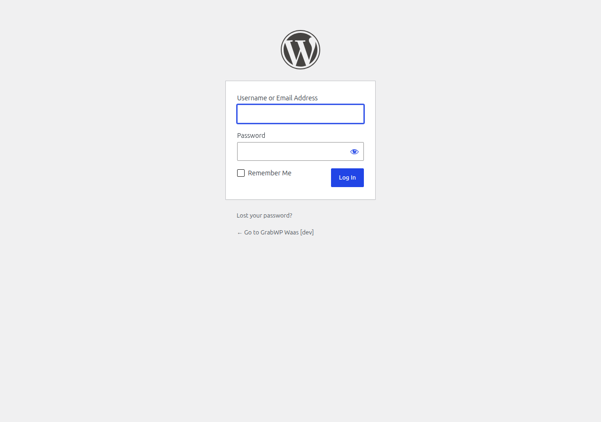

# Thiết lập trang Frontend

Nền tảng WaaS của bạn cần ba trang hướng tới khách hàng: **Signup**, **Dashboard** và **Templates**. Mỗi trang có thể dùng một shortcode hoặc một block Gutenberg.

## Thiết lập nhanh (Tự động tạo)

Cách nhanh nhất: vào **WaaS → Settings → General** và nhấn nút **Create/Repair Signup and Dashboard Pages**. Việc này tạo cả ba trang với các shortcode chính xác.

Sau đó chọn từng trang trong danh sách thả xuống tương ứng và lưu cài đặt.

## Thiết lập thủ công

### Phương án A: Dùng Shortcode

Tạo ba trang WordPress với các shortcode sau:

#### 1. Trang Signup

Tạo một trang mới (ví dụ: tiêu đề: "Signup", slug: `/signup/`).

Thêm shortcode này làm nội dung trang:

```
[grabwp_waas_signup]
```

Shortcode này hiển thị toàn bộ luồng đăng ký:
- Chọn gói
- Bộ chọn mẫu (nếu có mẫu)
- Form chi tiết site (subdomain, email)
- Chuyển hướng thanh toán (cho gói trả phí)
- Trạng thái khởi tạo

#### 2. Trang Dashboard

Tạo một trang mới (ví dụ: tiêu đề: "Dashboard", slug: `/dashboard/`).

```
[grabwp_waas_dashboard]
```

Shortcode này hiển thị bảng điều khiển của chủ tenant:
- Tổng quan site và liên kết nhanh
- Trạng thái subscription và thanh toán
- Quản lý tên miền riêng
- Sao lưu và khôi phục
- Cài đặt tài khoản (email, mật khẩu)

#### 3. Trang Templates

Tạo một trang mới (ví dụ: tiêu đề: "Templates", slug: `/templates/`).

```
[grabwp_waas_templates]
```

Shortcode này hiển thị thư viện trình duyệt mẫu với:
- Thẻ mẫu kèm ảnh thu nhỏ và mô tả
- Lọc theo tag (pill và danh sách thả xuống)
- Tìm kiếm
- Phân trang
- Nút xem trước và "Use this template"

> **Tùy chỉnh trình duyệt mẫu** bằng các thuộc tính shortcode. Xem [Tham chiếu Shortcode](/vi/grabwp-tenancy-waas/waas-shortcode-templates) để biết mọi tùy chọn.

Các cấu hình phổ biến:

```
// Hiển thị mọi mẫu, bộ lọc mặc định
[grabwp_waas_templates]

// Hiển thị 9 mẫu mỗi trang, tag industry dạng pill
[grabwp_waas_templates per-page="9" filter-tags="industry"]

// Thư viện tuyển chọn, không bộ lọc, không phân trang
[grabwp_waas_templates tags="featured" tags-browser="no" per-page="0"]
```

### Phương án B: Dùng block Gutenberg

Nếu bạn thích trình soạn thảo block hơn, hãy dùng các block Gutenberg thay cho shortcode.

#### 1. Block Signup

1. Chỉnh sửa trang Signup của bạn
2. Nhấn **+** (trình chèn block) và tìm **"WaaS Signup"**
3. Chèn block
4. Lưu trang

#### 2. Block Dashboard

1. Chỉnh sửa trang Dashboard của bạn
2. Tìm **"WaaS Dashboard"**
3. Chèn block — hỗ trợ căn chỉnh rộng và toàn chiều rộng
4. Lưu

#### 3. Block Template Browser

1. Chỉnh sửa trang Templates của bạn
2. Tìm **"GrabWP Template Browser"**
3. Chèn block
4. Cấu hình qua **thanh bên Settings** (nhấn biểu tượng bánh răng):

| Điều khiển | Chức năng |
|---------|-------------|
| **Limit by tags** | Bộ lọc phía server — chỉ tải các mẫu có những tag này |
| **Show tag browser toolbar** | Bật/tắt thanh công cụ lọc |
| **Pill filter groups** | Nhóm tag nào hiển thị dạng nút pill thay vì danh sách thả xuống |
| **Cards per page** | Số thẻ mẫu mỗi trang (0 = hiển thị tất cả) |

5. Lưu trang

> **Lưu ý:** Block hiển thị một placeholder trong trình soạn thảo. Thư viện đầy đủ chỉ hiển thị trên frontend.

Xem [Hướng dẫn Block](/vi/grabwp-tenancy-waas/waas-block-walkthrough) để biết cách dùng block chi tiết.

## Liên kết trang trong cài đặt WaaS

Sau khi tạo các trang, hãy kết nối chúng:

1. Vào **WaaS → Settings → General**
2. Đặt từng danh sách thả xuống:
   - **Signup Page** → trang Signup của bạn
   - **Dashboard Page** → trang Dashboard của bạn
   - **Templates Page** → trang Templates của bạn
3. Nhấn **Save Settings**



## So sánh Shortcode và Block

| Tính năng | Shortcode | Block |
|---------|-----------|-------|
| **Dễ sử dụng** | Dán văn bản shortcode | Chèn qua trình soạn thảo trực quan |
| **Cấu hình** | Thuộc tính trong chuỗi shortcode | Điều khiển trên thanh bên Inspector |
| **Xem trước trong trình soạn thảo** | Hiển thị văn bản shortcode | Hiển thị placeholder |
| **Kết quả frontend** | Giống hệt | Giống hệt |
| **Tương thích theme** | Hoạt động mọi nơi | Cần theme tương thích block |

Cả hai đều tạo ra cùng kết quả frontend. Chọn cái nào bạn thấy thoải mái hơn.

## Kiểm thử các trang

Sau khi thiết lập, truy cập từng trang trên frontend:

1. **Trang Signup** — nên hiển thị phần chọn gói và form đăng ký
2. **Trang Templates** — nên hiển thị thư viện mẫu với các mẫu của bạn
3. **Trang Dashboard** — nên hiển thị form đăng nhập/OTP (khi chưa đăng nhập) hoặc bảng điều khiển (khi đã đăng nhập)

---

**Tiếp theo:** [Danh sách kiểm tra Go-Live](/vi/grabwp-tenancy-waas/waas-go-live-checklist)
