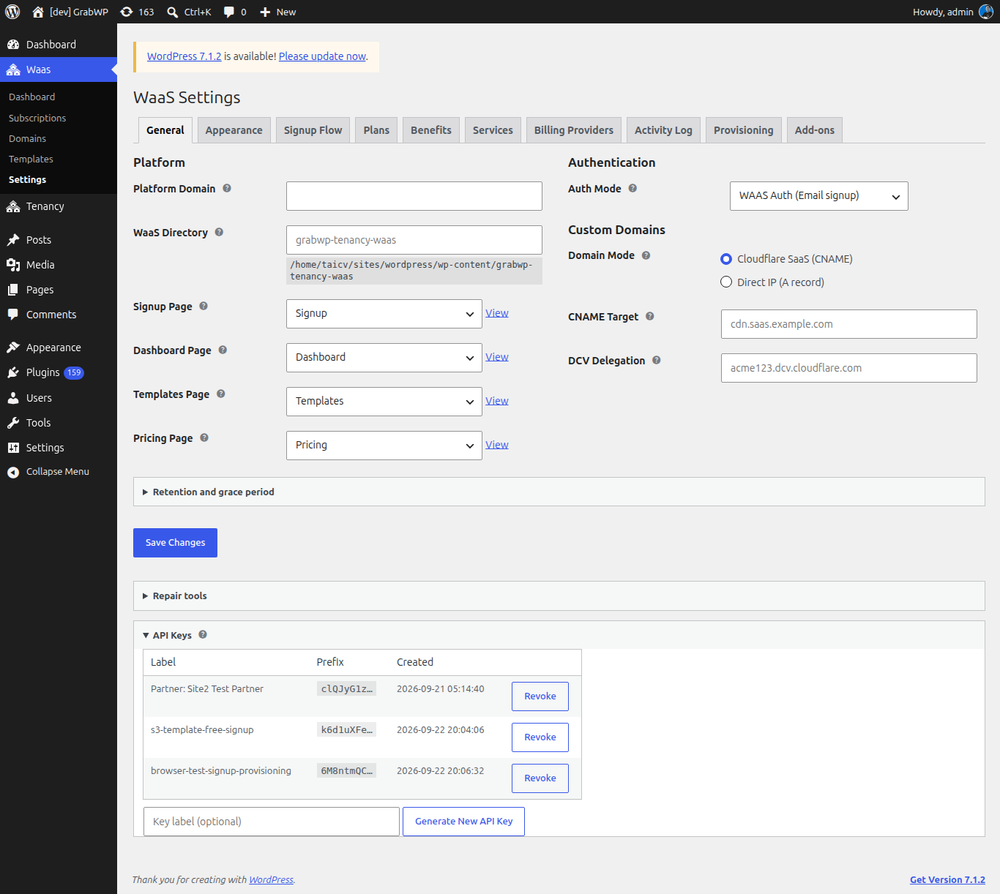

# Quản lý tên miền tùy chỉnh

Tên miền tùy chỉnh cho phép tenant dùng hostname riêng (ví dụ `mybusiness.com`) bên cạnh hostname nền tảng (`customer.yoursaas.com`). Khách thêm alias trên dashboard. Bạn xác minh trên **Domains**.

**Truy cập Waas → Domains** (`/wp-admin/admin.php?page=grabwp-tenancy-waas-domains`).

Nếu chưa đặt **Domain Mode**, trang hiện: **Domain settings not configured. Go to WaaS Settings → General to set domain mode.** Hostname thuộc **Platform Domain** đã cấu hình không xuất hiện trong danh sách này. Tên miền tùy chỉnh và alias vẫn còn.

## Bộ lọc và cột

Liên kết view phía trên:

| View | URL |
|------|-----|
| **All** | `page=grabwp-tenancy-waas-domains` |
| **Verified** | `dns_filter=verified` |
| **Pending** | `dns_filter=pending` |

**Verified** là các tên miền lần kiểm tra gần nhất thành công. **Pending** là các tên miền đã kiểm tra nhưng chưa đạt. Tên miền chưa từng kiểm tra nằm ở **All** với trạng thái **Unknown**. Chúng không nằm trong **Pending**.

| Cột | Ghi chú |
|-----|---------|
| **Domain** | Hostname |
| **Tenant** | Tenant ID |
| **Type** | **Primary** (hostname đầu tiên) hoặc **Alias** |
| **Status** | **Unknown**, **Verified**, hoặc **Pending** |
| **Last Checked** | Thời gian tương đối. Quá 24 giờ được đánh dấu **(stale)**. Trống cho đến lần kiểm tra đầu. |
| **Actions** | Dấu tích. Tooltip: **Verify domain** |

Dùng **Search Domains** để khớp hostname. Mỗi trang 10 dòng. **Domain**, **Tenant**, và **Type** sắp xếp được.

## Xác minh tên miền

Thao tác xác minh gọi `https://the-domain/?grabwp-verify-domain=1` (rồi HTTP nếu HTTPS lỗi) và kiểm tra phản hồi thuộc đúng tenant đã map. Đây không phải lệnh tra DNS đơn thuần. Tên miền phải phân giải và tới đúng site WordPress này.

1. Mở **Waas → Domains**.
2. Với một dòng, bấm dấu tích trong **Actions**.
3. Hoặc chọn nhiều dòng, chọn **Verify** trong **Bulk actions**, rồi bấm **Apply**.
4. Tải lại danh sách.

**Verify:** **Status** là **Verified**, hoặc **Pending** với **Last Checked** mới. Lần kiểm tra cũ hơn một ngày hiện **(stale)**. Chạy **Verify** lại sau khi DNS đổi.

Lỗi thường gặp:

| Kết quả | Ý nghĩa |
|---------|---------|
| **Pending**, domain did not respond | DNS chưa trỏ về đây, hoặc web server chưa nhận hostname. |
| **Pending**, reachable but not serving this site | Hostname trả lời, nhưng không phải tenant này. |
| Domain is not mapped to a tenant | Hostname không nằm trên bản ghi tenant. |

> **Note:** DNS có thể mất tới 48 giờ. Trên dashboard của khách, **Verify** yêu cầu thêm bản ghi trước, rồi **Check now**, và đợi ít nhất 15 phút trước khi thử lại.

## Chọn domain mode

**Truy cập Waas → Settings** (`/wp-admin/admin.php?page=grabwp-tenancy-waas-settings&tab=general`) và mở tab **General**. Mục **Custom Domains** quyết định hướng dẫn khách nhìn thấy.

| Trường | Ghi chú |
|--------|---------|
| **Domain Mode** | **Cloudflare SaaS (CNAME)** hoặc **Direct IP (A record)** |
| **CNAME Target** | Hiện với Cloudflare SaaS. Khách trỏ CNAME vào đây. Placeholder: `cdn.saas.example.com` |
| **DCV Delegation** | Hiện với Cloudflare SaaS. Giá trị CNAME từ Cloudflare để custom hostname xác thực SSL. Placeholder: `acme123.dcv.cloudflare.com` |
| **Server Public IP** | Hiện với Direct IP. Khách trỏ bản ghi A vào đây. |

Bấm **Save Changes**. Trang Domains sau đó hiện **Mode:** và giá trị bản ghi (ví dụ `CNAME: cdn.saas.example.com`).

## Cloudflare SaaS (CNAME)

1. Thêm zone nền tảng vào Cloudflare và bật Cloudflare for SaaS (SSL/TLS → Custom Hostnames). Tính năng này có thể cần gói Cloudflare trả phí.
2. Đặt fallback origin bằng hostname bạn sẽ dùng làm **CNAME Target**, và trỏ hostname đó về server này.
3. Trong **Custom Domains**, chọn **Cloudflare SaaS (CNAME)**, điền **CNAME Target**, và dán **DCV Delegation** nếu Cloudflare cung cấp.
4. Bấm **Save Changes**.

DNS phía khách (cũng hiện trên dashboard của tenant):

| Name | Type | Value |
|------|------|-------|
| `@` | `CNAME` | **CNAME Target** của bạn |
| `www` | `CNAME` | **CNAME Target** của bạn |
| `_acme-challenge.<your-domain>` | `CNAME` | `<your-domain>.` cộng giá trị **DCV Delegation** |

Dòng DCV chỉ hiện khi đã điền **DCV Delegation**.

> **Tài liệu Cloudflare:** [Cloudflare for SaaS](https://developers.cloudflare.com/cloudflare-for-platforms/cloudflare-for-saas/)

## Direct IP (A record)

1. Trong **Custom Domains**, chọn **Direct IP (A record)** và nhập **Server Public IP**.
2. Bấm **Save Changes**.
3. Với mỗi hostname tùy chỉnh, cho web server nhận tên đó (Nginx `server_name` hoặc virtual host Apache) và cấp chứng chỉ (ví dụ Certbot). Reload web server.
4. Xác minh tên miền trên **Waas → Domains**.

DNS phía khách:

| Name | Type | Value |
|------|------|-------|
| `@` | `A` | **Server Public IP** của bạn |
| `www` | `A` | **Server Public IP** của bạn |

> **Note:** Mỗi hostname Direct IP cần server name và chứng chỉ riêng. Cloudflare SaaS cấp chứng chỉ cho custom hostname sau khi đã đặt **CNAME Target** và **DCV Delegation**.

## Dashboard của khách

Công cụ tên miền hiện khi gói của tenant có benefit tên miền tùy chỉnh. Xem [Services and Benefits](/grabwp-tenancy-waas/waas-services-benefits).

Trên bảng Domains của dashboard, khách có thể:

1. Nhập hostname và bấm **Add Alias**. Một tenant có tối đa 2 alias. Nút xác nhận là **Add alias**.
2. Bấm **Verify**, rồi **Check now**, sau khi các bản ghi DNS ở trên đã có.
3. Khi alias đã **Verified** và chưa phải primary, bấm **Set Primary**. Xác nhận bằng **Set primary**. URL của site đổi sang hostname đó.
4. Bấm **Remove** trên alias không phải hostname primary.

Hostname nền tảng giữ nguyên cho đến khi một tên miền tùy chỉnh đã xác minh được đặt làm primary. Trạng thái của nó trên dashboard là **Active**. Nó không liệt kê trên **Waas → Domains** sau khi đã đặt **Platform Domain**.

**Verify:** Dòng trên Domains admin là **Verified**, **Last Checked** mới, và site tenant mở được bằng hostname tùy chỉnh.

---

**Tiếp theo:** [Quản lý subscription](/grabwp-tenancy-waas/waas-managing-subscriptions)
