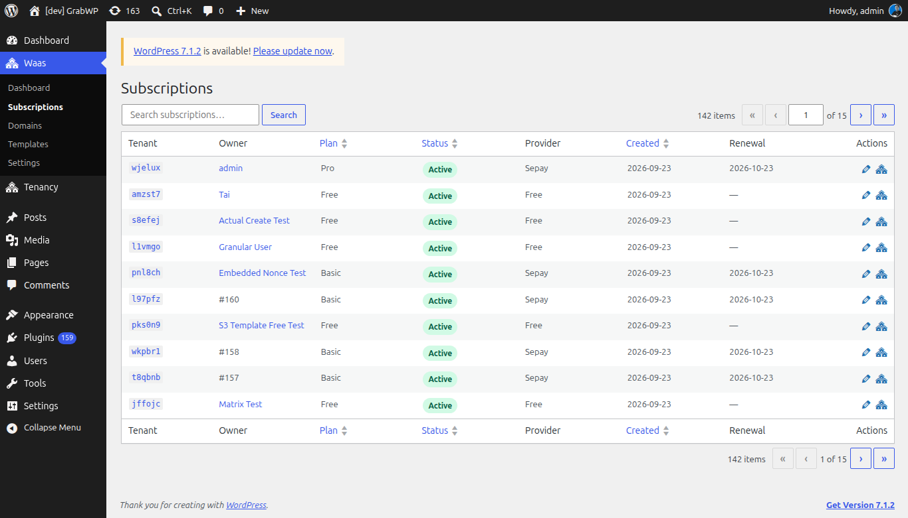
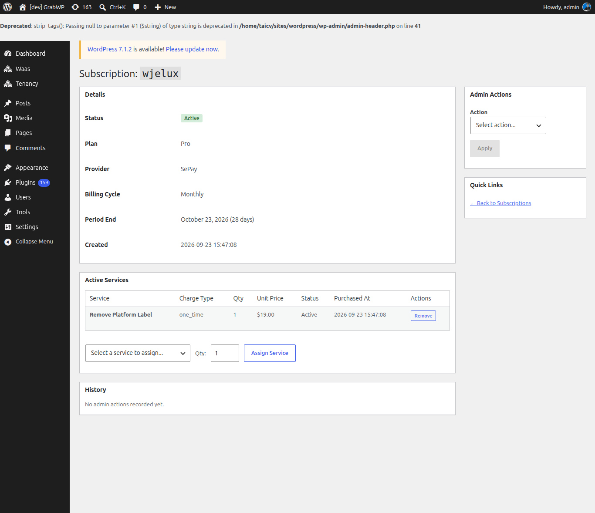

# Quản lý subscription

Mỗi tenant có một dòng subscription: gói, trạng thái, nhà cung cấp thanh toán, và ngày gia hạn. Admin sửa dòng đó từ **Subscriptions**. Khách hủy hoặc giữ subscription trên dashboard của họ.

**Truy cập Waas → Subscriptions** (`/wp-admin/admin.php?page=grabwp-tenancy-waas-subscriptions`).

## Danh sách

| Cột | Ghi chú |
|-----|---------|
| **Tenant** | Tenant ID. Mở màn hình chi tiết. |
| **Owner** | User WordPress. Mở hồ sơ user. |
| **Plan** | Plan ID, viết hoa chữ đầu |
| **Status** | Badge theo trạng thái lưu: **Active**, **Pending**, **Trial**, **Warning**, **Suspended**, **Cancelled**. **Warning** còn hiện **Expired N days ago**. |
| **Provider** | Tên nhà cung cấp thanh toán |
| **Created** | Ngày. Sắp xếp được. Mặc định mới nhất trước. |
| **Renewal** | Ngày `current_period_end`. Trống khi dòng không có ngày kết thúc kỳ. |
| **Actions** | **Edit** (chi tiết), **View Tenant** (trình sửa tenant, tab mới). **Reactivate** hiện khi trạng thái là **Suspended** hoặc **Cancelled**. |

**Plan** và **Status** sắp xếp được. Placeholder ô tìm là **Search subscriptions…**. Bấm **Search**. Mỗi trang 10 dòng.

## Trạng thái

Danh sách in trạng thái đã lưu. Màn hình chi tiết dùng badge có thể khác khi có ngày hoặc lịch hủy.

| Trạng thái lưu | Badge chi tiết | Ý nghĩa |
|----------------|----------------|---------|
| `pending` | **Pending** | Đăng ký đã bắt đầu. Site có thể chưa sẵn sàng. |
| `active` | **Active** | Quyền trả phí hoặc miễn phí còn hiệu lực. |
| `active`, còn tối đa 7 ngày | **Expiring Soon** | Vẫn active. Chỉ badge chi tiết. Gói miễn phí giữ **Active**. |
| `active` và hủy cuối kỳ | **Cancelling** | Vẫn truy cập đến **Period End**. |
| `trial` | **Trial** | Đang dùng thử. |
| `warning` | **Grace Period** | Đã qua ngày kết thúc kỳ. Site còn trong cửa sổ gia hạn. |
| `suspended` | **Suspended** | Hết cửa sổ gia hạn, hoặc admin đã tạm ngưng. |
| `cancelled` | **Cancelled** | Subscription đã hủy. |

## Mở một subscription

Bấm tenant ID hoặc biểu tượng bút chì (**Edit**).

Màn hình chi tiết là `page=grabwp-tenancy-waas-subscription-detail&tenant_id=<id>`.

### Details

| Trường | Ghi chú |
|--------|---------|
| **Status** | Badge theo bảng trên |
| **Plan** | Tên gói |
| **Provider** | Tên hiển thị của nhà cung cấp |
| **Billing Cycle** | **Monthly** hoặc **Yearly** |
| **Period End** | Ngày, rồi số ngày, **Today**, hoặc **Expired** |
| **Created** | Mốc thời gian |
| **Provider Subscription ID** | Hiện khi nhà cung cấp đã lưu ID |
| **Cancellation** | **Scheduled at period end** khi đã xếp lịch hủy |

**Quick Links:** **Back to Subscriptions**, và **Edit Tenant** khi Tenancy đang bật.

## Admin Actions

Form cột bên là **Admin Actions**. Chọn một action, điền trường hiện ra, rồi bấm **Apply**. **Apply** tắt cho đến khi chọn action. Mọi action trừ **Add Note** đều cần **Reason (required)**.

| Action | Trường |
|--------|--------|
| **Extend Period** | **Days** (1-365, mặc định 30) và **Reason (required)** |
| **Change Plan** | **Plan** (các gói active) và **Reason (required)** |
| **Grant Complimentary** | **Days**, **Plan**, và **Reason (required)** |
| **Suspend** | **Reason (required)** |
| **Reactivate** | **Reason (required)** |
| **Add Note** | Chỉ **Note**. Không có trường lý do. |

> **Note:** **Change Plan** cập nhật subscription WaaS ngay. Hãy sửa subscription tương ứng bên nhà cung cấp khi họ vẫn tính phí gói cũ.

Lưu thành công hiện **Action completed successfully.**

## Active Services

**Active Services** liệt kê service add-on của tenant này. Quản lý danh mục ở [Services and Benefits](/grabwp-tenancy-waas/waas-services-benefits).

| Cột | Ghi chú |
|-----|---------|
| **Service** | Tên service |
| **Charge Type** | Kiểu đã lưu: `one_time`, `recurring`, hoặc `non_recurring` |
| **Qty** | Số lượng |
| **Unit Price** | Giá theo đơn vị tiền WaaS |
| **Status** | Trạng thái mục, viết hoa chữ đầu |
| **Purchased At** | Mốc tạo |
| **Actions** | **Remove** khi mục đang active. Xác nhận: **Remove this service?** |

Để gắn service: chọn **Select a service to assign...**, đặt **Qty:** (tối thiểu 1), rồi bấm **Assign Service**.

Nếu tenant chưa có service, hộp hiện **No active services.**

## History

**History** ghi các action của admin. Khi trống: **No admin actions recorded yet.**

| Cột | Ghi chú |
|-----|---------|
| **Date** | `Y-m-d H:i` |
| **Action** | Tên action, gạch dưới đổi thành từ |
| **Admin** | Tên hiển thị, hoặc user ID |
| **Details** | Giá trị lưu sau thay đổi |
| **Reason** | Nội dung bạn nhập |

## Thời gian gia hạn

**Truy cập Waas → Settings**, tab **General** (`page=grabwp-tenancy-waas-settings&tab=general`). Mở **Retention and grace period**.

| Trường | Ghi chú |
|--------|---------|
| **Grace Period (days)** | 0-90. Chú thích: số ngày trước khi tenant bị suspended sau khi hủy. **0** nghĩa là ngay lập tức. Mặc định khi chưa đặt là 7. |

Job hằng ngày làm ba việc:

1. Gửi nhắc gia hạn khi kỳ **Active** kết thúc trong 3 ngày.
2. Chuyển dòng **Active** đã qua **Period End** sang `warning` (**Grace Period** trên màn hình chi tiết) và có thể gửi email cảnh báo.
3. Chuyển dòng `warning` vẫn quá ngày kết thúc kỳ sau số ngày gia hạn sang **Suspended**, và có thể gửi email thông báo tạm ngưng.

Job không tự hủy một dòng đã suspended.

## Thao tác của khách

Trên dashboard của tenant, **Subscription Actions** có thể gồm:

- **Cancel Subscription**. Tiêu đề hộp thoại là **Cancel Subscription**. Khách chọn lý do, bấm **Continue**, rồi **Confirm Cancellation**. Nội dung mặc định nói quyền truy cập còn đến ngày gia hạn kế tiếp. **Cancel immediately (lose access now)** cắt quyền ngay. **Keep Subscription** đóng hộp thoại.
- **Keep Subscription Active** khi đã xếp lịch hủy. Xác nhận: **Keep subscription**.
- Lựa chọn nâng cấp khi có gói cao hơn.

Một số nhà cung cấp bảo khách dùng cổng của họ thay vì các nút này.

**Verify:** Sau **Apply**, badge chi tiết và dòng **History** khớp action, và cột **Status** hoặc **Renewal** trên danh sách khớp theo.

---

**Tiếp theo:** [Lưu trữ đối tượng S3](/grabwp-tenancy-waas/waas-optional-s3-storage)
