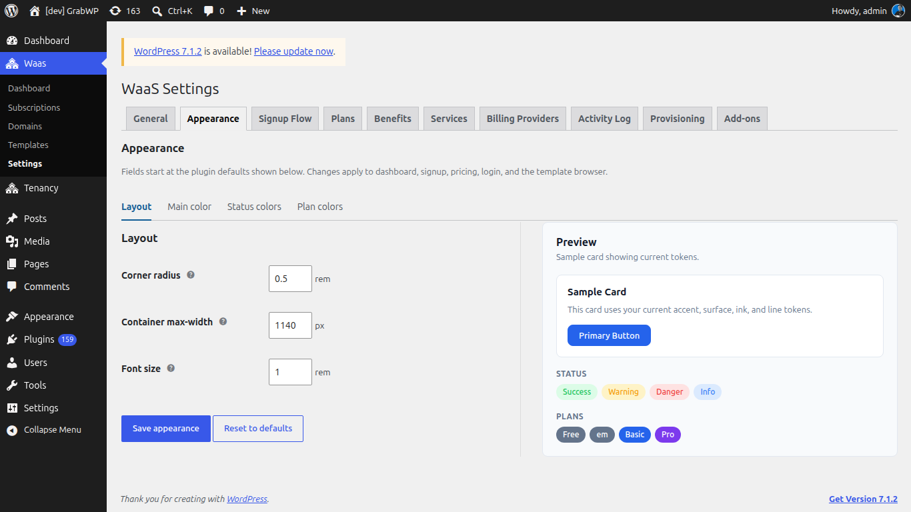
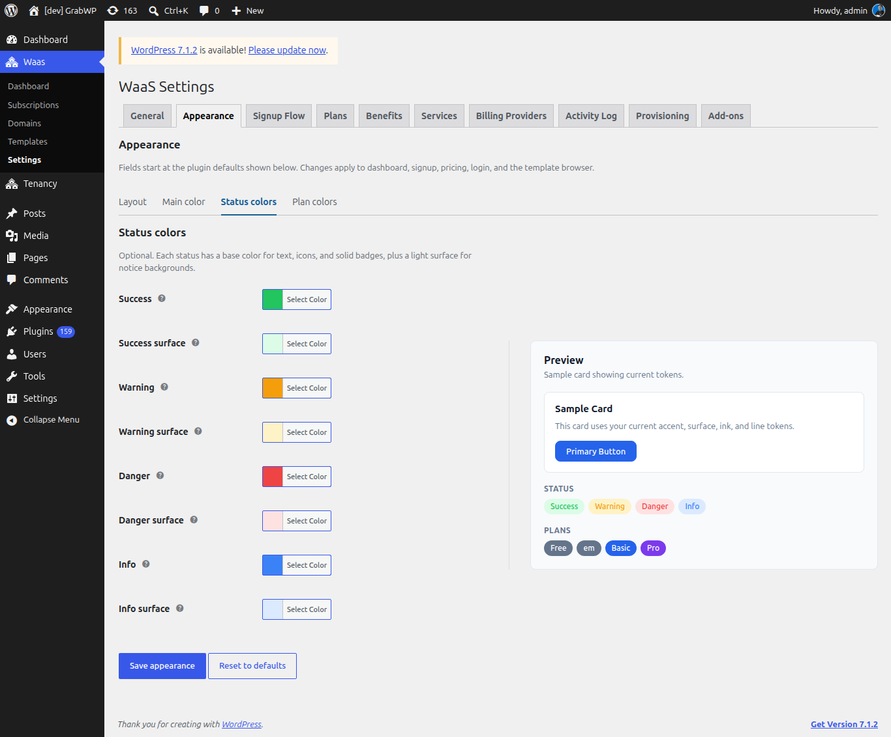
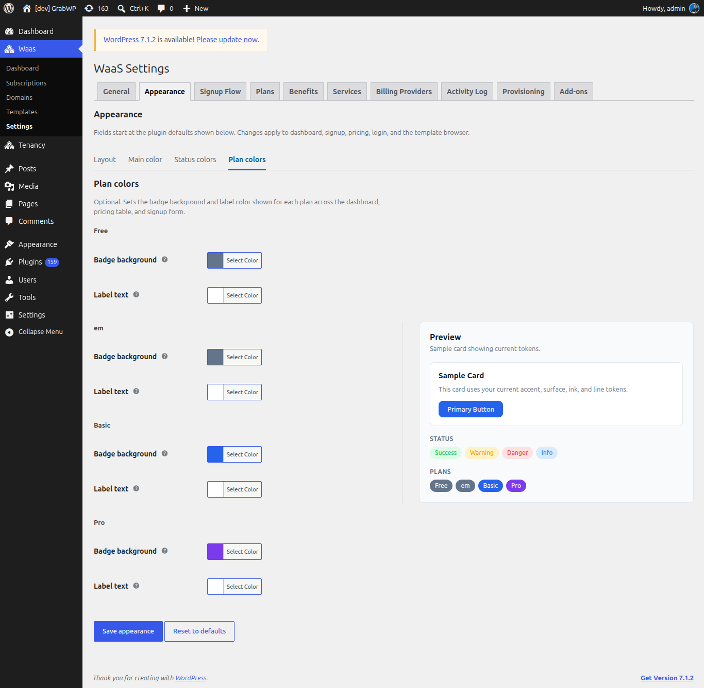

# Thiết lập giao diện signup và dashboard

Token giao diện định kiểu dashboard của khách, signup, pricing, login và template browser. Các trường bắt đầu từ mặc định của plugin. Một lần lưu ghi mọi sub-tab, kể cả tab đang không mở.

Bạn hãy truy cập vào **Waas → Settings → Appearance** (`/wp-admin/admin.php?page=grabwp-tenancy-waas-settings&tab=appearance`).

Các sub-tab là **Layout**, **Main color**, **Status colors** và **Plan colors**. Cột **Preview** luôn hiện trên mỗi tab.

## Layout

| Trường | Mặc định | Ghi chú |
|---|---|---|
| **Corner radius** | `0.5` rem | Bán kính gốc từ 0 đến 2, bước 0,05. Góc nhỏ hơn và lớn hơn được tính từ giá trị này. |
| **Container max-width** | `1140` px | Bề rộng tối đa của nội dung trang, từ 720 đến 1920, bước 10. |
| **Font size** | `1` rem | Cỡ chữ gốc từ 0,5 đến 2, bước 0,05. Chữ còn lại co giãn theo cỡ này. |

## Main color

Mở **Main color**.

Bảy màu này là nền của mọi bề mặt.

| Trường | Mặc định | Ghi chú |
|---|---|---|
| **Accent** | `#2563eb` | Nút chính, liên kết và mục điều hướng đang chọn. |
| **Accent contrast** | `#ffffff` | Chữ trên nền accent. |
| **Ink** | `#0f172a` | Chữ chính. |
| **Muted** | `#64748b` | Chữ phụ và gợi ý. |
| **Surface** | `#ffffff` | Nền thẻ và form. |
| **Canvas** | `#f8fafc` | Nền trang phía sau các thẻ. |
| **Line** | `#e2e8f0` | Viền và đường ngăn. |

## Status colors

Mở **Status colors**.

Mỗi trạng thái có một màu gốc cho chữ, icon và badge đặc, cùng một surface nhạt cho nền thông báo. Các trường này là tùy chọn.

| Trường | Mặc định | Ghi chú |
|---|---|---|
| **Success** | `#22c55e` | Xác nhận, trạng thái active và badge đã thanh toán. |
| **Success surface** | `#dcfce7` | Nền nhạt phía sau thông báo và badge success. |
| **Warning** | `#f59e0b` | Site sắp hết hạn, grace period và cảnh báo. |
| **Warning surface** | `#fef3c7` | Nền nhạt phía sau thông báo và badge warning. |
| **Danger** | `#ef4444` | Lỗi, thao tác phá hủy và site bị suspended. |
| **Danger surface** | `#fee2e2` | Nền nhạt phía sau thông báo lỗi và badge. |
| **Info** | `#3b82f6` | Thông báo trung tính, trial và badge thông tin. |
| **Info surface** | `#dbeafe` | Nền nhạt phía sau thông báo thông tin và badge. |

## Plan colors

Mở **Plan colors**.

Mỗi plan đang có nhận **Badge background** và **Label text**. Badge hiện trên dashboard, bảng giá và form signup. Hãy tạo plan trước nếu sub-tab này báo chưa có plan. Xem [Tạo plan](/grabwp-tenancy-waas/waas-create-plans).

Màu khởi đầu có sẵn:

| Slug plan | Badge background | Label text |
|---|---|---|
| `free` | `#64748b` | `#ffffff` |
| `basic` | `#2563eb` | `#ffffff` |
| `pro` | `#7c3aed` | `#ffffff` |
| Slug khác | `#64748b` | `#ffffff` |

## Preview

**Preview** có dòng **Sample card showing current tokens.** Bản xem trước gồm:

- Một **Sample Card** với câu "This card uses your current accent, surface, ink, and line tokens." và nút **Primary Button**.
- Badge **Status** cho **Success**, **Warning**, **Danger** và **Info**.
- Badge **Plans**, mỗi plan một badge.

Đổi màu và bo góc cập nhật preview trước khi lưu. **Container max-width** được lưu cùng các token khác và không được vẽ bên trong thẻ mẫu đó.

## Lưu

1. Chỉnh bất kỳ sub-tab nào. Không cần lưu giữa các sub-tab.
2. Bấm **Save appearance**.

**Kiểm tra:** thông báo **Settings saved.** xuất hiện, và trang signup hoặc dashboard của khách dùng màu, bo góc, chiều rộng và cỡ chữ mới.

Bấm **Reset to defaults** để xóa phần ghi đè và đưa mọi trường appearance về mặc định của plugin ở trên. **Kiểm tra:** **Settings saved.** xuất hiện và các trường hiện lại các mặc định đó.

---

**Tiếp theo:** [Benefits, Services và Add-ons](/grabwp-tenancy-waas/waas-services-benefits)
