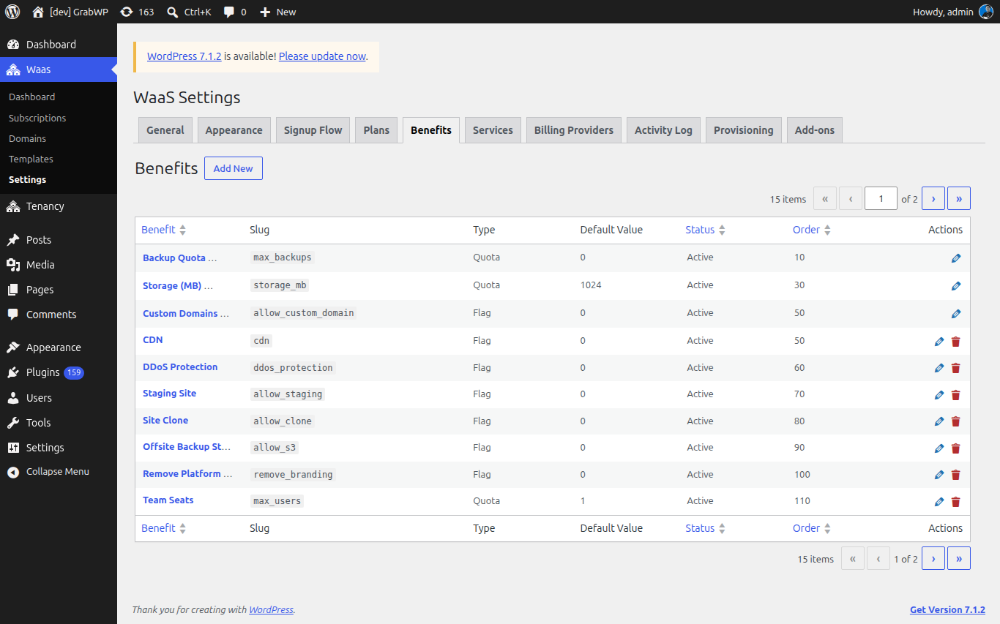
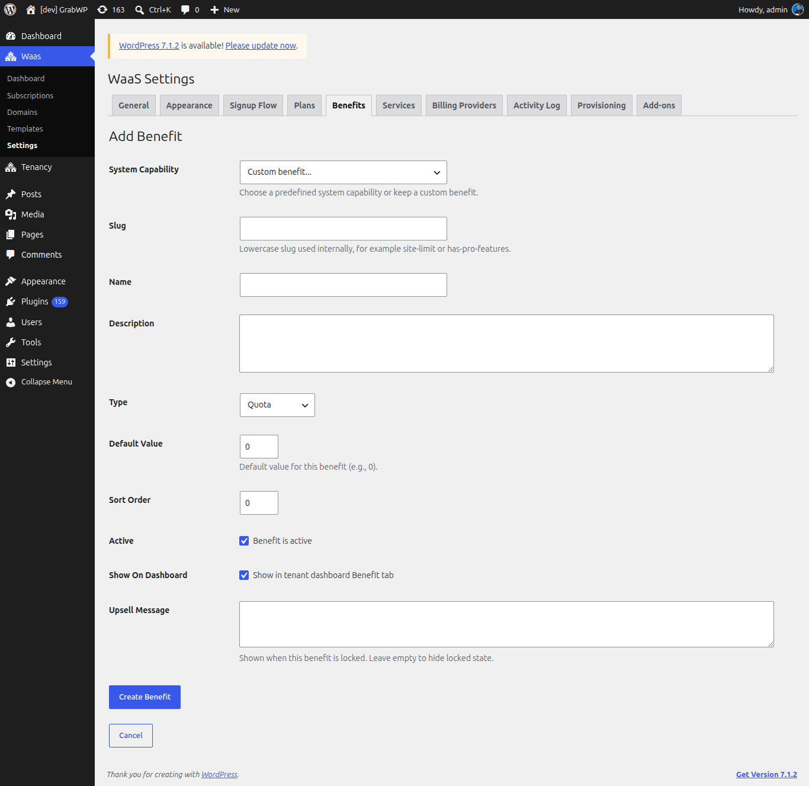
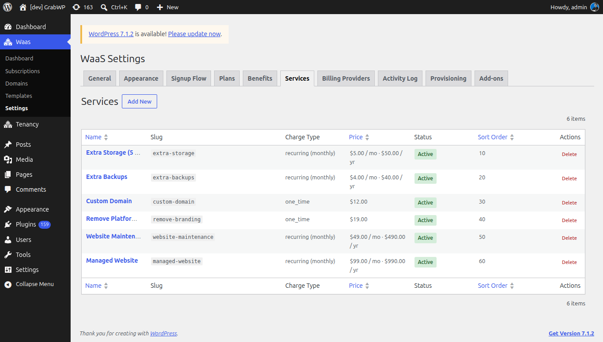
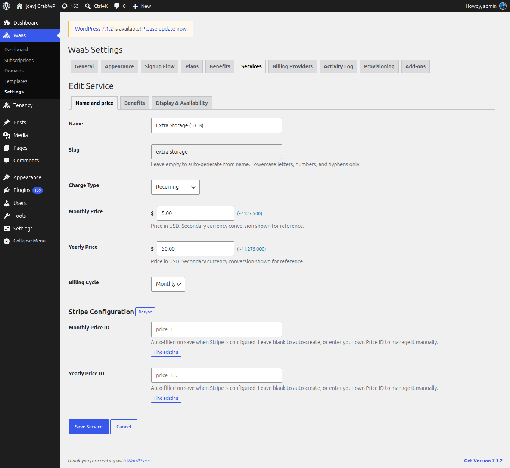
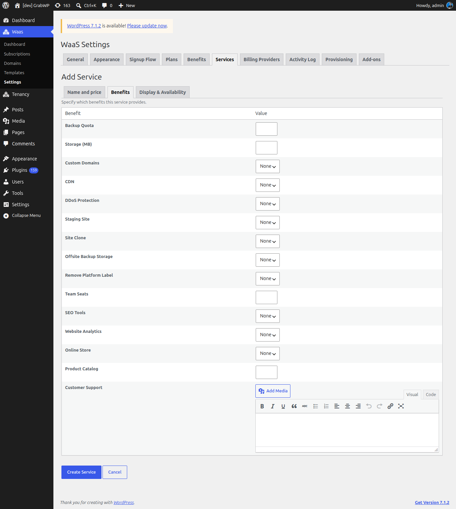
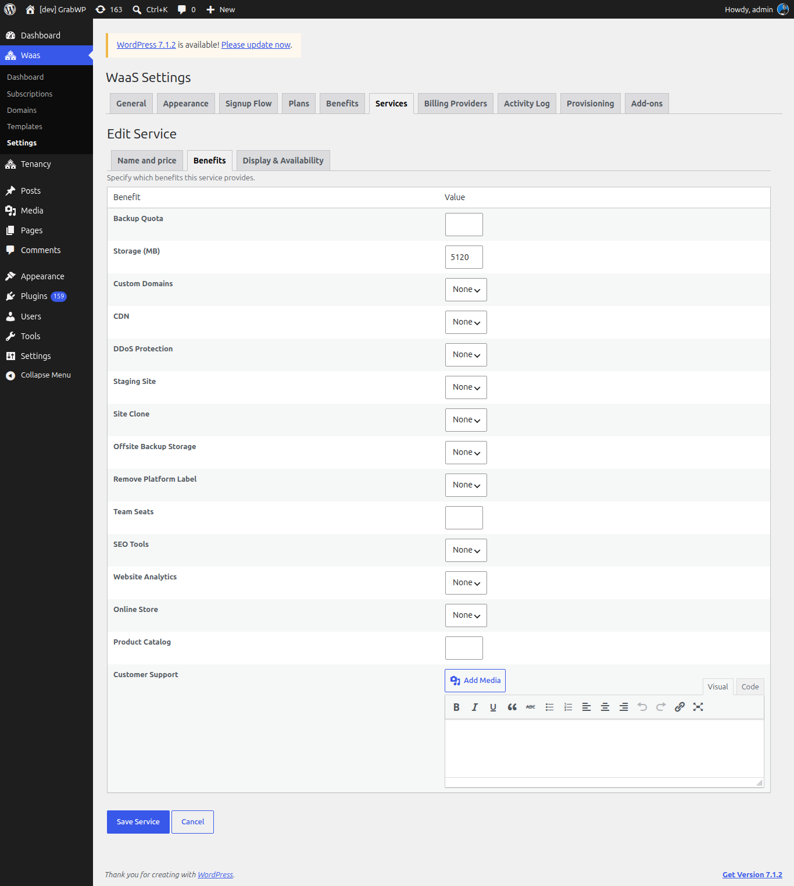
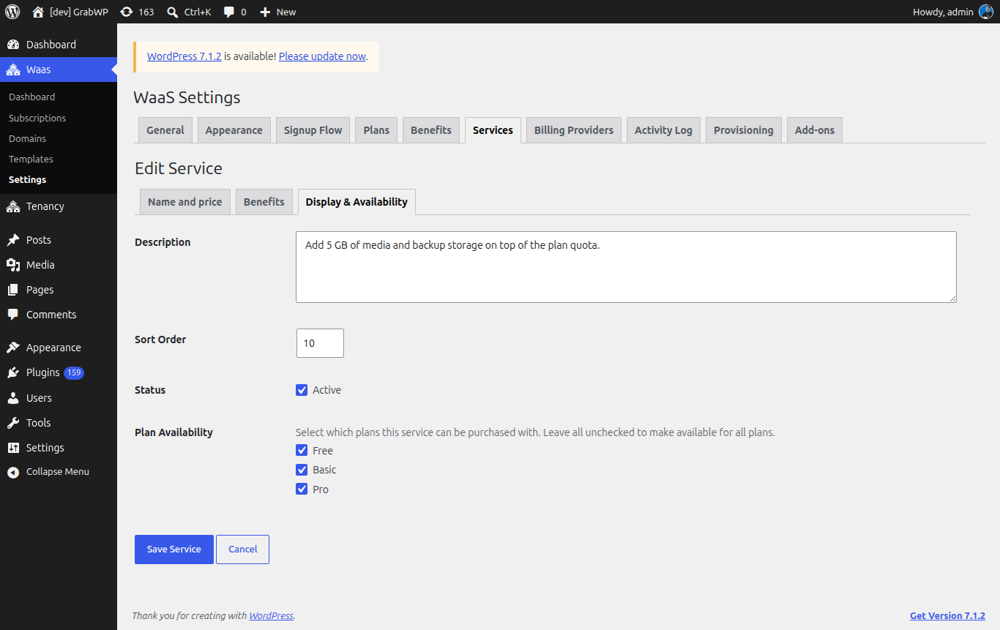
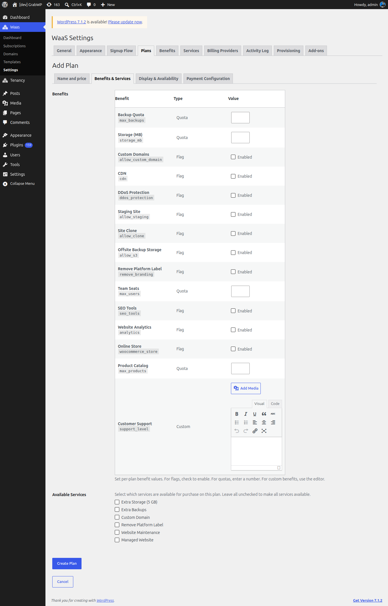

# Benefits, Services và Add-ons

Benefit là năng lực tenant nhận được. Service là phần trả thêm mà khách mua bên cạnh plan. Tab **Add-ons** là danh mục plugin cài riêng, không phải service.

## Benefits

Bạn hãy truy cập vào **Waas → Settings → Benefits** (`/wp-admin/admin.php?page=grabwp-tenancy-waas-settings&tab=benefits`).

Các cột là **Benefit**, **Slug**, **Type**, **Default Value**, **Status**, **Order** và **Actions**. **Edit** mở benefit. **Delete** hỏi **Delete this benefit?** Benefit hệ thống có badge **System** và không có nút xóa.

### Thêm benefit

Bấm **Add New**.

| Trường | Ghi chú |
|---|---|
| **System Capability** | **Custom benefit...** hoặc một capability có sẵn bên dưới. Chỉ hiện khi tạo mới. Chọn một mục sẽ điền slug và khóa type. |
| **Slug** | Chữ thường, số và dấu gạch ngang. Chỉ đọc sau khi lưu. |
| **Name** | Nhãn dùng cho tenant và form plan. |
| **Description** | Hiện trên tab **Benefit** của tenant. |
| **Type** | **Quota**, **Flag**, hoặc **Custom HTML**. Bị khóa với system capability. |
| **Default Value** | Quota: một số. Flag: **Enabled by default**. Custom HTML: trình soạn thảo. |
| **Sort Order** | Số nguyên, tối thiểu 0. Số nhỏ hơn đứng trước. |
| **Active** | **Benefit is active**. Benefit inactive không vào danh sách gán trên plan và service, vì các danh sách đó chỉ tải benefit đang active. |
| **Show On Dashboard** | **Show in tenant dashboard Benefit tab**. |
| **Upsell Message** | Chữ hiện khi benefit bị khóa. Để trống thì không in câu đó. |

Bấm **Create Benefit**.

**Kiểm tra:** thông báo **Benefit saved.** xuất hiện và dòng mới có trong danh sách.

### Sửa benefit

Bấm tên benefit hoặc icon sửa.

**Slug** chỉ đọc. Với benefit hệ thống, **Type** bị khóa. Bấm **Save Benefit**. **Cancel** quay lại danh sách.

**Kiểm tra:** thông báo **Benefit saved.** xuất hiện.

### Các kiểu benefit

| Type | Bạn lưu gì | Tenant thấy gì khi benefit được cấp |
|---|---|---|
| **Quota** | Một số | Một hạn mức. **Backup Quota** và **Storage (MB)** còn hiện mức dùng, dạng **N of M used**. Quota khác hiện **N included** khi không theo dõi mức dùng. |
| **Flag** | Bật hoặc tắt | **Included** khi giá trị đang bật. Công cụ liên quan mở trong panel benefit đối với các flag hệ thống bên dưới. |
| **Custom HTML** | HTML từ trình soạn thảo | HTML đó, khi giá trị của tenant không rỗng. |

### System capability

| Name | Slug | Type | Panel của tenant |
|---|---|---|---|
| **Backup Quota** | `max_backups` | Quota | Công cụ backup, kèm mức dùng so với quota. |
| **Storage (MB)** | `storage_mb` | Quota | Mức dùng storage, tính bằng megabyte. |
| **Custom Domains** | `allow_custom_domain` | Flag | Công cụ custom domain khi flag bật. |

Capability đã tạo rồi sẽ không còn trong dropdown **System Capability**.

## Services

Service là phần thêm tenant mua lúc signup (bước **Optional Services**) hoặc sau đó từ tab **Service** trên dashboard. Service được lưu riêng với danh mục plugin **Add-ons**.

Bạn hãy truy cập vào **Waas → Settings → Services** (`/wp-admin/admin.php?page=grabwp-tenancy-waas-settings&tab=services`).

Các cột là **Name**, **Slug**, **Charge Type**, **Price**, **Status**, **Sort Order** và **Actions**. Giá recurring hiện cả tháng và năm. Bấm tên để sửa. **Delete** hỏi **Are you sure you want to delete this service?** Nếu service đang được dùng, thông báo là **Failed to delete service. It may be in use.**

### Thêm service

Bấm **Add New**. Form có ba tab: **Name and price**, **Benefits** và **Display & Availability**.

| Trường | Ghi chú |
|---|---|
| **Name** | Tên khách nhìn thấy. |
| **Slug** | Để trống để tạo từ tên. Chữ thường, số và dấu gạch ngang. Chỉ đọc sau khi lưu. |
| **Charge Type** | **One Time**, **Non-Recurring**, hoặc **Recurring**. |
| **Price** | Hiện với **One Time** và **Non-Recurring**. |
| **Monthly Price** | Hiện với **Recurring**. Giá theo tiền tệ chính. Ước tính tiền tệ phụ hiện khi đã cấu hình. |
| **Yearly Price** | Hiện với **Recurring**. |
| **Billing Cycle** | **Monthly** hoặc **Yearly**. Hiện với **Recurring**. Đây là chu kỳ của chính service. |

**One Time** và **Non-Recurring** dùng một ô **Price** và không bị tính theo chu kỳ gia hạn. **Recurring** dùng **Monthly Price** và **Yearly Price**.

Khi **Charge Type** là **Recurring** và billing provider có trường cho service, phần cấu hình của provider hiện dưới giá. Khi Stripe đang bật, heading là **Stripe Configuration**, kèm **Resync**, **Monthly Price ID**, **Yearly Price ID** và **Find existing**. Để trống price id để tự tạo lúc lưu khi Stripe đã cấu hình, hoặc dán id của bạn. Phần cấu hình provider nằm ở **Waas → Settings → Billing Providers**.

### Benefit mà service này cấp

Mở **Benefits**. Dòng giới thiệu là **Specify which benefits this service provides.**

| Kiểu benefit | Ô giá trị |
|---|---|
| **Quota** | Một số. |
| **Flag** | **None**, **Yes**, hoặc **No**. |
| **Custom HTML** | Trình soạn thảo. |

Cùng bảng đó có trên **Edit Service**.

### Hiển thị và plan nào được bán

Mở **Display & Availability**.

| Trường | Ghi chú |
|---|---|
| **Description** | Hiện trên thẻ service. |
| **Sort Order** | Số nguyên, tối thiểu 0. Số nhỏ hơn đứng trước. |
| **Status** | **Active**. Service inactive không được chào bán. |
| **Plan Availability** | Chọn các plan được bán service này. Bỏ chọn hết để chào trên mọi plan. |

Bấm **Create Service** hoặc **Save Service**.

**Kiểm tra:** thông báo **Service saved.** xuất hiện và dòng hiện charge type cùng **Active** hoặc **Inactive**.

## Gắn benefit và service vào plan

Mở **Waas → Settings → Plans**, rồi **Add New Plan** hoặc sửa một plan, và mở **Benefits & Services**. Các trường plan cũng được nói trong [Tạo plan](/grabwp-tenancy-waas/waas-create-plans).

**Benefits** liệt kê mọi benefit đang active:

| Type | Giá trị |
|---|---|
| **Quota** | Một số, tối thiểu 0. |
| **Flag** | Chọn **Enabled**. |
| **Custom HTML** | Trình soạn thảo. |

Dòng trợ giúp dưới bảng: đặt giá trị benefit theo từng plan. Với flag, chọn để bật. Với quota, nhập số. Với custom benefit, dùng trình soạn thảo.

**Available Services** liệt kê service đang active. Chọn service plan này được bán. Bỏ chọn hết để mọi service đều dùng được. Đây là cùng quy tắc với **Plan Availability** trên form service.

Lưu plan.

**Kiểm tra:** mở lại **Benefits & Services** và xác nhận giá trị cùng các service đã chọn vẫn còn.

## Tenant nhìn thấy gì

Trên dashboard của khách, các tab là **Benefit** và **Service**.

**Benefit** liệt kê benefit đã bật **Show On Dashboard**. Mỗi mục là **Included** hoặc **Locked**.

- **Backup Quota**, **Storage (MB)** và **Custom Domains** khi đã được cấp sẽ nhúng công cụ tương ứng trong panel.
- Liên kết **Manage** hiện khi benefit trỏ tới **Plan & Billing**, **Overview** hoặc **Service**.
- Benefit bị khóa hiện **Locked**. **Upsell Message** được in khi bạn đã nhập. Nếu còn service tenant mua được mà cấp benefit đó, nút là **Buy Service**. Nếu không, liên kết là **Plan & Billing**.
- Khi không có mục nào, tab ghi **No benefits are available for this site yet.**

**Service** có hai phần:

- **Active Services**. Service recurring có badge **Recurring** và **Renews** hoặc **Ends** kèm ngày. **Cancel** hỏi **Cancel this service? It will keep working until the end of your current billing period, then stop.** Nút xác nhận là **Cancel service**.
- **Available Services**. Thẻ hiện mô tả, giá (hoặc **Free**) và **Buy**. Service recurring có cả hai giá sẽ hiện **Billing cycle** với **Monthly** và **Yearly**.

Nếu cả hai phần đều trống, tab ghi **No services are active or available for your plan.**

Signup hiện service ở bước **Optional Services** của [signup flow](/grabwp-tenancy-waas/waas-signup-flow). Chữ trên thẻ theo **Details** của bước đó (**Description** hoặc **Benefits**).

## Tab Add-ons

**Add-ons** liệt kê plugin GrabWP có thể cài. Tab này không tạo service.

Bạn hãy truy cập vào **Waas → Settings → Add-ons** (`/wp-admin/admin.php?page=grabwp-tenancy-waas-settings&tab=addons`).

Thẻ được nhóm theo category. Mỗi thẻ hiện tên, badge trạng thái, mô tả ngắn và phiên bản (`v` cộng số phiên bản).

| Badge | Ý nghĩa |
|---|---|
| **Available** | Chưa cài. |
| **Installed** | Đã có, chưa active. |
| **Active** | Plugin đang active. |
| **Update Available** | Danh mục có bản mới hơn. |
| **Requires WaaS Update** | Thẻ hiện **Requires WaaS** kèm phiên bản yêu cầu. Không có **Download ZIP**. |

Khi được phép tải, thẻ có **Download ZIP**. Sau khi tải, cài qua **Plugins → Add New → Upload Plugin**.

Nếu danh mục trống, thông báo là **No add-ons available right now.**

**Kiểm tra:** plugin đã tải xuất hiện trong **Plugins** sau khi bạn upload và kích hoạt, và badge trên thẻ đổi thành **Active**.

---

**Tiếp theo:** [Dashboard, Activity và Provisioning](/grabwp-tenancy-waas/waas-dashboard-activity)
