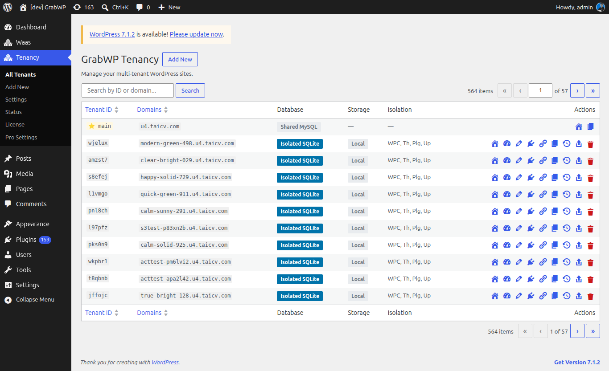

# Bắt đầu

Tạo một tenant site trên domain riêng, rồi mở site đó từ danh sách tenant.

## Yêu cầu

- WordPress 5.0 trở lên (tested up to 7.1)
- PHP 7.4 trở lên
- Quyền quản trị WordPress (`manage_options`)

## Bước 1: Cài plugin

1. Vào **Plugins → Add New**
2. Tìm **GrabWP Tenancy**
3. Nhấn **Install Now**, rồi **Activate**

Khi kích hoạt, plugin cài các thành phần cần thiết. Bạn không sửa `wp-config.php` bằng tay cho lần cài thông thường.

> **Tip:** Sau khi kích hoạt, mở **Tenancy → Status** (`page=grabwp-tenancy-status`) và kiểm tra các mục trên **Plugin General**. Nếu một dòng cảnh báo hoặc lỗi, nhấn **Auto Fix**.

## Bước 2: Tạo tenant đầu tiên

**Vào Tenancy → Add New** (`page=grabwp-tenancy-create`).

1. Giữ **I have a domain** (đây là lựa chọn mặc định).
2. Nhập domain, không kèm `http://` hay `www` (ví dụ `client1.com`).
3. Nhấn **Create Tenant**.

Plugin gán một tenant ID gồm 6 ký tự và tạo bảng cơ sở dữ liệu cùng thư mục upload của site đó.

> **Note:** **I'll set up a domain later** tạo tenant trước khi có domain. Cột Domains lúc đó hiện **Path access only**. URL xem trước tạm thời nằm trên màn Edit cho đến khi bạn thêm domain. Hãy gắn domain thật trước khi gửi site cho khách. Xem [Domain & DNS Setup](/grabwp-tenancy/hosting-dns-setup).

Nếu GrabWP Tenancy Pro đang bật, form này còn có **Content Isolation Options**, **Database Configuration**, và (khi đã cấu hình S3) **Storage Driver**. Các trường đó nằm trong [Database & Content Isolation](/grabwp-tenancy-pro/pro-database-isolation).

## Bước 3: Trỏ domain về máy chủ này

Thêm domain trong bảng điều khiển hosting sao cho document root là thư mục WordPress này, rồi trỏ DNS về máy chủ.

→ [Domain & DNS Setup](/grabwp-tenancy/hosting-dns-setup)

## Bước 4: Mở admin của tenant

**Vào Tenancy → All Tenants** (`page=grabwp-tenancy`).

Tìm dòng mới và nhấn **Admin** (biểu tượng dashboard). Liên kết mở WordPress admin của tenant và kèm access token sống ngắn (mặc định 30 phút). Nếu hết hạn, nhấn **Admin** lần nữa.

**Verify:** Mở domain của tenant trên trình duyệt. Bạn phải thấy site của tenant đó, không phải site chính. Domain xuất hiện ở cột **Domains** trên **All Tenants**.
