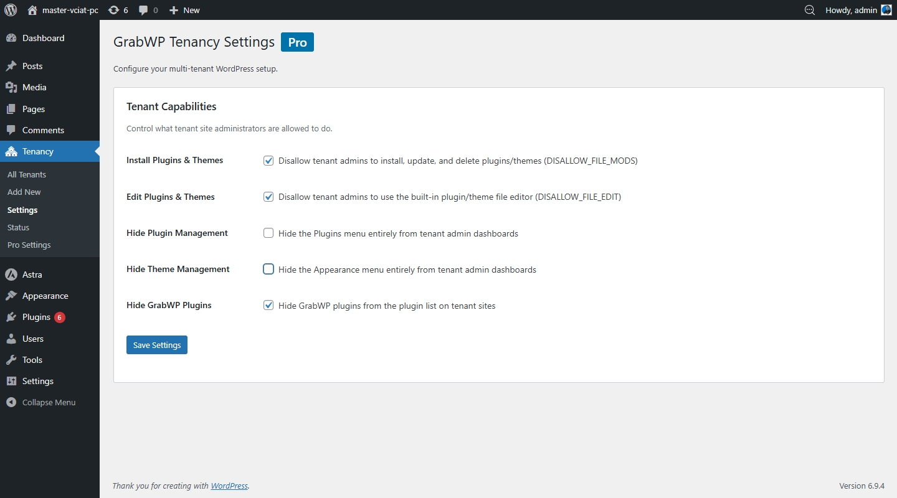

# Cài đặt

## Yêu cầu

- WordPress 5.0 trở lên
- PHP 7.4 trở lên
- MySQL 5.7 trở lên
- Quyền truy cập quản trị WordPress

## Cài qua trang quản trị WordPress (Khuyến nghị)

1. Vào **Plugins → Add New**
2. Tìm **GrabWP Tenancy**
3. Nhấn **Install Now** → **Activate**

Plugin sẽ tự động cài mọi thành phần cần thiết khi kích hoạt, bao gồm MU-plugin, rewrite rules và cấu trúc thư mục. Không cần chỉnh sửa file thủ công.

## Cài thủ công (Tải lên file ZIP)

1. Tải file ZIP plugin từ [wordpress.org/plugins/grabwp-tenancy](https://wordpress.org/plugins/grabwp-tenancy/)
2. Vào **Plugins → Add New → Upload Plugin**
3. Tải file ZIP lên → **Install Now** → **Activate Plugin**

## Kiểm tra cài đặt

Sau khi kích hoạt, vào **Dashboard → GrabWP Tenancy → Status**.

Trang Status sẽ tự động kiểm tra tất cả thành phần:

| Chỉ báo | Ý nghĩa |
|-----------|---------|
| ✓ Xanh lá | Mọi thứ hoạt động bình thường |
| ⚠ Cảnh báo | Lỗi nhỏ, nhấn **Auto Fix** |
| ✗ Lỗi | Cần xử lý, nhấn **Auto Fix** hoặc làm theo hướng dẫn trên màn hình |

Khi tất cả mục đều hiển thị màu xanh, bạn đã sẵn sàng tạo tenant site.

Các tùy chọn và công cụ của plugin nằm trong menu **GrabWP Tenancy** trong trang quản trị WordPress, bao gồm **Status**, **Tenants** và **Settings** nếu có.

## Gỡ cài đặt

Khi tắt plugin, tất cả thành phần đã chèn sẽ được gỡ bỏ, gồm MU-plugin, rewrite rules và loader trong `wp-config.php`.

**Dữ liệu tenant site của bạn KHÔNG bị xóa khi tắt plugin**. Các bảng cơ sở dữ liệu và file upload vẫn được giữ nguyên. Bạn có thể kích hoạt lại plugin bất kỳ lúc nào và toàn bộ site sẽ được khôi phục.
